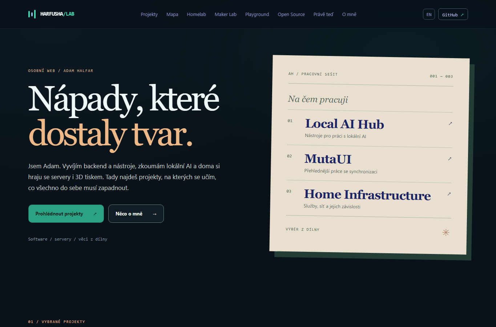
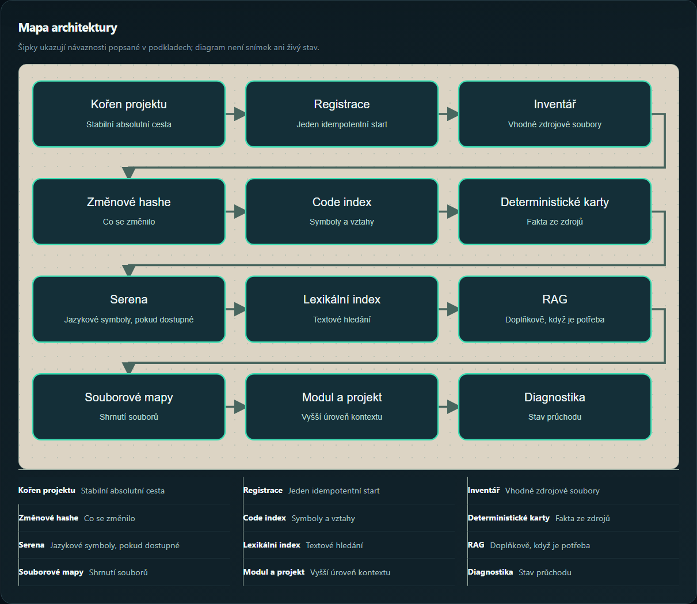
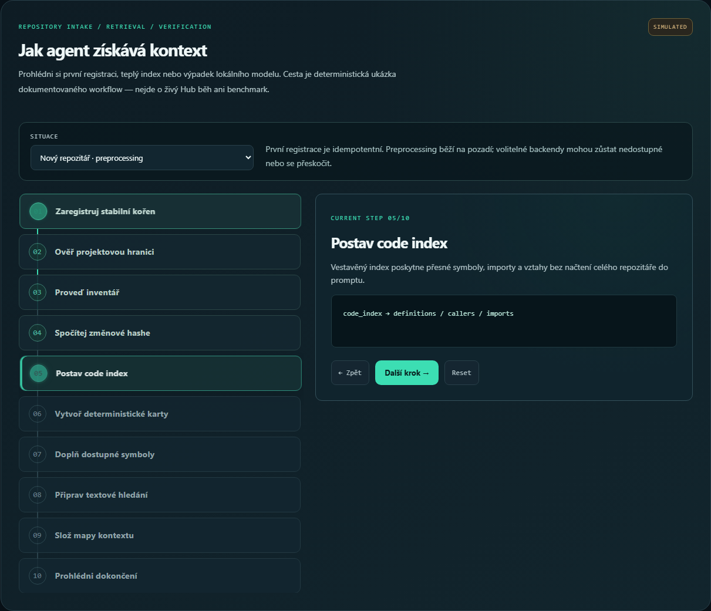
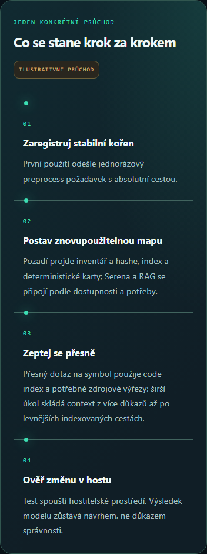

# Adam Halfar

**Backend engineer · PHP / CakePHP · developer tooling · local-first AI**

I build software for work that needs to remain understandable after the first demo: clear boundaries, traceable decisions, careful failure handling, useful tests and documentation that describes what actually runs.

Based in Czechia. My current work ranges from repository tooling and desktop utilities to 3D reconstruction and home infrastructure.

## Selected projects

| Project | What it does | Status and boundary |
| --- | --- | --- |
| [Local AI Hub](https://github.com/Harfusha/local-ai-hub) | Registers repositories, preprocesses and indexes them, then gives coding agents deterministic search, context, coordination and optional local models. | Version 6.1.0 source is a release candidate; model and optional backend availability depend on runtime configuration. |
| [MutaUI](https://github.com/Harfusha/MutaUI) | Desktop control surface for Mutagen sync and forwarding sessions. | Uses separately installed Mutagen CLI and its daemon; not its own sync engine. |
| Home Infrastructure | Git-backed Ansible automation for Pi-hole/Unbound DNS, Jellyfin, BookStack, CUPS printing, NAS backups, routing and on-demand Proxmox tests. | Private infrastructure, described through a redacted role model rather than live telemetry. |
| Woodbound | Unity prototype for layered world generation, routes and spatial validation. | A generated candidate is not yet an accepted playable release. |
| Scan2CAD Studio | Turns reviewed 3D scans and reference photos into editable CAD candidates. | Beta; computed dimensions still need physical and engineering review. |
| Tiskov | Symfony intake and queued processing for 3D-print estimates. | Prototype; estimate is indicative and final agreement is manual. |
| Shpotify | Private music rooms, shared queues and explainable recommendations. | Prototype; end-to-end playback is still being integrated. |
| Software Inc co-op mod | Separates collaboration rules from the game adapter. | In development; no playable multiplayer release has been accepted. |
| Discord bot | Application commands and a separate maintenance feature. | Under repair; the current maintenance source does not pass syntax validation. |

The portfolio explains each system with a concrete walkthrough and an architecture map. Private repositories are described at a curated level; private addresses, credentials and live infrastructure state are not published.

## Harfusha Lab

A bilingual CakePHP 5 application for project case studies, engineering decisions, open-source activity and a small browser-only workbench. The workbench traces inputs through systems—repository preprocessing, sync conflicts, request boundaries, terrain generation and mesh inspection. It is explicit about which parts are simulations and which claims need separate verification.

### Current captures

These images are freshly captured from the source-rendered pages in this repository. Project diagrams are explanatory maps, not live system views.

## How I work

- **Traceable behavior:** types and explicit validation at system boundaries.
- **Evidence before claims:** distinguish a source feature, a passing test, a running service and an accepted release.
- **Usable engineering:** readable interfaces, keyboard access, useful failure messages and current docs.

**Tools:** PHP, CakePHP, MySQL, Python, C#, Unity, Linux, Ansible, Docker and locally hosted AI models.

## Open source

Selected upstream contributions:

- [CakePHP #17827](https://github.com/cakephp/cakephp/pull/17827) — association typing and PHPStan improvements.
- [CakePHP #18957](https://github.com/cakephp/cakephp/pull/18957) — typed table locator usage.
- [DebugKit #1022](https://github.com/cakephp/debug_kit/pull/1022) — panel data compression and performance.
- [More public pull requests](https://github.com/pulls?q=is%3Apr+author%3AHarfusha).

## This repository

This checkout contains both my GitHub profile README and the Harfusha Lab application. Start with the [technical guide](docs/PROJECT-README.md), [architecture](docs/ARCHITECTURE.md), [release process](docs/RELEASE.md) or [Czech quick start](START-CZ.md).

CI evidence belongs to an exact commit. See the [GitHub Actions history](https://github.com/Harfusha/harfusha/actions) and the release notes for the revision you are reviewing; a green run alone does not prove a production deployment.

---

*I like systems where the useful path is clear, the failure path is visible, and the limits are written down.*
