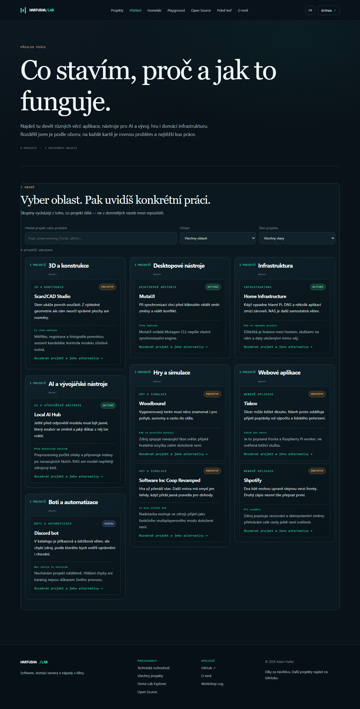
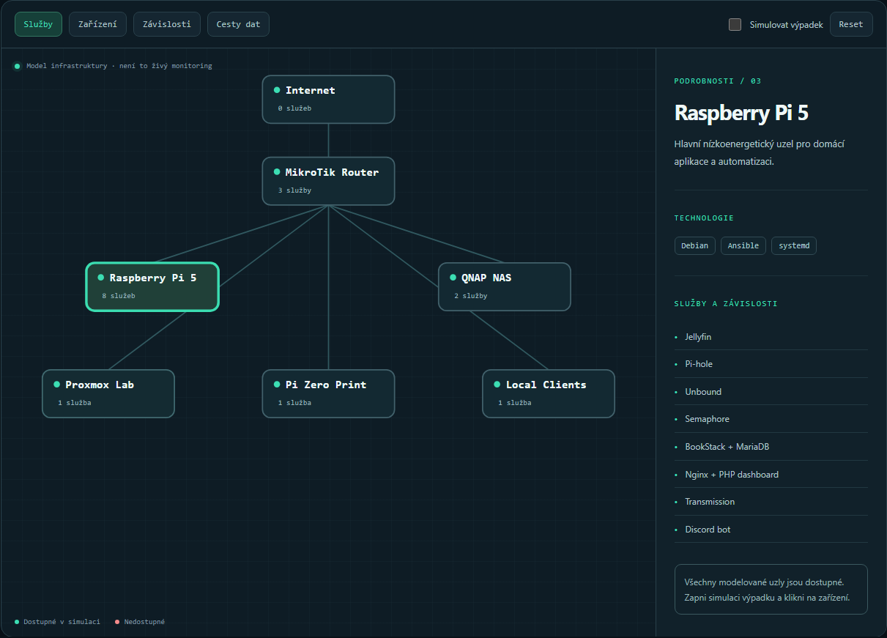
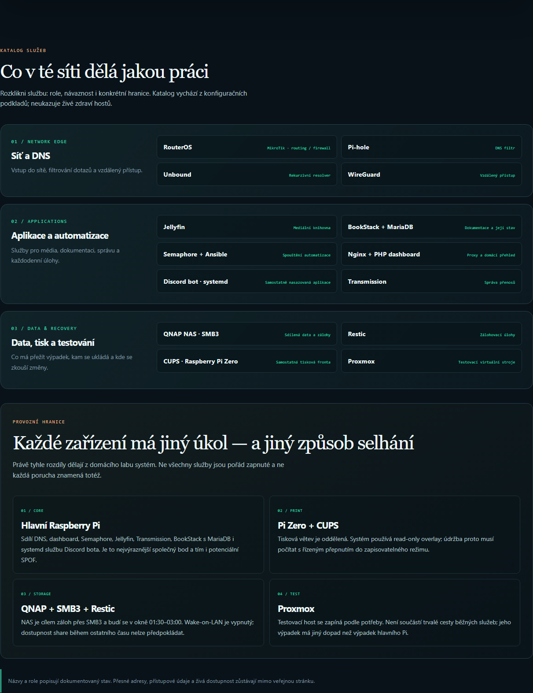
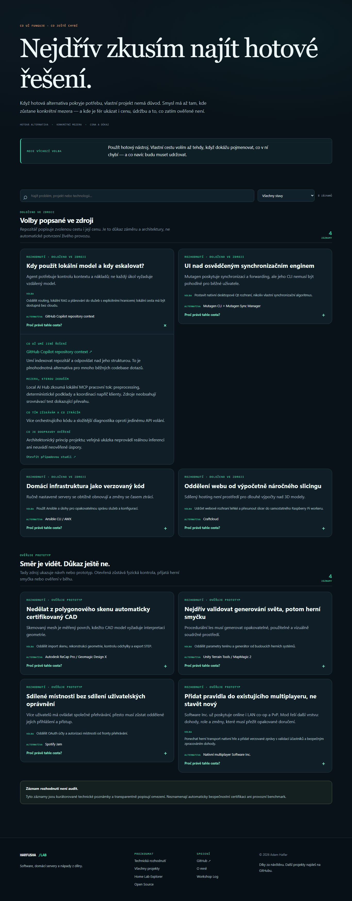

# Adam Halfar

**Backend engineer · PHP / CakePHP · developer tooling · local-first AI**

I spend most of my time in PHP and CakePHP. I care about being able to come back months later and understand why a system is built this way, so I pay attention to types, boundaries, tests and documentation. Outside that work, I build developer tools, try local AI workflows, look after home services and experiment with 3D reconstruction.

Based in Czechia. My current work ranges from repository tooling and desktop utilities to 3D reconstruction and home infrastructure.

## Selected projects

| Project | What it does | Status and boundary |
| --- | --- | --- |
| [Local AI Hub](https://github.com/Harfusha/local-ai-hub) | Registers repositories, preprocesses and indexes them, then gives coding agents deterministic search, context, coordination and optional local models. | Version 6.1.0 source is a release candidate; model and optional backend availability depend on runtime configuration. |
| [MutaUI](https://github.com/Harfusha/MutaUI) | Desktop control surface for Mutagen sync and forwarding sessions. | Uses separately installed Mutagen CLI and its daemon; not its own sync engine. |
| Home Infrastructure | Git-backed Ansible automation for Pi-hole/Unbound DNS, Jellyfin, BookStack, CUPS printing, NAS backups, routing and on-demand Proxmox tests. | Private infrastructure, described through a redacted role model rather than live telemetry. |
| Woodbound | Unity prototype for layered world generation, routes and spatial validation. | A generated candidate is not yet an accepted playable release. |
| Scan2CAD Studio | Turns reviewed 3D scans and reference photos into editable CAD candidates. | Beta; computed dimensions still need physical and engineering review. |
| Tiskov | A documented proposal for a local 3D-print request, queue and worker flow. | No source checkout, slicer run or live service is available to verify. The page presents the proposed hand-offs without pretending to submit an order or calculate a price; the original motive is undocumented. |
| Shpotify | Private music rooms, shared queues and explainable recommendations. | Prototype; end-to-end playback is still being integrated. |
| Software Inc co-op mod | Separates collaboration rules from the game adapter. | In development; no playable multiplayer release has been accepted. |
| Discord bot | Portfolio-catalog description of application commands and a maintenance path. | The source checkout is unavailable. The catalog preserves an earlier syntax-error report; exact commands, permissions and live operation are unverified. The original motive is undocumented. |

On the site I explain what each project is trying to solve, which existing tools could already do the job, and what I have or have not verified. For private projects, I describe the roles and design without publishing addresses, credentials or live infrastructure state.

## Harfusha Lab

Harfusha Lab is where I try to explain why I kept building each project when an existing tool might already be enough. I show the part I can point to in the code, docs or public history; when I do not know the original reason, I say so. Some projects work, some are still prototypes, and a few are only proposals. Playground examples recalculate a model in the browser; they do not call a real repository, printer or AI service.

### Current captures

These images are fresh captures of this checkout running locally. Diagrams describe the documented design; they are not live system views.

## How I work

- **Traceable behavior:** types and explicit validation at system boundaries.
- **Evidence before claims:** distinguish a source feature, a passing test, a running service and an accepted release.
- **Usable engineering:** readable interfaces, keyboard access, useful failure messages and current docs.

Research notes: [source reconciliation](docs/PROJECT-EVIDENCE-RECONCILIATION-2026-11-16.md) · [dated alternatives review](docs/PROJECT-ALTERNATIVES-RESEARCH-2026-11-16.md).

**Tools:** PHP, CakePHP, MySQL, Python, C#, Unity, Linux, Ansible, Docker and locally hosted AI models.

## Open source

Selected upstream contributions:

- [CakePHP #17827](https://github.com/cakephp/cakephp/pull/17827) — association typing and PHPStan improvements.
- [CakePHP #18957](https://github.com/cakephp/cakephp/pull/18957) — typed table locator usage.
- [DebugKit #1022](https://github.com/cakephp/debug_kit/pull/1022) — panel data compression and performance.
- [More public pull requests](https://github.com/pulls?q=is%3Apr+author%3AHarfusha).

## This repository

This checkout contains both my GitHub profile README and the Harfusha Lab application. Start with the [technical guide](docs/PROJECT-README.md), [architecture](docs/ARCHITECTURE.md), [release process](docs/RELEASE.md) or [Czech quick start](START-CZ.md).

CI evidence belongs to an exact commit. See the [GitHub Actions history](https://github.com/Harfusha/harfusha/actions) and the release notes for the revision you are reviewing; a green run alone does not prove a production deployment.

---

*I like systems where the useful path is clear, the failure path is visible, and the limits are written down.*
