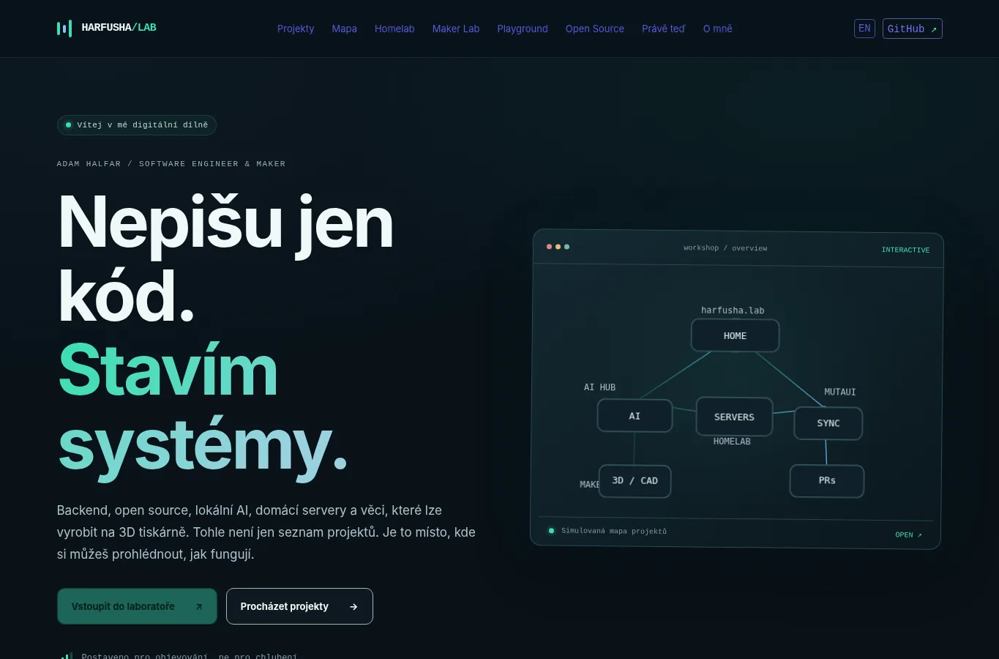

# Adam Halfar

**Backend Software Engineer · PHP & CakePHP · Open Source · Local AI · Homelab**

I build software with an emphasis on **type safety, reliability, security, and maintainability**. My main focus is backend engineering in PHP, but I also work on developer tools, local AI integration, self-hosted infrastructure, and practical 3D printing and CAD projects.

Based in Czechia. I enjoy taking projects beyond the proof-of-concept stage: clear architecture, reproducible tests, useful documentation, and thoughtful user experience matter as much as features.

[Projects](#selected-projects) · [Engineering](#how-i-build-software) · [Open source](#open-source-contributions) · [Homelab & maker](#beyond-software) · [This repository](#about-this-repository)

## Selected projects

| Project | What I'm building | Repository |
| --- | --- | --- |
| **Local AI Hub** | Tools for local AI models, repository context, and integrations with coding agents. Designed for privacy and controlled use of cloud models. | [local-ai-hub](https://github.com/Harfusha/local-ai-hub) |
| **MutaUI** | A desktop interface for managing Mutagen synchronization sessions and forwarding, with an emphasis on clarity and cross-platform use. | [MutaUI](https://github.com/Harfusha/MutaUI) |
| **Harfusha Lab** | An interactive engineering portfolio showcasing projects, architecture decisions, curated infrastructure diagrams, simulations, and open-source work. Built with CakePHP 5 and PHP 8.5. | [harfusha](https://github.com/Harfusha/harfusha) |
| **Scan2CAD Studio** | Experiments in reconstructing geometry from 3D scans and bridging mesh-based workflows with CAD. | Private development project |
| **Home Infrastructure** | Infrastructure-as-code experiments for Linux services, virtual machines, networking, and backups. | Private infrastructure |

I also explore game development and smaller software experiments. **Not every project is public or production-ready**; I try to distinguish prototypes, experiments, and validated features.

## How I build software

- **Strong contracts:** modern PHP, CakePHP, strict PHPStan analysis, precise types, and explicit validation at system boundaries.
- **Testable by design:** PHPUnit, regression tests, automated checks, and CI that produces reproducible evidence.
- **Secure and efficient:** least privilege, conservative defaults, careful handling of untrusted input, and profiling instead of guessing.
- **Pragmatic architecture:** choose the simplest design that still handles real requirements.
- **Usable tooling:** clear interfaces, actionable errors, accessibility, and documentation that reflects the actual implementation.

**Technologies:** PHP 8+, CakePHP 5, MySQL, PHPStan, PHPUnit, GitHub Actions, Python, Linux, Ansible, Docker, Raspberry Pi, and locally hosted AI models.

## Open-source contributions

I contribute upstream to projects I use, particularly around PHP typing, static analysis, diagnostics, and performance.

A few examples:

- [CakePHP #17827](https://github.com/cakephp/cakephp/pull/17827) — association typing and PHPStan-related improvements.
- [CakePHP #18957](https://github.com/cakephp/cakephp/pull/18957) — work on typed table locator usage.
- [DebugKit #1022](https://github.com/cakephp/debug_kit/pull/1022) — panel data compression and performance.
- [More public pull requests](https://github.com/pulls?q=is%3Apr+author%3AHarfusha).

## Beyond software

I run a personal **homelab** to learn about Linux, NAS storage, virtualization, networking, backups, Raspberry Pi devices, and running local AI on consumer hardware. The infrastructure presented in public projects is intentionally abstracted; it does not expose live private systems.

I also design and print practical parts, explore **FDM 3D printing and CAD**, and experiment with reconstructing mechanical geometry from scans.

## About this repository

This repository serves two purposes:

1. **My GitHub profile README** — the introduction you are reading now.
2. **Harfusha Lab source code** — an interactive, bilingual portfolio application based on CakePHP 5 and PHP 8.5.

*Preview of the application in development; this image is not evidence of a publicly deployed site.*

**Project documentation:** [Technical guide](docs/PROJECT-README.md) · [Architecture](docs/ARCHITECTURE.md) · [Deployment](docs/DEPLOYMENT.md) · [Testing](docs/TESTING.md) · [Release criteria](docs/RELEASE.md) · [Czech quick start](START-CZ.md)

**Verification:** The project has a [successful PHP 8.5 GitHub Actions run](https://github.com/Harfusha/harfusha/actions/runs/43658555206), covering locked Composer dependencies, PHPStan, CakePHP/PHPUnit, isolated MySQL migrations, PHPCS, Chromium tests, and an isolated production-only Composer installation. This verifies that CI run, **not a production deployment**. Target-host staging, database restore, and manual approval of public content remain separate release requirements.

---

*I'm interested in software that solves real problems, has understandable trade-offs, and can be maintained long after the first successful demo.*
