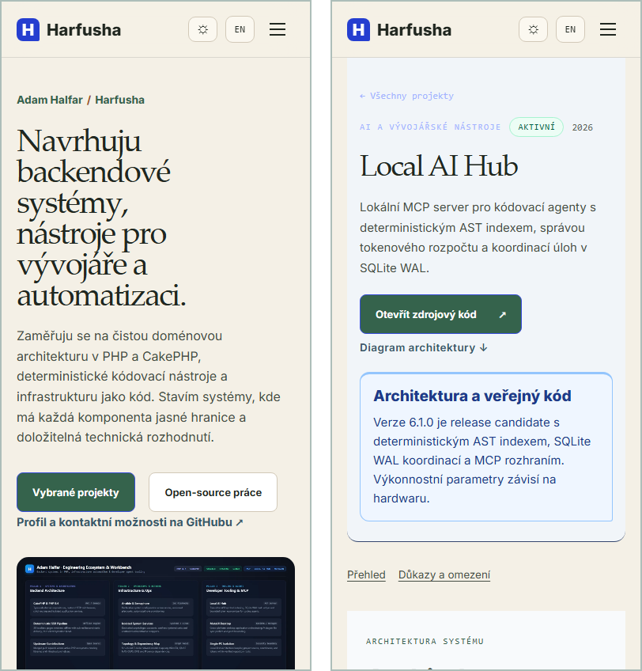

<a name="kapitola-1"></a>

# Kompletní audit portfolia Adama Halfara

> Harfusha · adam-halfar.cz · 24. listopadu 2026

## Rozhodnutí pro další vydání

Portfolio má tři silné a dobře doložitelné vstupy. Návštěvník si může otevřít skutečné příspěvky do CakePHP a dalších projektů, prohlédnout si snímky MutaUI a vyzkoušet model výpadku domácí sítě. Tyto důkazy mají dostat více místa na úvodu i v projektových detailech. První průchod přitom musí skončit možností kontaktovat autora, pokud se pro spolupráci rozhodne.

### Co opravit před vydáním

- Stabilizovat CI na kandidátní revizi. Rozběhnout skutečný HTTP test, databázové migrace i testovací sadu na předepsaném PHP. Produkční verzi svázat s revizí.
- Vynutit HTTPS před přihlášením a opravit vstup přes www. Odstranit blokovaný start motivu a opravit kontrast rozhodnutí, projektových detailů i stavů simulace.
- Zpřesnit profilová tvrzení a stavy projektů. Rozlišit kandidáta Local AI Hub 6.1.0, veřejné vydání, skutečný provoz soukromých projektů a schopnosti modelové simulace.
- Zvolit přímý profesní kontakt. Přidat ho na úvod, O mně a do patičky. Následně zjednodušit první obrazovku, aby bylo vidět, co Adam dělá a co už vytvořil.

### Co přinese největší změnu dojmu

Každý detail dostane jednu ústřední situaci. Čtenář se dozví, co Adam řešil, jaké rozhodnutí udělal, co se skutečně změnilo a jak to ověřit. Forma důkazu vychází z fáze projektu. U veřejného nástroje poslouží verze a ukázka. U návrhu může stačit jasně označený diagram. U experimentu je cenný jeden reprodukovatelný výsledek s hranicí platnosti.

> **38 veřejných tras, 532 funkčních kontrol a důkazy pro všech devět studií. Nejnovější protokol [od kapitoly 75](#kapitola-75) dokládá Docker staging obou nasazení, tři obnovy, skutečný GitHub import a nové vady HTTP i přístupnosti.**

Podrobný redakční a vizuální průchod je v [kritické kontrole sekcí](#kapitola-84).

[Produkční portfolio](<https://adam-halfar.cz/cs/>) · [GitHub Actions revize 3b70ce7](<https://github.com/Harfusha/harfusha/actions/runs/44949041980>)

---

<a name="kapitola-2"></a>

## Obsah a práce s auditem

### Stránky a případové studie

- [Rozsah, kvalita důkazů a stav release](#kapitola-3)
- [Publikum, cesty návštěvníků a společná navigace](#kapitola-4)
- [Úvodní stránka](#kapitola-5) · [O mně a profesní kontakt](#kapitola-6) · [Katalog projektů](#kapitola-7)
- [Tematické skupiny](#kapitola-8) · [Technická rozhodnutí](#kapitola-9) · [Domácí síť](#kapitola-10) · [Maker](#kapitola-11)
- [Open source](#kapitola-12) · [Časová osa](#kapitola-13) · [Vývojový deník](#kapitola-14)
- [Local AI Hub](#kapitola-15) · [MutaUI](#kapitola-16) · [Home Infrastructure](#kapitola-17)
- [Woodbound](#kapitola-18) · [Scan2CAD Studio](#kapitola-19) · [Tiskov](#kapitola-20)
- [Shpotify](#kapitola-21) · [Multiplayer pro Software Inc](#kapitola-22) · [Discord bot](#kapitola-23)

### Společné vrstvy a realizace

- [Přístupnost a ovládání](#kapitola-24) · [Obsah a lokalizace](#kapitola-25)
- [Vyhledávání a sdílení](#kapitola-26) · [Výkon](#kapitola-27)
- [HTTP a veřejná rozhraní](#kapitola-28) · [Provoz a publikace](#kapitola-29) · [CI a vydání](#kapitola-30)
- [Pořadí realizace](#kapitola-31) · [Akceptační scénáře](#kapitola-32) · [Inventář měření a zdrojů](#kapitola-33) · [Obrazové důkazy](#kapitola-34)

### Rozšířená realizační příloha

- [Práce s přílohou](#kapitola-35) · [Prohlížeče](#kapitola-36) · [Aktivní stavy](#kapitola-37) · [Produkční trasy](#kapitola-38)
- [Cílové PHP](#kapitola-39) · [Priorita P1](#kapitola-40) · [Úvod](#kapitola-41) · [Kontakt](#kapitola-42) · [Ovládání](#kapitola-43) · [Formát studií](#kapitola-44)
- [Hub](#kapitola-45) · [MutaUI](#kapitola-46) · [Infrastruktura](#kapitola-47) · [Woodbound](#kapitola-48) · [Scan2CAD](#kapitola-49) · [Tiskov](#kapitola-50)
- [Shpotify](#kapitola-51) · [Multiplayer](#kapitola-52) · [Discord bot](#kapitola-53) · [Upstream](#kapitola-54) · [Deník](#kapitola-55)
- [HTTP a cache](#kapitola-56) · [Přístupnost](#kapitola-57) · [Výkon](#kapitola-58) · [SEO](#kapitola-59) · [Provoz](#kapitola-60)
- [Dávky změn](#kapitola-61) · [Předání](#kapitola-62)

### Závěrečný ověřovací protokol

- [Rozsah](#kapitola-63) · [Odkazy](#kapitola-64) · [Vykreslení a přístupnost](#kapitola-65) · [Funkce](#kapitola-66) · [Dotyk](#kapitola-67)
- [Důkazy studií](#kapitola-68) · [PHP a CI](#kapitola-71) · [Obnova](#kapitola-72) · [Vydávání](#kapitola-73) · [Závěr](#kapitola-74)

### Docker, HTTPS a provozní přejímka

- [Výsledek](#kapitola-75) · [HTTP](#kapitola-76) · [Přístupnost](#kapitola-77) · [ZIP](#kapitola-78) · [Zálohy](#kapitola-79)
- [Apache](#kapitola-80) · [Import](#kapitola-81) · [Studie](#kapitola-82) · [Přejímka](#kapitola-83)

### Kritická kontrola sekcí

- [Kritická kontrola vzhledu, orientace a textu](#kapitola-84) · [Redakce devíti studií](#kapitola-85)

### Priority a stav důkazu

- P1 znamená opravu před dalším vydáním. Jde o potvrzenou provozní vadu, výrazné omezení přístupu, ztrátu důvěry nebo chybějící hlavní cestu návštěvníka.
- P2 znamená práci s vysokým přínosem pro čitelnost, důvěryhodnost nebo každodenní použitelnost. Řeší se po stabilizaci vydání.
- P3 znamená cílenou optimalizaci, rozšíření podkladů nebo dlouhodobou údržbu.
- Potvrzeno označuje přímé pozorování na uvedené vrstvě. Zjištěno v kódu označuje ověřenou implementaci a případný dopad, který ještě vyžaduje běh. Doporučení popisuje žádoucí stav nebo obsahový úkol. Navržené metriky jsou kritéria, která se mají změřit po změně.

---

<a name="kapitola-3"></a>

## Rozsah a kvalita důkazů

### Rozsah

Audit pokrývá 19 typů veřejných stránek v češtině a angličtině, všech devět publikovaných projektů, veřejné HTTP výstupy, společné rozhraní a vybrané zdrojové a release postupy. Pracovní základ je commit 3b70ce7eaa7f1884a1542280934c981c697ea0ef. Část testů v pracovní kopii už měla lokální úpravy. Výsledky čistého commitu, lokálního běhu a produkce se proto uvádějí odděleně.

### Produkce a prohlížeč

- Čerstvá kontrola produkce ověřila stav, kanonický odkaz a druhý jazyk všech 38 veřejných tras. Křížové jazykové odkazy, x-default a canonical souhlasily. Obě RSS poskytly 30 položek s existující kotvou na cílové stránce.
- Produkční Chromium z první kontroly zahrnulo všech 38 tras při šířce 390 a 1440 px. Lokální HTTP běh zahrnul šest šířek od 320 do 1440 px. Šířka dokumentu v měřených stavech odpovídala viewportu.
- Cíleně proběhl audit konzole, práce s klávesnicí, filtrování, přepnutí jazyka a simulace výpadku NAS. Offline axe zkontroloval základní stavy ve dvou motivech. Rozšířený mobilní axe nad produkcí zahrnul 14 kombinací stránky, motivu a stavu.
- Produkční titulky, H1 a odkazované skripty odpovídaly lokálnímu renderu všech 38 tras. Obsah dvou CSS, dvou JS souborů a favicon byl shodný po bajtech. Nasazený balík včetně konfigurace a vendoru nemá v tomto auditu potvrzený hash.

### Hranice závěrů

Stav soukromých projektů vychází z veřejných studií a dostupných podkladů. Audit nedokládá jejich interní běh, produkční obnovu, výkon návštěvníků z reálného provozu ani úplnou shodu s WCAG. Rozšířený průchod v Chromium, Firefox a WebKit je [v kapitole 36](#kapitola-36). Vybrané scénáře zůstávají otevřené pro skutečné Safari, čtečku displeje a fyzické mobilní zařízení. Analýza bezpečnostních hlaviček a rozhraní zahrnula standardní veřejné požadavky.

[Produkční sitemap](<https://adam-halfar.cz/sitemap.xml>) · [Veřejný zdroj na revizi](<https://github.com/Harfusha/harfusha/tree/3b70ce7eaa7f1884a1542280934c981c697ea0ef>)

---

<a name="kapitola-4"></a>

## Cesty návštěvníků a navigace

### UX01 P2  Nabídnout tři jasné cesty

Doporučení. Náborář potřebuje během prvního průchodu roli, jeden silný důkaz a kontakt. Technický kolega hledá návrhové rozhodnutí, konkrétní podklad a limity výsledku. Čtenář přicházející z GitHubu hledá autora, další práci a možnost spolupráce. Úvod má ukázat první cestu, katalog druhou a profil třetí. Ověřit tři úlohy s lidmi bez předchozí znalosti webu. Zaznamenat místo váhání, úspěšnost a počet kroků.

### UX02 P2  Zpřehlednit rozdíl mezi sekcemi

Potvrzeno. Projekty a tematické skupiny ukazují stejných devět položek. Časová osa přebírá úplný přehled příspěvků a 44 zápisků. Vymezit vlastní úlohu každé stránky. Katalog umožní vybrat projekt. Skupiny vysvětlí společné technické problémy. Deník nabídne čtení. Open source doloží externí přínos. Časová osa zůstane stručným přehledem s odkazy do archivů. Ověřit, že názvy navigace odpovídají tomuto dělení a člověk najde všechny sekce i bez patičky jako záchrany.

### UX03 P2  Zavírání mobilního menu

Potvrzeno. Nativní menu se otevře klávesou Enter. Klávesa Escape ho nechá otevřené. Zavést zavření při Escape uvnitř menu a vrátit fokus na ovladač. Zkontrolovat klik mimo menu a chování při přechodu mezi mobilním a desktopovým rozvržením. Klávesnicí projít celý cyklus po navigaci i bez navigace. Polohu fokusu ověřit také při zvětšení.

### UX04 P2  Zachovat cíl při změně jazyka

Potvrzeno. Přepnutí jazyka ze sdíleného odkazu na zápisek vede na začátek anglického deníku, ač cílové ID existuje. Zachovat fragment u potvrzených párů stránek a propojit ho se stabilní identitou. Ověřit oba směry na zápisku, technickém rozhodnutí a jiné podsekci. Výchozí jazyk domovské stránky ponechat podle publika a změnu posoudit odděleně od této vady.

[Úvod](<https://adam-halfar.cz/cs/>) · [Katalog](<https://adam-halfar.cz/cs/projects>) · [Časová osa](<https://adam-halfar.cz/cs/now>) · [Deník](<https://adam-halfar.cz/cs/journal>)

---

<a name="kapitola-5"></a>

## Úvodní stránka

### HOME01 P2  Ukázat práci dřív

Potvrzeno. Český H1 na 390 px zabral 234 px a šest řádků. Úvodní text, kontaktní odkaz a grafika odsunuly skutečnou ukázku za první obrazovku. Na desktopu vzniká velká mezera mezi sloupci. Využít větší část dostupné šířky textu, zkrátit sdělení a stáhnout jeho technické vysvětlení do následující sekce. Posoudit nejdříve variantu s titulkem „Backendový vývoj v PHP a nástroje pro vývojáře“ a jednou větou pod ním. Anglický protějšek může být „PHP backend development and developer tools“. Ověřit při 360, 390 a 1440 px i s delším překladem. Návštěvník má na 390 × 844 vidět roli, hlavní akci a začátek konkrétní ukázky.

### HOME02 P2  Dát grafice jednu úlohu

Potvrzeno. Úvodní obrázek kombinuje tři sloupce s drobným anglickým textem a má přibližně 95 kB ve WebP. Část textu na mobilu ztrácí funkci. Buď z něj udělat jednoduché téma s čitelným HTML popisem, nebo použít konkrétní ukázku projektu a ukázat, proč je relevantní. Oddělit obrázek od odkazu na celý katalog, pokud už je táž akce vedle něj. Po úpravě ověřit čitelnost bez zvětšení, alternativní text a počet klávesových zastávek.

### HOME03 P2  Doplnit důkaz na kartách

Doporučení. Pro Local AI Hub ukázat přesný výřez dohledaného zdroje. Pro MutaUI jednu relaci a stav, kterému návštěvník rozumí. Pro Home Infrastructure konkrétní scénář výpadku. Pod nadpisem karty má být stručný výsledek nebo jasná otázka. Při stejném rozvržení má být na každé kartě předvídatelné, co otevře a zda jde o zdroj, studii nebo model.

### HOME04 P2  Nechat aktivitu sloužit výběru

Potvrzeno. Úvod čerpá z deníku i importu a vede na více přehledů. Zvolit dva až tři skutečné orientační body s datem. Stav GitHub importu zobrazit jako zdroj a čas. Pokud ztratí aktuálnost, přejmenovat sekci nebo ukázat jen kurátorované důkazy. Ověřit prázdný a několik dní starý zdroj.

[Český úvod](<https://adam-halfar.cz/cs/>) · [Anglický úvod](<https://adam-halfar.cz/en/>) · [Zdroj layoutu](<https://github.com/Harfusha/harfusha/blob/3b70ce7/templates/Pages/home.php#L16-L38>)

---

<a name="kapitola-6"></a>

## O mně a profesní kontakt

### ABOUT01 P1  Zavést přímý kontakt

Potvrzeno. Hlavní formulace směřuje na profil GitHubu. Na 38 veřejných trasách audit nenašel přímo odkazovaný e-mail, telefon ani LinkedIn. Vybrat a schválit jednu funkční profesní cestu. Nejjednodušší je veřejná e-mailová adresa nebo ověřený profesní profil. Pokud vznikne formulář, bude potřebovat potvrzení doručení, řešení chyb, provozního vlastníka a odpovídající informaci o zpracování údajů. Ověřit kontakt v anonymní relaci a na mobilu. Reálné doručení otestovat kontrolovaným testem až po schválení kanálu.

### ABOUT02 P1  Uvést přesné technologické tvrzení

Potvrzeno. Profil používá formulaci o agentech bez halucinací. Doložený je přístup k indexovaným zdrojovým výřezům, jehož rozsah má jasnou hranici. Nahradit například větou „Deterministická část Hubu vrací dohledatelné výřezy zdrojového kódu. Při využití jazykového modelu lze odpověď porovnat s podklady.“ Profil také odkazuje na PHP 8.4 při popisu webového příkladu. V požadavcích portfolia je PHP 8.5.12+. Ponechat 8.4 jen tam, kde se vztahuje na určený příklad, a uvést verzi portfolia samostatně.

### ABOUT03 P2  Doplnit profesně použitelný kontext

Doporučení. Přidat, na koho má mířit spolupráce a jaké úkoly chce autor řešit. Vybrat dva příklady projektové odpovědnosti, například návrh datového kontraktu nebo řízenou obnovu služby. Uvést roli, výsledek a odkaz. Dostupnost, lokalitu, pracovní zkušenosti a CV zveřejnit po potvrzení autora. Čtenář má v textu najít podklad pro navázání kontaktu a vhodný vzorek práce.

### ABOUT04 P3  Přesměrovat odborné odkazy na cílového čtenáře

Potvrzeno. Jeden z profilových příkladů vede přímo do JSON katalogu. Pro první návštěvu je užitečnější vysvětlený příklad backendového rozhodnutí. Odkaz na JSON ponechat jako doplňkový technický podklad s popisem, co v něm lze ověřit.

[O mně](<https://adam-halfar.cz/cs/about>) · [GitHub profil](<https://github.com/Harfusha>) · [Požadavky portfolia](<https://github.com/Harfusha/harfusha/blob/3b70ce7/composer.json#L7-L15>)

---

<a name="kapitola-7"></a>

## Katalog projektů

### LIST01 P2  Kurátorovat pořadí podle důkazu

Potvrzeno. Katalog vrací devět projektů a pro každý vypisuje kategorii i jeden stav. Je v něm směs aktivních nástrojů, bety, návrhu, prototypů a provozního záznamu. Viditelně vyznačit tři doporučené první studie a zachovat plný katalog níže. Pro kvalitní první výběr rozhoduje síla veřejné ukázky, relevantní role a příběh. Ověřit, že čtenář umí rychle vybrat jeden veřejný produkt a jeden neveřejný projekt s dokladem.

### LIST02 P2  Vysvětlit význam stavu

Potvrzeno. Jedno slovo typu „Aktivní“ nepokrývá dostupnost, fázi vydání ani čerstvost důkazu. Doplnit krátkou legendu a na detailu oddělit vývojový stav, veřejnou dostupnost a datum podkladu. Home Infrastructure je aktivní a soukromé, MutaUI aktivní a veřejné a Hub má v detailu popsaného kandidáta. Uživatel má tyto situace bezpečně rozeznat na kartě nebo během jednoho kliknutí.

### LIST03 P2  Přidat užitečné chování filtrů

Potvrzeno. Vyhledávání zvládá jeden český pojem s diakritikou i bez. Aktuální kombinace se nezapisuje do URL. Zvážit sdílitelný stav až ve chvíli, kdy se používá odkaz na podmnožinu projektů nebo je zásadní návrat z detailu. Priorita je zachovat výběr při návratu, jasně vyprázdnit filtr a vysvětlit nulový výsledek. Ověřit i dvouslovný dotaz, souběh kategorie a dotazu, přechod na detail, návrat a změnu jazyka.

### LIST04 P3  Sjednotit názvy, počty a dlouhé karty

Zjištěno v kódu. Text o „devíti“ projektech existuje i mimo dynamický počet výsledků. Sjednotit zdroj počtů nebo ponechat nadčasové názvy. Hlídat dvouřádkové názvy, délku anglického popisu a srovnatelné pořadí informací. Ověřit katalog na smyšlené desáté položce ve fixture, při 320 px a při 200% zvětšení.

[Český katalog](<https://adam-halfar.cz/cs/projects>) · [Anglický katalog](<https://adam-halfar.cz/en/projects>) · [Katalogová data](<https://github.com/Harfusha/harfusha/blob/3b70ce7/data/projects.json>)

---

<a name="kapitola-8"></a>

## Tematické skupiny

### MAP01 P2  Vysvětlit vztahy mezi projekty

Potvrzeno. Tři skupiny mají devět projektů a pod každým je detail problému a řešení. Většina průchodu připomíná alternativní katalog. Dát každému okruhu jednu jasnou společnou tezi a uvést konkrétní rozdíl mezi přístupy. Například Home Infrastructure a Hub mohou sdílet důraz na předvídatelnost, ale první používá provozní model a druhý dohledatelné zdrojové výřezy. Ověřit, že skupina odpovídá na samostatnou otázku a její karty dávají smysl jako celek.

### MAP02 P2  Posílit příchozí odkazy z detailu

Potvrzeno. Woodbound, Shpotify a multiplayerový projekt odkazují na konkrétní kartu ve skupinách. Odkaz pomáhá najít zařazení, ale často opakuje informace přečtené na detailu. Ponechat ho jako vedlejší vazbu, místo hlavní akce nabídnout důkaz nebo rozhodnutí. Při přímém vstupu na kartu má být její jméno čitelné pod sticky navigací, karta má být vidět i s filtrem a zásadní informace lze otevřít klávesnicí.

### MAP03 P3  Zpřístupnit přehled i bez filtrování

Potvrzeno. Bez JavaScriptu jsou karty a přirozené rozbalení dostupné, zatímco pole vytvářejí dojem funkčního hledání. Skrýt neaktivní filtry do úspěšné inicializace. Zachovat odkazy na skupiny a rozbalovací prvky. Ověřit s pomalým nebo vypnutým JS, klávesnicí a čtečkou v obou jazycích.

### Praktický návrh obsahu

Každou skupinu napsat jako krátký odstavec s jedním pojmem, který propojuje její projekty, a navazujícím odkazem na odpovídající rozhodnutí. Doplňkový filtr má smysl, pokud skupina přeroste velikost, kterou lze pohodlně přečíst. Momentální počet dovoluje testovat i jednoduchý seznam s odkazy na sekce.

[Tematické skupiny](<https://adam-halfar.cz/cs/connections>) · [Cílová karta Shpotify](<https://adam-halfar.cz/cs/connections#map-project-shpotify>)

---

<a name="kapitola-9"></a>

## Technická rozhodnutí

### ADR01 P1  Opravit vzhled po rozbalení

Potvrzeno. Mobilní axe při rozbalení rozhodnutí o Local AI Hubu našel ve světlém motivu kontrast popisku 1,55 : 1. Odkaz na alternativu není vůči odstavci dostatečně odlišený v obou motivech. Sjednotit barvy normálního, rozbaleného a fokusovaného stavu a odkaz podtrhnout. Ověřit všech osm případů v mobilu i na desktopu. Pro běžný text požadovat nejméně 4,5 : 1.

### ADR02 P2  Vynutit důkaz pro výsledek rozhodnutí

Potvrzeno. Přehled má osm rozhodnutí a odlišuje dokumentovaný stav od návrhu či prototypu. U části záznamů „výsledek nebo mezera“ potřebuje konkrétnější vazbu na zdroj nebo podmínku změny. U každého rozhodnutí uvést výchozí podmínku, zvolené řešení, skutečný kompromis a ověřený výsledek nebo otázku. U návrhu stačí jasně formulovaná hypotéza, ověřovací krok a kritérium, kdy rozhodnutí otevřít znovu.

### ADR03 P2  Odkazovat na každou zmíněnou alternativu

Potvrzeno. Společný odkaz ReCap Pro a Geomagic vede jen na Autodesk. ReCap při dvou technických kontrolách vrátil 403 z auditního prostředí. To nedokládá nedostupnost pro běžného člověka. Odkazy na oba nástroje rozdělit, uvést rozsah srovnání a doplnit náhradní stabilní zdroj jen pokud se potvrdí překážka. Stejným způsobem projít další složené alternativy.

### ADR04 P3  Usnadnit sdílení jedné volby

Doporučení. Pravidla nad kotvami mají zajistit, že odkaz přímo na rozhodnutí zobrazí správný detail. Pro přímé sdílení je užitečný popis podle tématu, odkaz z projektové studie a přepnutí jazyka na protějšek. Ověřit, že po načtení s fragmentem lze detail ihned najít a fokus zůstane předvídatelný.

[Technická rozhodnutí](<https://adam-halfar.cz/cs/decisions>) · [Kontrolovaná kotva](<https://adam-halfar.cz/cs/decisions#local-ai-routing>) · [WCAG 2.2](<https://www.w3.org/TR/WCAG22/>)

---

<a name="kapitola-10"></a>

## Domácí síť a simulace

### LAB01 P1  Opravit kontrast aktivní trasy

Potvrzeno. Ve tmavém motivu při modelovaném výpadku NAS naměřil axe 4,45 : 1 u popisků tří uzlů. Aktivní trasa má používat barvy se zřetelnou rezervou nad limitem 4,5 : 1 pro běžný text. Stav doplnit textem a kontrolovat vybraný uzel, uzel na trase a nedostupný uzel. Ověřit čtyři datové cesty v obou motivech a na úzkém displeji.

### LAB02 P2  Ujasnit postup simulace

Potvrzeno. Model obsahuje sedm uzlů, čtyři datové cesty a dva připravené scénáře. Při scénáři výpadku NAS se cesta přeruší u NAS a po resetu se obnoví. Přidat vstupní instrukci s výsledkem, který má člověk hledat, a odlišit přepnutí pohledu, ruční výpadek a výběr připraveného scénáře. Reset má vrátit definovaný počáteční stav. Ověřit přechod mezi pohledy v průběhu scénáře a potvrdit oznámení výsledku čtečkou.

### LAB03 P2  Zprovoznit konkrétní odkazy na uzly a služby

Potvrzeno. Tlačítko z detailu Discord bota otevře obecnou mapu. Discord se objeví po zvolení Raspberry Pi 5. Ukotvit a zvýraznit odpovídající veřejný uzel nebo službu. Pokud se topologie mění, vazba musí odkazovat na stabilní identitu a při chybě srozumitelně skončit na přehledu. Ověřit oba jazyky, mobilní zobrazení a vypnutý JS.

### LAB04 P2  Udržet použitelný textový přehled

Potvrzeno. Bez JS jsou vidět neaktivní ovladače a pod nimi textový seznam datových cest. Nejprve zobrazit použitelný statický obsah, interaktivní model odkrýt po úspěšném spuštění. Textové schéma má popsat trasu, závislé služby a smysl výsledku. Model i studie mají citlivé provozní podklady publikovat pouze po kontrole.

[Interaktivní model](<https://adam-halfar.cz/cs/homelab#network-model>) · [Anglický model](<https://adam-halfar.cz/en/homelab>) · [Studie infrastruktury](<https://adam-halfar.cz/cs/projects/home-infrastructure>)

---

<a name="kapitola-11"></a>

## Maker a prezentace práce s 3D

### MAKE01 P2  Vysvětlit rozdíl ve výsledku

Potvrzeno. Maker představuje Scan2CAD jako cestu od skenu k pracovnímu CAD modelu a Tiskov jako návrh příjmu a asynchronní přípravy zakázky. Tento rozdíl je užitečný. Doplnit, co je typickým vstupem, výstupem a nutným ručním zásahem v každé větvi. Viditelně odlišit stav bety a stav návrhu i tam, kde návštěvník přeskočí do středu stránky.

### MAKE02 P2  Přidat jednu čitelnou ukázku na každou větev

Doporučení. U Scan2CAD použít stejný předmět na fotografii, ve skenu a v kandidátu CAD. Přidat jednu známou míru, metodu ověření a vysvětlení odchylky. U Tiskovu použít jednoduchý průchod modelové objednávky od přijetí do výsledku. Každý obrázek má mít popisek, původ a stav. Test ověří čitelnost na 390 px a možnost otevřít větší verzi.

### MAKE03 P2  Ujasnit očekávání na výstupu

Potvrzeno. Hlavní tlačítka obou projektových detailů vedou zpět na Maker. Vzniká okruh bez dalšího konkrétního důkazu. Přímou akci na detailu směrovat na případ, návrhové rozhodnutí nebo ukázkový soubor po schválení publikace. Maker má sloužit k výběru správné větve a nabídnout hlubší detail. Ověřit průchod ze vstupní sekce přes důkaz a návrat.

### MAKE04 P3  Rozlišit vývojové a fyzické materiály

Doporučení. Přidat průhledné označení „reálná fotografie“, „vývojový snímek“, „schéma“ nebo „ilustrace“. U fotografií prověřit práva a anonymizaci. Neslibovat službu, dodání nebo přesnost z pouhé existence vizuálu. Kritériem je srozumitelný původ každého obrázku a shoda popisků v CS a EN.

[Maker](<https://adam-halfar.cz/cs/maker>) · [Scan2CAD Studio](<https://adam-halfar.cz/cs/projects/scan2cad>) · [Tiskov](<https://adam-halfar.cz/cs/projects/tiskov>)

---

<a name="kapitola-12"></a>

## Open source a upstream příspěvky

### OSS01 P2  Postavit karty na doloženém přínosu

Potvrzeno. Šest zvýrazněných PR má veřejný merge a autora Harfusha. Vysvětlit u každého čtenářský dopad v jedné praktické větě. U ORM asociací například popsat, jak statická analýza rozpozná API cílové tabulky. U DebugKitu doložit změnu ukládání panelů a úsporu uvádět s měřením nebo jako zamýšlený efekt. Zachovat vazbu na změněné soubory a při tvrzení o vydání připojit doloženou verzi.

### OSS02 P2  Zkrátit vzdálenost mezi vysvětlením a diffem

Potvrzeno. Na desktopu je u řady karet pod textem velká mezera. Na mobilu se štítek a široký kód dělí o prostor. Zobrazení má dát krátký úryvek hned k příslušnému vysvětlení. Rozsáhlejší diff ponechat v upstream rozhraní. Ověřit klávesovou dostupnost posunovatelného kódu, zřetelný fokus a zobrazení při 320 px.

### OSS03 P2  Odlišit kurátorskou práci od importu

Potvrzeno. Na stránce je kurátorovaný výběr a importovaná historie. Ponechat stabilní výběr při chybě importu. Historii uvést jako přehled s časem získání, stránkováním nebo načtením další části. Aktuální vstupní HTML má 165 467 B před kompresí a v Chromium 2 165 elementů. Změnu ověřit na výchozím seznamu, filtrech a starším importu.

### OSS04 P3  Udržet důkaz při změně upstreamu

Doporučení. Ve zdrojích držet repo, číslo PR, commit nebo vydání, datum a typ příspěvku. Stabilní identitu neodvozovat z textu titulku. Při přejmenování repozitáře ověřit přesměrování. Karty projít redakčně vždy, když mají říkat více než potvrzuje merge.

[Open-source práce](<https://adam-halfar.cz/cs/open-source>) · [CakePHP ORM PR](<https://github.com/cakephp/cakephp/pull/17827>) · [DebugKit PR](<https://github.com/cakephp/debug_kit/pull/1022>) · [Rector PR](<https://github.com/rectorphp/rector-src/pull/6201>)

---

<a name="kapitola-13"></a>

## Časová osa a čerstvost

### NOW01 P1  Zviditelnit stáří importu

Potvrzeno. 24. listopadu stránka uváděla poslední úspěšný import 19. listopadu ve 22:42:15 UTC. MutaUI mezitím zveřejnilo v9.1.1. Stáří průběžně označovat vůči provoznímu očekávání, které odpovídá skutečné frekvenci manuálního nebo plánovaného importu. Přesný čas ponechat. Při zastarání upravit výrazy „poslední“ a „aktuální“ tak, aby odkazovaly na importovaný snímek. Ověřit čerstvý, zastaralý a nikdy neprovedený import.

### NOW02 P2  Vytvořit krátký autorský přehled

Potvrzeno. Časová osa současně zobrazuje repozitáře, 44 poznámek a 127 záznamů příspěvků z produkčního importu. Jde o jiné druhy událostí s různou hodnotou. V prvním pohledu zobrazit několik skutečných milníků a samostatný odkaz na technický deník či plnou open-source historii. Ověřit, že návštěvník pochopí, která datum mají význam vydání a která znamenají obyčejný push.

### NOW03 P2  Otestovat pořadí a ořez historie

Zjištěno v kódu. Úložiště omezuje hodnoty na posledních 500 podle času založení. Zobrazení je uvnitř sady řadí podle poslední relevantní události. Starý příspěvek nově sloučený po velkém počtu událostí může být mimo načtenou sadu. Na produkci 127 záznamů tento případ nepotvrdilo. Buď použít pořadí podle efektivního času před limitem, nebo doložit, proč se limitu nemá dosáhnout. Přidat test s jednou starou položkou a čerstvým merge.

### NOW04 P3  Jazyk a datum

Doporučení. Časové údaje zobrazovat konzistentně a s uvedenou zónou, strojovou hodnotu ponechat úplnou. Překládat ovládání a vysvětlení, názvy upstream issue ponechat podle zdroje. Vyjasnit, co znamená uzavřeno, dokončeno a sloučeno.

[Časová osa](<https://adam-halfar.cz/cs/now>) · [Vydání MutaUI v9.1.1](<https://github.com/Harfusha/MutaUI/releases/tag/v9.1.1>) · [Zdroj výběru událostí](<https://github.com/Harfusha/harfusha/blob/3b70ce7/src/Service/ContentRepository.php#L200-L234>)

---

<a name="kapitola-14"></a>

## Vývojový deník a trvalé odkazy

### LOG01 P2  Stabilizovat identitu zápisků

Zjištěno v kódu. Databázové zápisky používají stabilní ID. U kurátorovaných záznamů závisí kotva na anglickém titulku a datu. Změna jedné hodnoty změní také permalink a GUID v RSS. Zavést explicitní stabilní ID kurátorovaných zápisů. Při přechodu ponechat historickou kotvu jako alias. Ověřit, že změněný titulek nezaloží v RSS novou položku a starý sdílený odkaz otevře stejný obsah.

### LOG02 P2  Zachovat jazyk i místo čtení

Potvrzeno. V obou RSS je 30 položek a všechny odkazové kotvy existují. Přepnutí jazyka z konkrétního zápisku ale fragment zahodí. Pro přenos mezi jazyky používat společné ID. U filtrovaného archivu otestovat konflikt mezi filtrem a cílem fragmentu. Člověk má i při sdíleném linku získat název, aktuální obsah a zdroj.

### LOG03 P2  Zlepšit orientaci v 44 zápiscích

Potvrzeno. Deník obsahuje 44 zápisků a podporuje hledání a filtrování. Odlišit výběr několika technicky nejlepších textů od úplného archivu. Výběr může fungovat podle problému, přínosu nebo projektu. Sjednotit používané kategorie a ověřit nulový výsledek, vymazání filtrů a krátké vyhledávací výrazy. Čerstvé příspěvky mají skutečně vysvětlit změnu, ke které se stojí za to vrátit.

### LOG04 P3  Přidat publikační standard zápisku

Doporučení. Každý důležitý zápisek uvádí situaci, rozhodnutí, co bylo zkontrolováno, a odkaz na dohledatelný zdroj. Případové studie mohou připojit jeden relevantní zápisek. Veřejné a soukromé podklady posuzovat samostatně. Ověřit shodu českého textu, anglického textu, odkazu a data před zveřejněním.

[Vývojový deník](<https://adam-halfar.cz/cs/journal>) · [České RSS](<https://adam-halfar.cz/cs/feed.xml>) · [Anglické RSS](<https://adam-halfar.cz/en/feed.xml>) · [Generování kotvy](<https://github.com/Harfusha/harfusha/blob/3b70ce7/src/Domain/JournalFeed.php#L28-L40>)

---

<a name="kapitola-15"></a>

## Local AI Hub

> Aktivní veřejný projekt · Studie backendu a nástrojů pro vývojáře

### HUB01 P1  Oddělit veřejné vydání od kandidáta

Potvrzeno. Studie uvádí 6.1.0 jako kandidáta. Veřejný GitHub Releases při auditu ukázal v5.1.4 a veřejné dotazy na tag 6.1.0 nevrátily existující tag. Doplnit odkaz na poslední veřejné vydání a samostatně uvést revizi kandidáta, pokud je publikovatelná. Dát datum k oběma údajům. Při změně verze má redakční kontrola ověřit, kterou verzi popisuje diagram a kterou text.

### HUB02 P2  Zviditelnit jeden dohledatelný dotaz

Doporučení. Na první ukázce nechat čtenáře sledovat konkrétní otázku o malé veřejné ukázce kódu. Zobrazit stručný dotaz, nalezený symbol, commit a odkaz na výřez. Přidat příklad, kdy index nestačí a je na místě rozšířit hledaný kontext. Ukázku při publikaci znovu spustit na uvedené verzi nebo jasně popsat jako ilustraci. Při zmenšení obrazovky má zůstat čitelná bez otevření detailu.

### HUB03 P2  Zpřesnit technické hranice

Zjištěno ve studii. Text zmiňuje konkrétní ořez do 3 200 tokenů a schopnosti modelů. Ukotvit pevný limit k nastavení a verzi nebo jej popsat jako příklad konfigurace. Přesně vymezit deterministické hledání, sémantickou vrstvu a volitelný model. Důkaz o úspoře vyžaduje srovnatelný úkol, výchozí postup, verzi, vstupní data, nastavení a opakování. Přidat nulové a záporné výsledky, pokud se při skutečném měření objeví.

### HUB04 P2  Udělat čitelnou architekturu

Potvrzeno. Raster s mnoha popisky je při šířce 390 px obtížně čitelný. Převést hlavní tok do několika krátkých kroků v HTML a doplnit zvětšitelný obrázek se zdrojem, datem a verzí. Priorita první akce je otevřít ověřený příklad. Druhá akce může vést do repozitáře. Ověřit CS a EN, klávesnici a viditelnost obrázku při 200% zvětšení.

[Případová studie](<https://adam-halfar.cz/cs/projects/local-ai-hub>) · [Veřejný repozitář](<https://github.com/Harfusha/local-ai-hub>) · [Veřejná vydání](<https://github.com/Harfusha/local-ai-hub/releases>)

---

<a name="kapitola-16"></a>

## MutaUI

> Aktivní veřejný projekt · Desktopové rozhraní pro Mutagen

### MUTA01 P2  Připojit vydání a ověřené platformy

Potvrzeno. Studie odkazuje na zdrojový kód a dokumentaci screenshotů, přímo však neodkazuje na vydání. GitHub během auditu ukazoval v9.1.1 z 23. listopadu 2026. Přidat vědomě udržovaný odkaz „Vydání a instalace“ a krátké uvedení základního předpokladu, kterým je Mutagen. Verzi a platformy dokládat release assetem nebo kontrolou na daném systému. Přítomnost balíčku neprokazuje běh na všech strojích.

### MUTA02 P2  Ukázat práci s jednou relací

Doporučení. Vést čtenáře od výběru konfigurace přes vznik relace k pozorovatelnému stavu. Jednu sekci věnovat synchronizaci, druhou přesměrování portů. U každé ukázat, které kroky provádí MutaUI a který stav vrací Mutagen. Pro popis reálného příkladu přidat odpovídající verzi a uvést, že jde o testovací data, pokud snímek pochází z fixture.

### MUTA03 P2  Zlepšit čitelnost obrazovek

Potvrzeno. První snímek je v mobilu drobný a druhý je pod rozbalením. Použít výřezy zaměřené na významný prvek, například stav relace a stav synchronizace. Kompletní screenshot otevřít samostatně s popiskem. Doplnit původ, verzi a jazyk screenshotu. V screenshotu kontrolovat anonymizaci názvů, lokálních cest a serverů.

### MUTA04 P3  Dořešit veřejné podklady ke snímkům

Potvrzeno. Přímá kontrola dokumentace screenshotů obdržela 503, GitHub API ale existenci souboru ověřilo. Doplnit odkaz vázaný na revizi nebo vydání, pokud snímek popisuje konkrétní podobu. Ověřit odkaz běžným prohlížečem. V případě dočasné chyby má hlavní detail nadále obsahovat popis toho, co obrázky ukazují.

[Studie MutaUI](<https://adam-halfar.cz/cs/projects/mutaui>) · [Verze v9.1.1](<https://github.com/Harfusha/MutaUI/releases/tag/v9.1.1>) · [Původ screenshotů](<https://github.com/Harfusha/MutaUI/blob/master/docs/screenshots.md>)

---

<a name="kapitola-17"></a>

## Home Infrastructure

> Aktivní soukromý projekt · Veřejný model závislostí

### INFRA01 P2  Spojit skutečný přínos s modelem

Potvrzeno. Z detailu je přímý vstup do interaktivní mapy. Mapa poskytuje deterministický příklad šíření výpadku. Přidat jednu schválenou situaci z provozu nebo cvičení obnovy, která vysvětlí, proč se mapují závislosti. Uvést spouštěč, očekávaný dopad, skutečně pozorovaný výsledek a co se po cvičení změnilo. Každá položka má jasně uvádět, zda jde o výsledek simulace nebo skutečnou kontrolu.

### INFRA02 P2  Zdokumentovat jednu obnovu

Doporučení. Pro vybranou službu ukázat pořadí obnovy a kritérium, kdy se služba považuje za obnovenou. Stačí schválený výtah z dokumentace nebo anonymizovaný záznam bez interních údajů. Jestliže autor nemá měření času, uvést doložený postup a stav jeho ověření. Nepřebírat cílový čas z obecného runbooku jako naměřený výsledek.

### INFRA03 P2  Upřesnit roli Ansible a Semaphore

Zjištěno ve studii. Aktuální popis nese mnoho technologií, ale konkrétní rozhodnutí lze vysvětlit věcněji. Uvést, kde je zdroj konfigurace, kde se spouští změna, jaký typ rozdílu se kontroluje a co dělá veřejný model. Ukázat jednu bezpečnou změnu v abstraktním příkladu a přiřadit ji k rozhodnutí o deklarativní správě. Ověřit, že ve veřejném podkladu zůstává jen schválený rozsah.

### INFRA04 P3  Udržovat veřejnou topologii odděleně

Doporučení. Veřejná topologie má sloužit k výuce a auditovatelné ukázce. Vést stručný seznam toho, co je zjednodušené, kdy se model naposledy porovnal s vybranou částí skutečnosti a kdo může dát podklad k aktualizaci. Kontrola veřejné verze se má opakovat po každé změně vizuálu nebo nového modelovaného uzlu.

[Studie infrastruktury](<https://adam-halfar.cz/cs/projects/home-infrastructure>) · [Simulace](<https://adam-halfar.cz/cs/homelab>) · [Rozhodnutí Ansible](<https://adam-halfar.cz/cs/decisions#home-infrastructure-as-code>)

---

<a name="kapitola-18"></a>

## Woodbound

> Soukromý prototyp · Procedurální svět v Unity

### WOOD01 P2  Doložit jedno území od seedu po výsledek

Potvrzeno. Web má vývojový záběr lesní oblasti a popis validátorů. Přidat schválený seed, revizi, parametry použité ukázky, zobrazené fáze a výsledek alespoň jedné konkrétní kontroly. Vhodný exemplář je test, zda spojení k provozovnám zůstalo sjízdné podle definovaných parametrů. Publikovat jen hodnoty, které lze potvrdit. Pro kusou ukázku stačí vysvětlit konkrétní validační pravidlo.

### WOOD02 P2  Ukázat účel validátoru

Doporučení. Dva výřezy stejného modelového případu mohou vysvětlit vadný stav a výsledek po konkrétní opravě generování. U každého popsat typ kontroly, kontext a zda jde o ilustraci nebo opakovatelný běh. Pokud se zveřejní údaj o 20 modulech, připsat revizi nebo použít pružnější popis generovacích fází.

### WOOD03 P2  Oddělit generátor od hry

Potvrzeno. Studie označuje projekt za prototyp, ale detail obsahuje návrhové a herní slovníky současně. Vysvětlit, které části běží v generátoru a které byly ověřeny v editoru či sestavení hry. Ověření v editoru, validace dat a herní používání představují samostatné druhy důkazu. Po změně má čtenář snadno poznat, co může příklad doložit pro průchodnost a co zatím pro hratelnost.

### WOOD04 P3  Zlepšit práci se snímkem

Potvrzeno. Detail má příchozí akci na skupinu a odkaz na vývojový záběr. Ukázku přesunout blíž k prvnímu řešení a doplnit anotovanou mapu v mobilním formátu. Jako hlavní akci nabídnout ověřený vývojový příklad. Zkontrolovat práva k použitým assetům a čitelnost legendy.

[Studie Woodbound](<https://adam-halfar.cz/cs/projects/woodbound>) · [Návrhové rozhodnutí](<https://adam-halfar.cz/cs/decisions#woodbound-world-first>)

---

<a name="kapitola-19"></a>

## Scan2CAD Studio

> Soukromá beta · Pracovní rekonstrukce ze skenu

### SCAN01 P2  Předvést známý předmět a výchozí míru

Doporučení. Vybrat schválený předmět s jednoznačnou referenční mírou. Ukázat vstupní sken, způsob určení měřítka, ručně potvrzený krok a kandidátní výstup. Zapsat, jakou část geometrie lze porovnat a zda se odchylka vztahuje ke skenu nebo k fyzickému předmětu. Výsledek uvedený bez měření popsat jako vizuální porovnání.

### SCAN02 P1  Zpřesnit tvrzení o formátech a betě

Zjištěno ve zdroji. Studie a data uvádějí STEP, DXF a JSON. Text má rozlišit formát deklarovaný, exportovaný a samostatně otevřený či zkontrolovaný jiným nástrojem. Pokud ověření existuje jen pro část formátů, uvést přesný výsledek, revizi a vhodný vstup. Status beta má mít jasný rozsah dostupnosti a typ podporovaného scénáře.

### SCAN03 P2  Doložit selhání, která aplikace zvládá

Doporučení. Ve veřejné ukázce vysvětlit, co se stane u zakryté plochy, hlučné sítě nebo chybného měřítka. Uvést, kde nástroj požádá o rozhodnutí a jak se projeví upozornění. Ověřit dva cílené vstupy a jednu nepotvrzenou situaci popsat jako otevřenou. Neoznačovat celý pracovní model jako parametricky nebo metrologicky ověřený bez konkrétního dokladu.

### SCAN04 P2  Zpřístupnit konkrétní podklad z detailu

Potvrzeno. Detail nemá vlastní obrázek a hlavní odkaz vede na Maker. Přidat přímo do studie vstup a schválený výstup s krátkým popiskem. Ponechat Maker jako zpětnou navigaci. Text obrázku musí vysvětlit vybraný postup i člověku bez znalosti CAD. Ověřit hlavní akci v obou jazycích.

[Studie Scan2CAD Studio](<https://adam-halfar.cz/cs/projects/scan2cad>) · [Rozhodnutí o hranici rekonstrukce](<https://adam-halfar.cz/cs/decisions#scan-to-cad-boundary>)

---

<a name="kapitola-20"></a>

## Tiskov

> Soukromý návrh · Zpracování 3D tiskové zakázky

### TISK01 P1  Přenést stav návrhu do všech tvrzení

Potvrzeno. Projekt má stav návrh. Text u řešení ale pracuje s vyhrazeným workerem a integrací Bambu Lab API způsobem, který může působit jako hotová schopnost. Upřesnit návrhovou a případnou ověřenou vrstvu u vstupu, slicing pipeline, odhadu nákladů i napojení na zařízení. Tvrzení o průchodu přes Bambu publikovat s odpovídajícím dokladem nebo v podmiňovacím znění.

### TISK02 P2  Ukázat stavový průchod zakázky

Doporučení. Na jednom modelovém vstupu vysvětlit přijetí, čekání, zpracování, výsledek a chybu. Popsat, co se stane po znovunačtení stránky a při opakovaném požadavku. Použít jednoduchou časovou osu nebo diagram. Pokud se použijí sekundy a minuty, uvést metodiku nebo číslo odstranit. Ověření na skutečném workeru má být samostatný krok, pokud vznikne.

### TISK03 P2  Ukotvit návrh v konkrétním rozhodnutí

Potvrzeno. Hlavní odkaz vrací na Maker a detail schovává část společného rozhodovacího přehledu. Místo obecného odkazu zdůraznit rozhodnutí o oddělení příjmu a zpracování. Ukázat kompromis, například okamžité potvrzení při delším čekání na výsledek, a vymezit datový výstup mezi aplikací a zpracovatelem.

### TISK04 P3  Popsat původ výrobních vizuálů

Doporučení. Vizuál tiskárny, fotografie výrobku a schéma procesu mají různý význam. Označit, co je používaný hardware, co ilustrační snímek a co výsledek projektu. Ověřit licenci, fotografie bez osobních údajů a případné partnerství nebo komerční službu popsat pouze podle schváleného stavu.

[Studie Tiskov](<https://adam-halfar.cz/cs/projects/tiskov>) · [Rozhodnutí o frontě](<https://adam-halfar.cz/cs/decisions#slicing-worker>) · [Maker](<https://adam-halfar.cz/cs/maker>)

---

<a name="kapitola-21"></a>

## Shpotify

> Soukromý prototyp · Koordinace sdílené fronty

### SHP01 P2  Změnit obecné tvrzení na jedno pozorování

Zjištěno ve zdroji. Text tvrdí, že verze spolehlivě odmítají zastaralé změny a identifikátory eliminují duplicity. Doložit přesnou hranici alespoň jedním opakovatelným scénářem. Ověřit souběh dvou přípustných změn, odeslání už neplatné verze a přijetí opakovaného požadavku. Příklad má ukázat vstupní verzi, rozhodnutí serveru a výsledný stav. V textu mluvit o ověřeném scénáři.

### SHP02 P2  Oddělit interní stav od integrace

Doporučení. Popsat, co je vlastním stavem místnosti, co zajišťuje propojení s externím přehráváním a které kroky v ukázce používají modelová data. Role Spotify funkčního srovnání ani prezentace prototypu nevyžaduje použití aktivního účtu návštěvníka. Ve veřejném důkazu schválit výřezy, použité značky a anonymizaci uživatelských údajů.

### SHP03 P2  Přidat smysluplnou hlavní akci

Potvrzeno. Hlavní odkaz otevře tematickou skupinu. Předřadit případ sdílené fronty, nazvaný například „Co se stane při souběžné změně fronty“. Pro lepší orientaci připojit krátké vysvětlení kompromisu z rozhodnutí o oddělení tokenů od stavu místnosti. Na konci má návštěvník vidět, jak byla změna potvrzena nebo odmítnuta.

### SHP04 P3  Vymezit publicitu prototypu

Doporučení. Uvést, zda jsou dostupné jen zápisky, ukázkové schéma nebo řízený test. Pokud půjde zveřejnit krátká ukázka, oddělit ověřené chování prototypu od subjektivního popisu uživatelského zážitku. Datum posledního doloženého příkladu přináší víc informace než obecný rok.

[Studie Shpotify](<https://adam-halfar.cz/cs/projects/shpotify>) · [Technické rozhodnutí](<https://adam-halfar.cz/cs/decisions#spotify-multi-tenancy>)

---

<a name="kapitola-22"></a>

## Multiplayer pro Software Inc

> Software Inc. Coop Revamped · Soukromý prototyp

### COOP01 P2  Doložit průchod jedné dohody

Doporučení. Vybrat situaci, ve které hostitel přijme návrh a vytvoří nový stav dohody, a druhou, kde návrh odmítne kvůli neaktuálnímu stavu nebo nevyhovujícímu členství. Přidat verzi, záznam rozhodnutí a pozorovatelný výsledek. Schválený výřez nebo rozhodovací tabulka může ilustrovat přínos i bez publikace celého zdrojového kódu.

### COOP02 P1  Označit úroveň skutečného ověření

Zjištěno v textu. Projekt uvádí autoritativní hostitelský model, atomické ověření transakce a návaznost na hru. Případová studie má rozlišit čisté doménové jádro, izolovanou integraci, běh hry a skutečnou relaci více hráčů. Další úroveň uvést až s doloženým testem na konkrétní verzi. Pro dvě ověřené úrovně zachovat dva samostatné veřejné popisy.

### COOP03 P2  Zpřesnit technický příběh

Doporučení. Uvést, proč se část pravidel přesunula do samostatného jádra a co zůstává odpovědností herní integrace. Z rozhodnutí o protokolu přebrat jeden konkrétní kompromis a odkaz. Výhodu replay záznamu popsat přes problém, který řeší v povoleném testovacím scénáři. Učitelným výsledkem je srozumitelná hranice mezi rozhodnutím hostitele a zobrazením u klienta.

### COOP04 P3  Zlepšit kontext pro nehráče

Potvrzeno. Tlačítko vede na tematické skupiny a stránka začíná názvem hry a modifikace. Jedna věta může stručně vysvětlit věcný problém sdílených herních dohod. Pokud se použijí snímky hry, označit jejich původ a zachovat autorské a distribuční podmínky.

[Studie multiplayeru](<https://adam-halfar.cz/cs/projects/softwareinc-multiplayer>) · [Technické rozhodnutí](<https://adam-halfar.cz/cs/decisions#softwareinc-agreement-boundary>)

---

<a name="kapitola-23"></a>

## Discord bot

> Soukromý provozní záznam · Správa služby v infrastruktuře

### BOT01 P2  Zavést přímou vazbu na službu

Potvrzeno. Výzva „Zobrazit v mapě sítě“ otevře model bez označení služby. Je potřeba ručně vybrat Raspberry Pi 5. Akce má označit nebo předvybrat odpovídající veřejný uzel a poskytnout krátký popis vazby. Ověřit základní a resetovaný stav mapy, návrat z odkazu a variantu bez interaktivní části.

### BOT02 P2  Vysvětlit vlastní provozní přínos

Potvrzeno. Detail uvádí systémovou službu, vyhrazený účet a omezené obslužné postupy. Přidat anonymizovaný typický zásah, například ověřený restart po změně konfigurace, a uvést, z čeho je možné poznat úspěch. Popis má obsahovat pouze podklady schválené k zveřejnění. Přístupové a interní provozní údaje držet v interním runbooku.

### BOT03 P2  Zachovat hranice schopností

Potvrzeno ve zdroji. Web uvádí, že chování příkazů bota není ověřené. Tento rozdíl je důležitý pro důvěru. Uvést tři jednoduché informace. Co bylo spravováno, jak se zkontroloval běh a zda existuje ověření vlastního chování bota. Pokud přibude důkaz, přiřadit jej k odpovídající kategorii a datu.

### BOT04 P3  Posoudit poměr délky a síly důkazu

Doporučení. Krátký provozní záznam je vhodný, pokud má smysl jako příklad izolace a údržby. Jestliže nenabídne vlastní doložené rozhodnutí nebo podklad, může fungovat jako součást studie Home Infrastructure. O změně struktury rozhodnout až podle dostupnosti důkazu. Pokud se mění URL, zachovat cestu starých odkazů přesměrováním.

[Discord bot](<https://adam-halfar.cz/cs/projects/discord-bot>) · [Síťový model](<https://adam-halfar.cz/cs/homelab#network-model>)

---

<a name="kapitola-24"></a>

## Přístupnost a ovládání

### A1101 P1  Opravit potvrzené stavy

Mobilní axe na produkci našel kontrast 1,55 : 1 u popisku rozbaleného rozhodnutí ve světlém motivu, kontrast 4,45 : 1 u tří popisků aktivní trasy v tmavém Homelabu a málo odlišený odkaz na alternativu v obou motivech. Na všech devíti světlých projektových kartách následné měření potvrdilo nízký kontrast odkazu zpět a štítku kategorie 1,32 až 1,82 : 1. Výsledky jsou [v kapitole 65](#kapitola-65). Opravit systémové barvy pro výchozí, vybraný, aktivní a fokusovaný stav. Zachovat podtržení u textových odkazů, které jinak splývají s okolím.

### A1102 P2  Projít klávesnici ve skutečném pořadí

Podstatné kroky jsou první Tab a přeskočení na obsah, mobilní menu, filtr katalogu, otevření rozhodnutí, volba scénáře, odkaz do detailu a návrat. Ověřit Escape v menu, přesun fokusu po akcích a viditelnost pod sticky hlavičkou. Projít i stránky s přirozeně posunovatelnými diffy. Výsledek uložit s verzí prohlížeče, šířkou a motivem.

### A1103 P2  Ověřit přístupná jména a živé změny

Přepínač motivu, jazyk, filtry, ikony, stav uzlu a prázdné výsledky potřebují srozumitelná jména a stavy. U modelu má čtečka oznámit, co se přerušilo a co se resetovalo. Pro NVDA s Firefoxem nebo Chromem a VoiceOver se Safari zkontrolovat zejména změny, které se projeví mimo aktuální fokus. Kontrola bez JS má ověřit funkční čtení a jasně přiznanou dostupnost interakcí.

### A1104 P2  Měřit dotyk, reflow a zvětšení

Projít 320 px, 200 % zvětšení a odpovídající šířku pro 400 % reflow. Zkontrolovat 24 × 24 CSS px pro ovládací cíle podle WCAG 2.2 včetně příslušných výjimek a mezer. Pro často používaná místa volit větší komfortní plochu. U diagramu vloženého do přetečení poskytnout čitelný textový přehled. Offline a automatizované kontroly zkombinovat s testem skutečné stránky v otevřených stavech.

[WCAG 2.2](<https://www.w3.org/TR/WCAG22/>) · [Rozhodnutí](<https://adam-halfar.cz/cs/decisions>) · [Homelab](<https://adam-halfar.cz/cs/homelab>)

---

<a name="kapitola-25"></a>

## Redakce a jazykové verze

### COPY01 P1  Zavést stupnici důkazů

Doporučení. „Změřeno“ spojit s hodnotou, prostředím a datem. „Ověřeno“ spojit s konkrétní verzí a scénářem. „Demonstrováno“ používat k viditelnému příkladu a „navrženo“ k rozhodnutí před jeho ověřením. Důsledně uvádět, zda zdroj patří k veřejné verzi, internímu kandidátu, modelovým datům nebo provozu. U všech projektů projít formulace o výkonu, spolehlivosti, přesnosti, vydání a integraci.

### COPY02 P2  Použít pevnou osnovu případových studií

Začít jednou veřejně srozumitelnou větou. Uvést roli a omezení projektu. Na jedné situaci vysvětlit problém a rozhodnutí. Připojit ukázku, naměřený nebo pozorovaný výsledek, zdroj a jeho hranici. Doplňkový výčet technologií přidat až po výsledku. Kritériem je odpověď na otázku, co autor skutečně dodal, během zhruba půl minuty čtení prvního bloku.

### COPY03 P2  Ujednotit pojmosloví CS a EN

Zkontrolovat jazyk stavů, formulace o příspěvcích, technické nadpisy a výzvy. České „doklad“, „podklad“ nebo „ověření“ volit podle významu. Výrazy typu „immutable identifikátor důkazu“ vysvětlit česky, když jsou součástí profilu. Technické termíny, které mají zavedený význam, ponechat přesně. Při změně překladů ověřit názvy jazyků, stavy, plurály a navigační zkratky v obou jazycích.

### COPY04 P2  Schvalovat podklady před publikací

Doporučení. Každému soukromému materiálu přiřadit původ, schválený výřez, odpovídající stav a datum poslední kontroly. Pro soukromou infrastrukturu a integrace kontrolovat identifikující názvy, účty, cesty a metadata. Už existující ruční schválení obsahu rozšířit o důkaz o retuši či výřezu přímo u měněných obrazových souborů. Přidat redakční vlastníka jednotlivých sekcí.

### Krátká vzorová formulace

„Navrhuju backendy v PHP a vývojářské nástroje. V ukázkách najdeš, jak jsem řešil dohledatelnost zdrojového kódu, stav desktopové synchronizace a obnovu závislých služeb.“ Je to pracovní návrh, který má projít autorskou a anglickou redakcí.

[České O mně](<https://adam-halfar.cz/cs/about>) · [Anglické About](<https://adam-halfar.cz/en/about>) · [Redakční schválení](<https://github.com/Harfusha/harfusha/blob/3b70ce7/docs/CONTENT-APPROVAL.md>)

---

<a name="kapitola-26"></a>

## Vyhledávání a sdílení

### SEO01 P1  Opravit kanonický vstup s www

Potvrzeno. www vrací 400, zatímco kořen kanonické domény přesměruje na český úvod. Nastavit přesměrování na vrstvě hostingu, zachovat celou cestu a query a ověřit HTTPS pro oba hosty. Viditelnou chybu otestovat s veřejnou domovskou stránkou i konkrétním anglickým detailem. Přesměrování má skončit na správné jazykové variantě.

### SEO02 P2  Zachovat správné párování a deklarovat sitemap

Potvrzeno. Všech 38 HTML stránek má očekávaný canonical, druhý jazyk a x-default. Soubor robots.txt sitemap nedeklaruje. Přidat absolutní odkaz na sitemap a automatizovat kontrolu vzájemných párů. Přidání či odebrání projektu má vytvořit nebo odebrat obě jazykové položky. Skutečný stav indexace ověřit v Search Console, až bude dostupný.

### SEO03 P2  Navrhnout použitelné sdílecí karty

Potvrzeno. Open Graph obrázek má 10 z 38 stránek. Některé projekty i sekce sdílejí jen text, MutaUI používá anglický screenshot i pro český odkaz. Přidat rozpoznatelnou výchozí kartu a smysluplné projektové varianty. Doložit čitelnost v malém poměru stran, metadata, velikost souboru, jazyk a dostupnost bez přihlášení. Vizuál upravit s ohledem na skutečný stav projektu.

### SEO04 P3  Zpřesnit strukturovaná data a profil

Zjištěno v kódu. Všechny projektové detaily generují SoftwareSourceCode. Pole programmingLanguage obsahuje stack včetně technologií, které nejsou programovacími jazyky. Přiřadit typ podle charakteru veřejného objektu a omezit specifická pole na přesný obsah. Ověřit strojově čitelný JSON-LD a platnost odkazů. GitHub profil i repozitář mají vést na portfolio tehdy, pokud to odpovídá autorskému záměru. Aktualizace těchto profilů je samostatný publikační krok.

[Robots.txt](<https://adam-halfar.cz/robots.txt>) · [Sitemap](<https://adam-halfar.cz/sitemap.xml>) · [Lokalizované verze Google](<https://developers.google.com/search/docs/specialty/international/localized-versions>) · [Strukturovaná data](<https://github.com/Harfusha/harfusha/blob/3b70ce7/templates/layout/default.php#L55-L107>)

---

<a name="kapitola-27"></a>

## Výkon a vizuální stabilita

### PERF01 P2  Použít konkrétní výchozí měření

Změřeno v Chromium při viewportu 390 × 844, třikrát z nového kontextu. Emulace měla 150 ms latenci, 1,6 Mbit/s downstream, 0,75 Mbit/s upstream a čtyřnásobné zpomalení CPU. Uvádí se medián tří navigací, body po načtení v krátkém pozorovacím okně. Výsledky charakterizují tento laboratorní průchod.

| Trasa | LCP medián | Medián přenosu | Požadavky |
| --- | --- | --- | --- |
| Úvod | 1,60 s | 433 kB | 10 |
| Projekty | 1,24 s | 188 kB | 7 |
| Local AI Hub | 1,27 s | 277 kB | 6 až 8 |
| Open source | 1,73 s | 195 kB | 7 |
| Časová osa | 1,62 s | 196 kB | 7 |
| Homelab | 1,32 s | 192 kB | 7 |

Ve vzorku bylo CLS 0. LCP úvodu odpovídal obrázku. Jeden běh studie Hubu stáhl méně zdrojů než zbylé dva. V tabulce má 277 kB význam mediánu, ne garantované velikosti. INP ani terénní distribuce uživatelů nebyla změřena.

### PERF02 P2  Cílit na skutečný objem

Dva globální CSS soubory měly 199 506 B před kompresí a přibližně 37,6 kB po ní. Dvě fontové sady dohromady zhruba 133 kB po síti. Hero WebP má přibližně 95 kB. Nejprve zjednodušit grafiku a ověřit sady fontů, potom odstranit doložené mrtvé styly bývalých ukázek. Ověřit písmo pro české znaky, zobrazení bez fontového souboru, cache a tmavý motiv.

### PERF03 P2  Zkrátit těžké archivy bez ztráty historii

Open source a časová osa mají 127 příspěvků v produkčním výchozím DOM. Při šířce 390 px jejich výšky dosáhly zhruba 28 270 a 19 509 px. Přidat krátký výchozí výběr a plnohodnotnou cestu do historie. Filtr a URL mají mít předvídatelný rozsah. Orientační terénní hranice jsou LCP do 2,5 s, INP do 200 ms a CLS do 0,1 na 75. percentilu. Zvolit je jako ověřovací cíl, pokud bude dostupný dostatečný terénní vzorek.

[Web Vitals a metodika](<https://web.dev/articles/vitals>) · [Úvod](<https://adam-halfar.cz/cs/>) · [Rozsáhlá historie](<https://adam-halfar.cz/cs/open-source>)

---

<a name="kapitola-28"></a>

## Veřejná HTTP rozhraní

### HTTP01 P2  Sjednotit podmíněné požadavky API

Potvrzeno. JSON katalog se standardním Accept-Encoding identity při zaslání vráceného ETagu vrátí 304. Komprimovaná odpověď vrací ETag se sufixem -gzip. Pokud klient zopakuje tento přesně vrácený validátor při stejném Accept-Encoding gzip, dostane 200 a celé tělo. Obdobný 200 byl pozorován i u detailu v režimu gzip. V Apache a aplikaci sjednotit odpovědnost za validátory jednotlivých reprezentací. Ověřit 200 po skutečné změně obsahu, 304 při shodě i gzip, body prázdné u 304 a správné Vary.

### HTTP02 P2  Popsat a sjednotit cache

Potvrzeno. Sitemap v aplikaci deklaruje hodinovou cache, zatímco produkční odpověď uvádí no-store. RSS má no-store přímo v aplikaci. Tyto trasy při kontrole nastavovaly CSRF cookie. Rozhodnout, které veřejné trasy mohou využít opakované ověření a delší cache. U odpublikování dbát na to, aby se dřívější text nevracel z cache. Doplnit automatizovanou kontrolu hlaviček HTTP v produkčnímu podobném prostředí.

### HTTP03 P2  Zajistit shodu reprezentací katalogu

JSON katalog vrací devět projektů a funguje v obou jazycích. Přidat test stejného jména, stavu a rozsahu zveřejnitelných údajů mezi hlavním katalogem, detailem a API. U API ověřit matici veřejný projekt, neveřejný zdroj v rámci veřejné studie, neznámý slug a nepovolený jazyk. Běžných klientů se týká také dokumentace očekávaných chyb a podmíněných odpovědí.

### HTTP04 P3  Ověřit lokální manifest a veřejné soubory

Potvrzeno. Produkční manifest vrací správný typ a HTTP 200. Lokální vývojový router jej v předchozím běhu nenačetl a vrátil 404. Sjednotit běžný lokální start se stagingem a přidat kontrolu manifestu, favicon, CSS a JS včetně verzovaných adres. U chybových stránek ověřit 404, oba jazyky, funkční návrat a záměrnou politiku indexace.

[JSON katalog](<https://adam-halfar.cz/api/v1/projects?lang=en>) · [Manifest](<https://adam-halfar.cz/manifest.webmanifest>) · [API implementace](<https://github.com/Harfusha/harfusha/blob/3b70ce7/src/Controller/ApiController.php#L76-L95>) · [Lokální router](<https://github.com/Harfusha/harfusha/blob/3b70ce7/webroot/index.php#L6-L25>)

---

<a name="kapitola-29"></a>

## Provoz a bezpečné publikování

### OPS01 P1  Sjednotit CSP a start motivu

Potvrzeno. Produkční Chromium blokuje inline skript pro počáteční motiv. Externí odložený JavaScript motiv následně nastaví. Přesunout počáteční logiku do malé povolené externí části nebo použít přesně spravovaný hash. Zachovat účinné omezení CSP. Projdou oba motivy, první vykreslení při pomalejší síti, změna jazyka a zpětné načtení. Test má kontrolovat konzoli a skutečnou hlavičku.

### OPS02 P1  Oddělit liveness, readiness a čerstvost dat

Potvrzeno v kódu a HTTP. /healthz je úmyslně jednoduchá známka živosti. Monitor skutečné připravenosti má čerpat z oddělené kontroly aplikace, schématu, úložiště a stáří importu. Dát provozní odpovědnost k naměřeným stavům a rozlišit selhání importu od nedostupnosti DB. Veřejná odpověď nemá zveřejňovat privátní diagnostiku. Po změně provést neúspěšný import a výpadek DB ve stagingu.

### OPS03 P2  Doplnit reprodukovatelný obnovovací scénář

Doporučení. Dokumenty popisují zálohu a rollback. Pro konkrétní release doplnit čas zálohy, odpovídající schéma, izolovaný cíl obnovy, očekávané klíčové záznamy a výsledek veřejných smoke testů po obnově. U migrací zvlášť ověřit kompatibilitu starého kódu s novou DB nebo předem napsat alternativní rollback. K přijetí doložit jednu provedenou obnovu pro aktuální formát zálohy.

### OPS04 P2  Schvalovat veřejný výstup z privátních podkladů

Stávající redakční schválení je dobrý základ. Vydávaný balík má obsahovat revizi a čas schválení. Samostatně zaměřit kontrolu na anonymizované screenshoty, záznamy z interních systémů, model sítě a obrázky s vloženým textem. Nepublikovat provozní logy jako nezkontrolované přílohy. Čtenář má dostat dostatek informací k ověření přínosu v bezpečně odvozené podobě.

[Veřejný healthz](<https://adam-halfar.cz/healthz>) · [Provozní dokumentace](<https://github.com/Harfusha/harfusha/blob/3b70ce7/docs/OPERATIONS.md>) · [Nasazení a obnova](<https://github.com/Harfusha/harfusha/blob/3b70ce7/docs/DEPLOYMENT.md>)

---

<a name="kapitola-30"></a>

## Vývojové prostředí a vydání

### REL01 P1  Opravit regresní sadu na kandidátní revizi

Potvrzeno. Na revizi 3b70ce7 selhaly dva joby. Čistý lokální export zopakoval dvě Python selhání v testech stagingového skriptu kvůli staré variantě značky. V rozpracované kopii tyto testy prošly po předem existujících úpravách. Upravit testy podle správného kontraktu. Kontrolovat samostatně přítomnost hlavní struktury stránky, jazyk a nadpis tam, kde tvoří kontrakt. Jiné texty netestovat přes křehký přesný řetězec.

### REL02 P1  Zprovoznit čistý lokální start

Potvrzeno. Příkaz použitého Compose obsahuje parametr --no-interaction, který lokální příkaz migrace odmítl jako neznámý. Bez něj proběhly všechny čtyři migrace v čisté MySQL 8.4. Sjednotit Compose, verzi kontejneru a minimum z Composeru. Ověřit jednou z čistého připojení bez stávajícího vendoru a podruhé při opakovaném běhu nad původní vývojovou DB.

### REL03 P1  Oddělit offline test od skutečného serveru

Offline Chromium prošlo 94 kontrolami. Vkládá skripty do připravené stránky a neukazuje vliv produkční CSP nebo Apache. CI doplnit o běh prohlížeče nad reálným HTTP serverem s produkční konfigurací hlaviček. Zahrnout funkci přepínače motivu, aktivní rozbalené stavy, lokalizované 404, ETag gzip a XML vazby. Suite bez moderního PHP a serverové vrstvy evidovat jako doplňkovou.

### REL04 P2  Dohledat, co je skutečně nasazené

Doporučení. Každé vydání má doložit stejný commit v CI, balíku, schválení obsahu a verifikačním záznamu z produkce. Uložit číslo běhu, identifikátor balíku, výsledek stagingu a odkaz na předchozí funkční release. Historické průchody ponechat s datem a vlastním rozsahem. Nenahrazovat údaje o aktuálním stavu starými checklisty.

[Selhaný běh CI](<https://github.com/Harfusha/harfusha/actions/runs/44949041980>) · [Compose](<https://github.com/Harfusha/harfusha/blob/3b70ce7/compose.dev.yml>) · [Release pravidla](<https://github.com/Harfusha/harfusha/blob/3b70ce7/docs/RELEASE.md>)

---

<a name="kapitola-31"></a>

## Pořadí realizace a odpovědnosti

### 1  Stabilizace a důvěryhodnost

Zprovoznit při stejné revizi CI a Docker. Opravit www, CSP a potvrzené poruchy kontrastu. Vyjasnit technologické verze, kandidáta Hubu a tvrzení o betě či prototypu. Schválit jedinou funkční cestu ke kontaktu. Technická část potřebuje řešení aplikace a hostingu. Redakční stav a kontaktní údaje potvrzuje autor. Konec fáze znamená zelený kandidátní běh, kontrolu stagingu a veřejný text s podklady.

### 2  Nejpřesvědčivější první průchod

Upřednostnit úvod a O mně, viditelný kontakt a tři případové studie s nejsilnějším důkazem. Smyslem je přivést i netechnického návštěvníka z první obrazovky k jedné ověřitelné ukázce během dvou kliknutí a následně ke kontaktu. Ověřit na několika nových uživatelích s různou zkušeností. Jejich první volba a úspěšné splnění úkolu poslouží k úpravě pořadí.

### 3  Zbytek katalogu a společné ovládání

Doplnit šest dalších studií, upravit navigaci mezi skupinami a rozhodnutími, přepínání jazyka na kotvě a použitelnost bez JS. Vyřešit sdílení v obou jazycích a vazby na zdroj. Obsah vyžadující soukromé podklady čeká na autorské schválení konkrétní ukázky. Mezitím může pokračovat struktura, semantika a testovací sada.

### 4  Provozní standard a následné měření

Navázat aktuální výchozí metriky, výkon po změně a stav GitHub importu na release. Doplňkově ověřit čtečky, WebKit, Firefox, fyzický mobil a obnovu. Začít ručními kontrolami před vydáním. Po stabilizaci automatizovat opakovatelné věci. Návrhy rozsáhlejšího přepisování CSS a nasazování dalších služeb mají vycházet z naměřeného přínosu.

> **Rozhodnutí, která potřebují autora. Veřejný kontakt a případné CV. Údaje o vlastní roli a ověřeném výsledku. Souhlas se zveřejněním soukromých podkladů. Označení konkrétního vydání a provozní odpovědnosti.**

---

<a name="kapitola-32"></a>

## Akceptační scénáře pro vydání

### Uživatelské průchody

- U01. Na 390 × 844 otevřít český i anglický úvod. Přečíst roli, rozpoznat silnou ukázku a přejít na její důkaz. Najít kontakt do dvou kliknutí. Opakovat z O mně a v anonymním okně.
- U02. Z mobilního menu přejít do projektu klávesnicí, vyzkoušet Escape s návratem fokusu, změnit jazyk v konkrétním zápisku a zkontrolovat zachovanou kotvu. Při návratu z detailu ověřit filtr.
- U03. V obou motivech rozbalit rozhodnutí, spustit výpadek NAS, přepnout pohled a použít reset. Posoudit kontrast, fokus i oznámení stavu. Ověřit průchod s vypnutým JS a na šířce 320 px.
- U04. Otevřít tři dohodnuté případové studie a příslušný důkaz. Nechat čtenáře říct vlastními slovy roli, výsledek a hranici důkazu. Tvrzení ověřovat na schválené verzi a v obou jazycích.

### Technické kontroly

- T01. Pro 38 očekávaných tras ověřit 200, jeden H1, canonical, zpětný jazykový pár a x-default. Ověřit www, dva jazykové 404, obě RSS a všechny jimi odkazované kotvy.
- T02. Ověřit JSON katalog a detail v identity i gzip. Zopakovat vlastní vrácený ETag, zkontrolovat 304 a pak ověřit změnu reprezentace. Ověřit skutečnou CSP, motiv při prvním vykreslení a načtení verzovaných assetů.
- T03. Z čistého prostředí spustit migrace, skutečný HTTP smoke, PHPUnit na předepsaném PHP, statické kontroly a reálný browser smoke. Pro každý běh uložit revizi, verze a krátký výsledek.
- T04. Kontrolovaně simulovat zastaralou aktualizaci a neúspěšný import. Ověřit interní diagnostiku a čitelný veřejný stav. Po souhlasu provozního vlastníka obnovit ověřenou zálohu do izolovaného prostředí.
- T05. Po nasazení provázat manifest nasazení, přesný commit, stagingový záznam a veřejný smoke. Pokud základní průchody selžou, provést postup podle schváleného rollback plánu.

---

<a name="kapitola-33"></a>

## Inventář měření a zdrojů

### Veřejné stránky a čerstvé HTTP kontroly

| Vrstva | Rozsah | Doložený výsledek |
| --- | --- | --- |
| Veřejné HTML | 19 typů stránky v CS a EN | 38 z 38 HTTP 200, canonical a jazykové odkazy souhlasí |
| Sdílení | 38 HTML tras | 10 tras má og:image |
| RSS | Dvě jazykové verze | 30 položek v každé, 60 existujících cílových kotev |
| API | Katalog, detail a dva režimy přenosu | 200 s daty, identity 304 u katalogu, gzip 200 s vráceným ETagem |
| Prohlížeč | 76 produkčních a 228 lokálních základních kontrol | Bez naměřeného přetečení dokumentu, cílené funkční vady v kapitolách |
| Přístupnost | 76 offline a 14 cílených mobilních stavů | V produkčních stavech potvrzeny problémy kontrastu a odlišení odkazu |
| Upstream PR | Šest zvýrazněných příspěvků | U všech ověřen autor Harfusha a merge |

### Stav testů na revizi

- PHP syntaxe 126 souborů bez chyb. Composer validace prošla. Audit uzamčených závislostí neohlásil advisory. Standalone 165 PASS, jedna skupina přeskočená kvůli právům na Windows. Node 2/2. Lokální PHPStan prošel a PHPCS našel chybu odsazení v předem rozpracované změně.
- Python 51 případů a 3 přeskočené. Čistý export commitu měl 2 selhání. V pracovní kopii 0 selhání. Izolovaná MySQL 8.4 přijala všechny čtyři migrace. Lokální PHPUnit 178 testů, jedna chyba a dvě selhání v DeploymentPolicyTest při PHP 8.5.6 pod minimem 8.5.12 a 9 přeskočených. Pozdější srovnání na cílovém PHP 8.5.12 je [v kapitole 39](#kapitola-39). Zelený běh CI na přesném kandidátovi zůstává součástí akceptace.

[Produkční sitemap](<https://adam-halfar.cz/sitemap.xml>) · [Zdrojový commit](<https://github.com/Harfusha/harfusha/commit/3b70ce7eaa7f1884a1542280934c981c697ea0ef>) · [CI důkaz](<https://github.com/Harfusha/harfusha/actions/runs/44949041980>) · [Pravidla přístupnosti](<https://www.w3.org/TR/WCAG22/>)

---

<a name="kapitola-34"></a>

## Obrazové důkazy z mobilu

> Produkční Chromium · viewport 390 × 844 px · 24. listopadu 2026


### Úvodní stránka vlevo

Titulek zabírá šest řádků, první karta vybraných projektů začíná pod první obrazovkou. V cíleném měření začínala sekce Vybraná práce přibližně v 1 031 px. Návrh úpravy je v úkolu HOME01.
### Local AI Hub vpravo

Úvod zvýrazňuje architekturu a kandidátskou verzi. Důkaz přímo odkazovaný na revizi na první obrazovce chybí. Prioritu mají čitelný detail, veřejná verze a příklad konkrétního dotazu. Návrh je v úkolech HUB01 až HUB04.

[Úvod na produkci](<https://adam-halfar.cz/cs/>) · [Studie Local AI Hub na produkci](<https://adam-halfar.cz/cs/projects/local-ai-hub>)

---

<a name="kapitola-35"></a>

## Jak použít realizační přílohu

> Rozšířená revize · návaznost na nálezy z první části

Příloha převádí nálezy na práci, kterou je možné zadat, provést a převzít. ID z první části, například HOME01 nebo REL03, zůstávají stabilní. Když jedna oprava řeší část více nálezů, patří do jednoho společného balíku. Ostatní nálezy zůstanou otevřené do splnění jejich vlastního kritéria. U každého výstupu ukládat veřejně bezpečný důkaz ve formě odkazu, snímku nebo výsledku testu.

### Rozhodnutí před první úpravou

- Určit, jestli portfolio primárně slouží získání práce, zakázek nebo prezentaci vlastní inženýrské práce. Na první obrazovce zachovat jeden dominantní účel. V závěru každého průchodu bude kontakt nebo další konkrétní technický krok.
- Schválit publikovatelný kontakt, dostupné podklady pro tři vlajkové studie a hranici toho, co lze převzít z privátních projektů. Nedostupný důkaz řešit přesným zúžením tvrzení.
- Potvrdit aktuální zdroj, který má být porovnán s produkcí. Kandidát musí mít samostatný commit a jasný výsledek v CI. Pracovní úpravy testů z auditované kopie nemají představovat samostatné vydání.

### Záznam každé opravy

| Pole | Obsah | Příklad údaje |
| --- | --- | --- |
| Identita | Nález a revize | HOME01, SHA kandidáta |
| Provedení | Změněná vrstva | Šablona a pravidlo šířky úvodu |
| Důkaz | Očekávání a výsledek | CS i EN při 390 × 844 a skutečném scrollu |
| Zbylá rizika | Neověřená podmínka | Safari na fyzickém telefonu |
| Vrácení | Návrat ke stabilnímu stavu | Předchozí šablona a assety vydání |

### Jak poznat dokončení

Změna je převzatá, pokud existuje splněná uživatelská podmínka, odpovídající technická kontrola a rozhodnutí o zbývajícím riziku. U obsahového návrhu připojit schválený veřejný zdroj. U kritické opravy připojit důkaz ze stagingu nebo produkce se stejným kandidátem.

---

<a name="kapitola-36"></a>

## Srovnání prohlížečů a rozhraní

### Co měří tento průchod

Stejný seznam 38 veřejných tras byl kontrolován při šířce 320 a 1440 px. U každé navigace se hodnotil stav HTTP, počet hlavních nadpisů, šířka dokumentu vůči viewportu a neodchycené chyby JavaScriptu. Jde o základní kontrolu, která sama nepokrývá kontrast, čtení textu ani všechny dynamické stavy.

| Prohlížeč | Kontroly | Základní odchylky |
| --- | --- | --- |
| Chromium 141.0.7390.37 | 76 | 0 |
| Firefox 142.0.1 | 76 | 0 |
| WebKit 26.0 | 76 | 0 |

### Skutečné interakce při 390 px

- Všechna tři jádra otevřela menu klávesnicí, ve všech jej Escape nechal otevřené. Po resetu vyhledávání se zobrazilo devět projektů a fokus se vrátil do vyhledávacího pole.
- Ve všech jádrech kliknutí na odkaz se záznamem v deníku a následná změna jazyka odstranily fragment. Stejné ID na anglické stránce existovalo. Kotva rozhodnutí naopak dopadla na viditelnou, zavřenou kartu, kterou šlo ručně otevřít.
- Tmavý motiv v samostatném kontrolním průchodu přetrval při navigaci ve všech třech jádrech. Výpadek NAS oznámil přerušení a reset obnovil dostupnou modelovou cestu.
- V běžném průchodu Tab dosáhly Chromium a Firefox nejprve odkazu pro přeskočení na obsah. Po Enter a Tab následoval hlavní odkaz v obsahu. Ve zkoušeném WebKitu byl první fokus na motivu a po výslovném zaměření odkazu a Enter se sice nastavilo #main, další Tab se vrátil na motiv. Výsledek patří k testovacímu jádru na Windows, nikoli k ověření fyzického Safari.

### Co zopakovat při změně

Při úpravě navigace spustit klávesový průchod přes přeskočení na obsah, Enter a Escape, volbu odkazu a změnu jazyka. Po úpravě filtrů projít dotaz s jedním výsledkem, nulový výsledek, reset a návrat z detailu. Po úpravě grafu ověřit dva scénáře i výchozí pohled. Všechny naměřené stavy ponechat oddělené podle jádra prohlížeče a funkce. Prohlížeče s chybějícím nebo nestabilním prostředím vykazovat s konkrétní překážkou.

[Produkční domovská stránka](<https://adam-halfar.cz/cs/>) · [Veřejný katalog](<https://adam-halfar.cz/cs/projects>) · [Model sítě](<https://adam-halfar.cz/cs/homelab>)

---

<a name="kapitola-37"></a>

## Přístupnost v aktivních stavech

### Rozšířený test

Cílený audit v mobilním Chromium doplnil oba jazyky a oba motivy. V rozhodnutích se otevřely všechny dostupné karty. V modelu se spustil první připravený výpadek. V katalogu se vyvolal nulový výsledek. Na úvodu zůstalo otevřené mobilní menu. Zobrazované stavy mají být součástí regresní matice.

| Stav | Rozsah | Nález |
| --- | --- | --- |
| Rozhodnutí světlá | CS a EN | 8 popisků 1,55 : 1 a 8 málo odlišených odkazů v každém jazyce |
| Rozhodnutí tmavá | CS a EN | 8 málo odlišených odkazů v každém jazyce |
| Výpadek světlý | CS a EN | 0 automaticky nahlášených porušení |
| Výpadek tmavý | CS a EN | 3 popisky 4,45 : 1 v každém jazyce |
| Menu a nulový výsledek | CS a EN, 2 motivy | 0 automaticky nahlášených porušení ve zkoušených stavech |

### Jak výsledek interpretovat

Počty jsou počty zasažených prvků, mohou se opakovat napříč jazykem nebo motivem. Jeden společný selektor může opravit několik prvků. U každé chyby uložit konkrétní stav a identitu stránky, u kontrastu také vypočtenou barvu popředí a pozadí. Nálezy z pravidel nejlepší praxe posoudit samostatně od pravidel spojených s kritériem WCAG. Kombinace stavů bez nálezu nenahrazují ruční práci s fokusem, čtečkou, reflow nebo obrazovkou s nucenými barvami.

### Převzetí změny

Opravit nejprve společné styly stavů. Zkontrolovat stejný výsledek u všech rozbalených rozhodnutí a variant prvků, pak projet obě jazykové matice. U ručního průchodu uložit prohlížeč, verzi a konkrétní výsledek oznámení. Pro běžný text požadovat nejméně 4,5 : 1 včetně aktivního a rozbaleného stavu.

[WCAG 2.2](<https://www.w3.org/TR/WCAG22/>) · [Rozhodnutí](<https://adam-halfar.cz/cs/decisions>) · [Homelab](<https://adam-halfar.cz/cs/homelab>)

---

<a name="kapitola-38"></a>

## Produkční přehled českých tras

Tabulka uvádí opakovanou kontrolu produkčních HTML odpovědí z 24. listopadu. Velikost odpovídá tělu odpovědi po gzip bez ostatních souborů a režie spojení. Obrázek pro sdílení značí přítomnost Open Graph metadat. Anglické protějšky byly součástí párové kontroly. Výběr tras je kompletní pro českou veřejnou sitemap.

| Česká trasa | Tělo gzip | og:image |
| --- | --- | --- |
| Úvod | 4 380 B | Ano |
| projects | 4 257 B | Ne |
| connections | 5 603 B | Ne |
| decisions | 9 117 B | Ne |
| homelab | 8 049 B | Ano |
| maker | 2 657 B | Ne |
| open-source | 11 811 B | Ne |
| now | 12 636 B | Ne |
| journal | 11 676 B | Ne |
| about | 3 170 B | Ne |
| projects/local-ai-hub | 3 911 B | Ano |
| projects/mutaui | 3 802 B | Ano |
| projects/home-infrastructure | 3 354 B | Ne |
| projects/woodbound | 3 669 B | Ano |
| projects/scan2cad | 2 797 B | Ne |
| projects/tiskov | 2 806 B | Ne |
| projects/shpotify | 3 285 B | Ne |
| projects/softwareinc-multiplayer | 3 288 B | Ne |
| projects/discord-bot | 2 796 B | Ne |

### Použití při regresi

Srovnávat stejnou trasu, jazyk, reprezentaci a množství veřejných dat. Růst časové osy nebo deníku může být rozdílem obsahu po importu. Přesměrování a chybové stránky vyhodnocovat mimo tuto tabulku. Vydání má zachovat všechna očekávaná ID, obě jazyková URL a správný kanonický odkaz.

[Sitemap produkce](<https://adam-halfar.cz/sitemap.xml>)

---

<a name="kapitola-39"></a>

## Rozšířená kontrola na cílovém PHP

### Konfigurace a výběr testů

Čistý archiv commitu 3b70ce7 byl přenesen do jednorázového linuxového kontejneru. Composer nainstaloval balíčky z uzamčeného seznamu. PHP 8.5.12 a izolovaná MySQL 8.4 přijaly čtyři migrace. PHPUnit běžel se stejnou hodnotou APP_URL, jakou očekávají integrační testy.

| Běh | Výsledek | Rozsah |
| --- | --- | --- |
| Čistý commit | 7 selhání při 178 testech | 1 183 assertions |
| Vybrané testy v čistém commitu | 6 selhání při 40 testech | 200 assertions |
| Vybrané testy s lokálně změněnými testy | 45 úspěšných testů | 411 assertions |
| Plná sada s lokálně změněnými testy | 178 úspěšných testů | 1 227 assertions |

Ve druhém běhu byly nad zdrojovým commitem přeneseny jen tři předem rozpracované soubory ProjectCatalogTest, PagesControllerTest a PublicRoutesTest. Tím se izoloval rozdíl v testovacích očekáváních. Opětovné vybalení čistých testů vrátilo sedm selhání. Hlášení se týkala názvu značky a chybového textu, staršího modelu časové osy a uzavřených příspěvků, zastaralé výzvy na detailu projektu a očekávaného překladu vlastnosti MutaUI.

### Čtení výsledků

Výsledek čistého commitu a kopie s upravenými testy vyhodnocovat odděleně. Použít správný testovací host a port. Jiný rozsah selhání nejdřív ověřit proti přesnému kandidátovi, konfiguraci a verzi PHP.

### Klasifikace při opravě

- Selhání starého textového očekávání prověřit porovnáním se schválenou redakcí. Ve smoke testu používat stabilní strukturu a značku jen v případě, že patří do kontraktu.
- Selhání stavu HTTP, kanonického odkazu, relační integrity nebo identity dat řešit jako chybu běhu. Připojit podobu požadavku, očekávanou odpověď a přehled zachovaného obsahu.
- Selhání závislé na cílové verzi, rozšíření nebo konfiguraci označit jako problém prostředí. Připojit přesný PHP runtime, seznam potřebných rozšíření a příslušnou revizi Composer locku.
- Pro opakované spuštění databázové části používat vyhrazenou databázi s testovacím jménem a lokálním přístupem. Nechat nasazená data mimo tento průchod.

### Podmínka vydání

Kandidát potřebuje zelený HTTP smoke, migrace a plnou požadovanou sadu CI. Úspěch menšího cíleného výběru je podklad k diagnóze. Sloučení úprav dovolit až po zelené bráně na revizi, která vstoupí do release balíku.

[Původní CI běh](<https://github.com/Harfusha/harfusha/actions/runs/44949041980>) · [CI konfigurace](<https://github.com/Harfusha/harfusha/blob/3b70ce7/.github/workflows/ci.yml>)

---

<a name="kapitola-40"></a>

## Priorita oprav před dalším vydáním

Všechny položky P1 z první části jsou zde přiřazené k výstupům. Jedna změna může řešit víc položek. Stav evidovat podle hotového důkazu ve sloupci vpravo.

| Balík | Nálezy | Podmínka převzetí |
| --- | --- | --- |
| Vydání | REL01, REL02, REL03 | Cílové PHP a čistý start. Zelené joby a skutečná navigace přes HTTP. |
| Hosting | SEO01 | www přesměruje na kanonické schéma a hosta, cesta a query zůstanou. |
| Motiv | OPS01 | První snímek odpovídá uloženému motivu a konzole nemá chybu CSP. |
| Přístupnost | ADR01, LAB01, A1101 | Otevřené karty i scénáře mají správný kontrast a rozeznatelný odkaz. |
| Aktualizace | NOW01, OPS02 | Viditelné datum importu, rozpoznané zastarání a interní readiness. |
| Autor a důvěra | ABOUT01, ABOUT02, COPY01 | Funkční kontakt na třech místech, přesné verze a čitelné hranice tvrzení. |
| Status studií | HUB01, SCAN02, TISK01, COOP02 | Revize kandidáta a veřejná verze. U soukromých studií oddělené úrovně ověření. |

### Doporučené pořadí jednotlivých dodávek

1. Zafixovat revizi a vyřešit opakovatelný runtime. Paralelně připravit schválený kontakt a podklady ke stavům projektů.
2. Opravit produkční vstup, CSP a bloky přístupnosti v oddělených malých změnách. Potvrdit v reálném prohlížeči a na stagingu.
3. Publikovat přesný text o ověřených schopnostech a čerstvosti dat. Zkontrolovat shodu CS a EN a po vydání ověřit trvalé odkazy.

### Kdy odložit vydání

Odložit release při nejasné identitě balíku, červeném požadovaném jobu, nepřístupném hlavním vstupu, nefunkčním kontaktu nebo publikovaném tvrzení, které přesahuje potvrzený stav. Pokud některý projekt čeká na podklady, lze publikovat přesně omezený text se samostatným otevřeným úkolem.

---

<a name="kapitola-41"></a>

## Návrh první obrazovky a výběru práce

### Cílové pořadí při šířce 390 px

Řádek se jménem. Titulek s rolí. Jedna věta s přínosem. Primární odkaz na konkrétní výběr práce a druhá jasná možnost kontaktu. Potom první karta se zdrojem. Grafika má podpořit zvolenou kartu nebo technologický příklad a doprovodit text. Je-li hlavní akcí kontakt, pořadí tlačítek změnit až na základě zvoleného publika.

### Varianta ke srovnání

- Užitková varianta. „Backendový vývoj v PHP a nástroje pro vývojáře.“ Pod ní „Ukázky zahrnují dohledatelné zdrojové výřezy, správu synchronizace a provozní závislosti.“ Primární akce „Prohlédnout vybranou práci“. Vedlejší akce „Kontakt“.
- Důkazová varianta. Stejná role s krátkým doprovodným panelem o konkrétním upstream PR nebo MutaUI. Panel má jeden obrázek a větu o skutečném výsledku.
- Pro angličtinu použít významový překlad s přirozenou délkou. Změna šířky nesmí být závislá na tom, že text má v obou jazycích stejný počet řádků.

### Pořadí práce v implementaci

Nejprve zkrátit text a upravit šířku existujícího sloupce. Teprve potom měnit obrázek či model karet. Vycházet z měření sekce Vybraná práce u 390 px, která dříve začínala kolem 1 031 px. U nového rozložení zkontrolovat čitelnost bez pevně uzamčené výšky a vyfiltrovat dekorativní odkazy ze sledu Tab.

### Test a rozhodnutí

Na čistém zařízení nechat nové návštěvníky po krátkém pohledu vlastními slovy říct, komu portfolio patří a čím se autor zabývá. Zopakovat u 360, 390 a 1440 px. Jako vstupní cíl používat viditelnou roli, primární akci a začátek důkazu při 390 × 844. Zaznamenat také, zda lidé měli pocit, že ukázka odpovídá titulku.

[Podklad úvodu](<https://adam-halfar.cz/cs/>) · [Zdroj šablony](<https://github.com/Harfusha/harfusha/blob/3b70ce7/templates/Pages/home.php>)

---

<a name="kapitola-42"></a>

## Kontakt a profesionální profil v praxi

### Minimální funkční řešení

Autor vybere veřejný kanál a ověří, že je použitelný i bez přihlášení k vývojářské platformě. Viditelný kontakt má samostatný identický název na úvodu, v O mně a v patičce. Technická síť a GitHub se zachovají jako odkazy na práci. Tlačítko má popsat výsledek kliknutí. Je-li cílem klient pro e-mail, přidat čitelnou druhou cestu pro návštěvníka bez tohoto klienta.

### Struktura profilu

- První odstavec. Jméno, role, oblast backendu nebo vývojářských nástrojů a reálně nabízený druh spolupráce.
- Střed stránky. Dva konkrétní důkazy s rolí a výsledkem. Jeden z vlastního projektu, druhý z veřejného upstream příspěvku.
- Závěr. Kontakt a případný odkaz na CV, pokud je aktuální a autor chce zveřejnit údaje v něm uvedené. Životopis i profil přebírají stejná schválená data a data poslední aktualizace.

### Hranice formulací

Nahradit obecné absolutní sliby konkrétními tvrzeními. „Deterministická část vrací dohledatelné výřezy“ potřebuje odkaz na příklad. „Portfoliový web běží na PHP 8.5“ potřebuje ověřenou verzi provozního prostředí nebo přesnou formulaci o požadavku z Composeru. Tvrzení o schopnosti správně reagovat na selhání má ukázat jeden bezpečně publikovatelný test.

### Přejímka

Ověřit viditelnost na úvodu i patičce v CS a EN bez přihlášení. Zkontrolovat přirozený tabulační sled, přístupné jméno a skutečnou reakci cíle. Profesní kontakt považovat za ověřený po kontrolovaném testu doručení nebo otevření schváleného externího kanálu. Při změně kanálu ověřit staré odkazy a aktuální údaje.

[O mně](<https://adam-halfar.cz/cs/about>) · [GitHub profil](<https://github.com/Harfusha>)

---

<a name="kapitola-43"></a>

## Navigace a filtry v praxi

### Kontrakt běžného vstupu

Domovská stránka zachová konzistentní odkazy. Mobile menu otevře klávesa Enter nebo mezerník podle nativního chování, Escape ho zavře a obnoví fokus. Volba jazyka přenese stejnou sekci. Pokud protějšek specifické kotvy neexistuje, přejde na odpovídající stránku se srozumitelným obsahem bez starého fragmentu. Příspěvky a zápisky potřebují stabilní identity.

### Kontrakt vyhledávání

Katalog má vracet výsledky s diakritikou i bez ní. Rozhodnout o významu více slov, případně hledat všechna slova v libovolném pořadí. Popsat chování, pokud se kombinují kategorie, dotaz a stav. Reset zobrazí všechny položky v aktuálním rozsahu a fokus vrátí na vyhledávací pole. Po přechodu na detail a návratu zachovat aktivní výběr, pokud uživatel opustil stránku běžnou navigací. Při sdílené URL zobrazit stav vyplývající z parametrů.

### Trvalé odkazy a focus

Při přímém vstupu na rozhodnutí, tematickou kartu nebo zápisek musí sticky hlavička odkrýt cílový nadpis. Rozhodnout, které typy cíle se automaticky rozbalí, a kde postačí přirozené zobrazení kotvy. Testovat umístění scrollu i po načtení fontu a motivu. Pro čtečku použít odpovídající nadpis a fokus pouze tam, kde navigace dává smysl.

### Matice funkčního převzetí

| Akce | Očekávání na mobilu | Regresní kontrola |
| --- | --- | --- |
| Escape v menu | Zavřené menu a fokus ovladače | JS zapnutý, oba motivy |
| Přepnutí jazyka | Protějšek cílové položky | Deník, rozhodnutí a skupina |
| Nulový filtr | Čitelná zpráva a reset | Katalog a open-source historie |
| Návrat z detailu | Zachovaný záměr hledání | Back, dopředný pohyb a reset |
| Bez JavaScriptu | Viditelné přímé odkazy | Filtrační ovladače vzniknou po inicializaci |

[Navigační šablona](<https://github.com/Harfusha/harfusha/blob/3b70ce7/templates/layout/default.php#L158-L180>) · [Vyhledávání](<https://adam-halfar.cz/cs/projects>)

---

<a name="kapitola-44"></a>

## Jednotný formát případových studií

### Čím začít

Nadpis a jedna věta o problému. Za nimi štítky pro stav vývoje a dostupnost podkladu, datum nebo revize a jedna vysvětlující akce. Na první mobilní obrazovce by mělo být zřejmé, zda je projekt dostupný ke stažení, k prohlédnutí nebo jen k přečtení. Technický stack může přijít v bočním nebo závěrečném bloku.

### Tělo studie

1. Kontext. Kdo naráží na problém a co se bez řešení děje.
2. Role. Jaká byla konkrétní odpovědnost autora a které části patří jinému nástroji nebo platformě.
3. Rozhodnutí. Jedna udržovaná volba, její alternativa a důvod, proč je vhodná pro tento rozsah.
4. Ukázka. Jeden provedený scénář, modelový vstup nebo kontrolovaná změna. Popisek vysvětlí stav a verzi.
5. Výsledek. Odkaz na verifikovatelný podklad, omezení měření a jedna relevantní část, kterou má smysl ověřit později.

### Co před publikací uložit

| Druh podkladu | Povinné minimum | Vhodné ověření |
| --- | --- | --- |
| Veřejný kód | Vydání nebo revize a cesta | Otevření v čisté relaci, vazba na zobrazovaný výsledek |
| Screenshot | Původ, datum, role a verze | Čitelnost a anonymizace ve správném výřezu |
| Měření | Otázka, vstup, sada, metoda a výsledek | Opakování se stejnou verzí a konfigurací |
| Schéma | Význam uzlů, rozsah a označení | Porovnání s podkladem a textová alternativa |
| Prototyp | Případ, úroveň běhu a mez platnosti | Spustit daný případ nebo ověřit schválený záznam |

### Přejímka šablony

Tým ověří dvě veřejné a dvě soukromé studie. Zkoumá, jestli návštěvník najde důkaz, rozezná stav a dokáže odlišit výsledek od plánů. Odkazy jsou funkční v obou jazycích a čitelnost nepředpokládá desktop. Pokud případ chybí, layout nabídne užitečný vysvětlující text a odkaz na existující podklad.

---

<a name="kapitola-45"></a>

## Local AI Hub a důkazní balík

### Vstupní volba

Nejvhodnější výchozí důkaz je malý ověřitelný případ získání kontextu nad veřejným repozitářem. Vybrat dotaz, jehož správný výsledek se dá ručně ověřit v několika souborech. Uvést verzi Hubu nebo revizi kandidáta, revizi prohledávaného repozitáře a zda byl index čerstvě vytvořený nebo už připravený. Zvolit takovou ukázku, která funguje bez privátního projektu a citlivých záznamů.

### Průchod schválenou ukázkou

1. Ukázat otázku, skutečný výstup a odkaz na odpovídající řádky zdroje.
2. Uvést, zda výsledek vznikl deterministickou cestou nebo při využití modelu.
3. Přidat krátký příklad pokrytí hranice. Čtenář uvidí, co se stane při neznámém symbolu nebo potřebě dalšího kontextu. Text má odpovídat tomu, co bylo opravdu pozorováno.
4. Nepublikovat měření úspor bez uvedení vstupu, srovnávacího postupu a jednotky. Pokud se používá více různých baseline, uvést každý výsledek samostatně.
5. Oddělit odkazy na stabilní vydání a kandidáta. Stav v patičce studie aktualizovat s každou doloženou změnou.

### Minimální přejímka studie

Čtenář klikne na veřejný příklad, najde zdrojovou revizi a je schopen zkontrolovat správnost. Mobilní layout ukáže kroky jako normální text, přiblížení obrázku je doplňkové. Studie používá jeden srozumitelný pojem pro index a jasně uvádí roli modelu. Pokud benchmark ještě nevznikl, použít kvalitativní důkaz bez úspor v procentech. Stav publikace 6.1.0 ověřit na zvoleném veřejném místě v den vydání studie.

[Studie Local AI Hub](<https://adam-halfar.cz/cs/projects/local-ai-hub>) · [Veřejná vydání](<https://github.com/Harfusha/local-ai-hub/releases>)

---

<a name="kapitola-46"></a>

## MutaUI a ověření desktopové ukázky

### Nejmenší přesvědčivá ukázka

Zvolit jednoduchou, schválenou dvojici koncových bodů a ukázku jednoho synchronizačního profilu. Do prvního snímku vložit nastavený stav, do druhého pozorovatelný výsledek, například aktualizovanou relaci, konflikt nebo informaci, která je v běžném CLI obtížněji dohledatelná. Vzorem je smyšlená neproduktivní konfigurace, pokud má být příklad veřejně sdílen.

### Technický rozsah doložení

U každého ověřeného operačního systému zaznamenat balíček, verzi MutaUI, verzi Mutagenu, zahájení a konec průchodu, očekávání a výsledek. Pokud se testuje přesměrování portu, veřejný popis může ukázat jméno názorného profilu a stav, bez reálných adres a oprávnění. Návod na instalaci je odkaz na verzi, dostupnost balíčku je samostatný údaj.

### Obsah k publikaci

- Tři řádky před snímkem. Co se operátor snaží zjistit, kde to v aplikaci vidí a jak pozná úspěch.
- U snímku. Verze, platforma, datum, ukázkové prostředí a konkrétní část rozhraní, která vysvětluje přínos.
- Pod snímkem. Vydání, dokumentace a alternativní text. Druhé zobrazení může být samostatné rozbalení se zřetelným nadpisem.
- U hranice. Odlišit řízení relace od vlastního přenosového mechanismu Mutagenu. Přehled dostupných platforem nerozšiřovat jen podle existence balíčku.

### Převzetí

Veřejný čtenář najde ukázku a verzi bez procházení historie repozitáře. Stahovací odkaz vede na schválené vydání. Na 390 px lze přečíst části znázorňující stav bez nutnosti stránku zvětšit. Celý screenshot se otevře i klávesnicí a jeho původ je dohledatelný.

[Studie MutaUI](<https://adam-halfar.cz/cs/projects/mutaui>) · [Vydání v9.1.1](<https://github.com/Harfusha/MutaUI/releases/tag/v9.1.1>)

---

<a name="kapitola-47"></a>

## Home Infrastructure a záznam obnovy

### Volba vhodné situace

Vybrat jednu veřejně popsatelnou službu, jejíž obnova má jednoduchou návaznost. K popisu použít stabilní obecné názvy uzlů, které odpovídají publikovanému modelu, bez interních adres a logů. Jako demonstrační vstup funguje pozorovatelný výpadek úložiště, ke kterému vede připravený scénář v mapě. Skutečná obnova má vlastní protokol z kontrolovaného běhu.

### Doporučený protokol důkazu

| Část | Co zaznamenat | Co zveřejnit |
| --- | --- | --- |
| Výchozí stav | Dostupnost služby a očekávané vazby | Modelovou datovou cestu |
| Změna | Druh a rozsah modelovaného výpadku | Obecný popis události |
| Obnova | Kontrolní pořadí a návaznost | Jednu schválenou posloupnost |
| Výsledek | Způsob a okamžik ověření | Typ kontroly, datum a schválený výsledek |
| Výluka | Co bylo mimo scénář | Stručnou hranici platnosti |

### Hranice mezi mapou a provozem

Mapa už dokládá předvídatelnou simulaci. Naměřený čas obnovy vyžaduje skutečný kontrolovaný běh se zaznamenaným začátkem a koncem. Průkazné je i kvalitativní potvrzení, že vybraná cesta byla po obnově dostupná. Provozní záznam s interními hodnotami zůstává v neveřejné dokumentaci. Veřejná studie zachovává princip, aby si čtenář mohl propojit model se zodpovědným provozním rozhodnutím.

### Přejímka

Z detailu otevřít konkrétní scénář. Vyzkoušet ho pro oba jazyky a vysvětlit, co model dokládá. Pokud je připojen skutečný záznam obnovy, dohledat datum a průchod i jeho omezení. Pokud podklad chybí, upravit veřejný text tak, aby odpovídal doložené simulaci.

[Studie infrastruktury](<https://adam-halfar.cz/cs/projects/home-infrastructure>) · [Model sítě](<https://adam-halfar.cz/cs/homelab>)

---

<a name="kapitola-48"></a>

## Woodbound a opakovatelnost generování

### Co má návštěvník vidět

Jeden vybraný region, jednu fyzickou podmínku a jednu změnu stavu při průchodu generátorem. Příklad může sledovat spojení mezi těžebním bodem a provozovnou. Ukázka popisuje seed, modelový rozsah a konkrétní metriku průchodnosti, pokud je měřená. Počty modulů uvádět k přesné revizi.

### Záznam před vydáním podkladu

- Vstupní data. Seed, verze generátoru, rozsah regionu a význam parametrů, které se mění. Schválené vstupy popsat tak, aby bylo možné porovnat nový běh.
- Podmínka. Před spuštěním určit, co se považuje za úspěšnou trasu. Například zvolená dvojice bodů má spojení, které projde uvedeným validačním pravidlem.
- Snímek. Zachytit jen oblasti a okamžiky, které dávají smysl pro technický výklad. Vývojový snímek odlišit od finálního herního vizuálu.
- Výsledek. Připojit druh běhu, pozorovanou hodnotu, způsob kontroly a hranici. Pouze ověřené údaje patří do výkonnostních tvrzení.

### Dva různé scénáře

Normální region ukáže, jak se vytvoří navazující vrstvy a průchodná trasa. Hraniční region ukáže, které pravidlo označí nesjízdnost a jak se změnila konfigurace. Je užitečné uvést i známý nevyřešený případ. Výsledky z editoru, dávkové generace a samotné hry evidovat samostatně.

### Přejímka

Čtenář dokáže vysvětlit důvod validace bez prohlížení dlouhého seznamu technologií. V mobilu přečte legendu. Případ je vázaný na revizi, obrazová data mají publikovatelný původ a status prototypu je stejný v CS a EN. Pokud výkon či paměť nejsou změřené pro daný běh, k záběru se nepřipojí čísla.

[Studie Woodbound](<https://adam-halfar.cz/cs/projects/woodbound>) · [Technické rozhodnutí](<https://adam-halfar.cz/cs/decisions#woodbound-world-first>)

---

<a name="kapitola-49"></a>

## Scan2CAD a důkaz exportovaného výstupu

### Doporučený zkušební kus

Použít neproblematický veřejně publikovatelný předmět se známým rozměrem a jednoznačně viditelnou plochou. Zaznamenat, jak vznikla reference, v jaké jednotce se měří a zda výsledná hodnota pochází ze skenu nebo fyzického kusu. Veřejnou ukázku tvoří tři srovnatelné snímky. Skutečný předmět, vstupní síť a kandidát CAD. Pod obrázky ponechat normální text s nejdůležitějšími údaji.

### Tabulka formátů pro zveřejnění

| Formát | Co doložit před veřejným tvrzením | Hranice |
| --- | --- | --- |
| STEP | Vygenerování a otevření v nezávislém prohlížeči, měřítko a typ objektu | Pohled na těleso ještě nedokládá parametrickou historii |
| DXF | Čitelný 2D výstup, očekávaná vrstva a jednotka | Popsat přesně typ testované geometrie |
| JSON | Tvar exportu a rozsah přenesených dat | Jasně uvést závislost na formátu projektu |

### Scénář funkční kontroly

Na začátku je známá referenční míra. Při importu se ověří měřítko. Při rekonstrukci se zaznamená krok, který potřeboval potvrzení. Po exportu vznikne soubor s popsaným výsledkem a kontrolou jedné míry. Druhý scénář s problematickou částí má ukázat, jestli postup nabídne rozhodnutí, co zůstává nezpracované a kde přestává být výsledek vhodný.

### Přejímka

Detail obsahuje čitelný příklad přímo na stránce a odkaz na schválený soubor, pokud je k dispozici. Stav beta nezastírá hranici měření. Publikovaný výsledek souhlasí s ověřenou revizí a uvedený formát prošel výše zvolenou kontrolou. Každý nepodložený formát je popsán jako plánovaný, rozpracovaný nebo dostupný v přesně daném rozsahu.

[Studie Scan2CAD](<https://adam-halfar.cz/cs/projects/scan2cad>) · [Geometrická hranice](<https://adam-halfar.cz/cs/decisions#scan-to-cad-boundary>)

---

<a name="kapitola-50"></a>

## Tiskov a specifikace návrhového případu

### Modelový příjem zakázky

Zvolit malý ukázkový 3D soubor a názorný případ poptávky. Návrh ukáže přijetí, samostatnou přípravu a výsledek. V každém stavu uvést, co návštěvník vidí a co vlastní aplikace ukládá nebo předává. Po druhé návštěvě stránky má být zřejmé, jak rozpozná stejnou zakázku. Neověřený dopad ceny či času označit jako hypotézu.

### Přehled návrhových stavů

| Stav | Co má uživatel zjistit | Rozhodnutí k ověření |
| --- | --- | --- |
| Přijato | Zakázka byla založena | Způsob identifikace a potvrzení |
| Ve frontě | Příprava čeká na zpracování | Chování po znovunačtení |
| Zpracování | Příprava probíhá | Jak se zobrazí zpoždění |
| Výsledek | Vznikl popsaný výstup | Co je podklad ceny a času |
| Chyba | Výstup je nedostupný | Opakování nebo bezpečný výstup |

### Rozdíl mezi konceptem a ověřením

Diagram může doložit promyšlený kontrakt a zvažované chování. Potvrzení reálného workeru, komunikace s konkrétní tiskárnou a doby slicování vyžaduje důkaz na přesném vstupu, verzi a zařízení. Položku Bambu Lab uvést ve vrstvě, kterou příslušný test skutečně potvrzuje. Osobní údaje, výrobní přílohy a skutečné zakázky pro veřejný příklad nahradit syntetickou variantou.

### Přejímka

Dokumentace spojí minimálně jeden očekávaný stav s konkrétní obrazovkou nebo diagramem. Čtenář vidí, co je návrhové. Pokud existuje pouze architektura, hlavní akce vede právě k ní. Potvrzení reálné zakázky a komerční dostupnost vyžadují samostatný schválený podklad.

[Studie Tiskov](<https://adam-halfar.cz/cs/projects/tiskov>) · [Návrhové rozhodnutí](<https://adam-halfar.cz/cs/decisions#slicing-worker>)

---

<a name="kapitola-51"></a>

## Shpotify a protokol jednoho příkladu

### Modelový vstup

Dva posluchači ve stejné modelové místnosti upravují frontu. Oba vycházejí ze stejné počáteční verze. Jeden přidá položku, druhý odešle změnu až po přijetí té první. U příkladu zachovat srozumitelné názvy položek a anonymní označení osob. Stručně popsat, které údaje jsou vlastní stav prototypu a které představují přehrávání na externí platformě.

### Tři veřejně srozumitelné výsledky

- Běžná změna. Doklad má ukázat původní verzi, přijatou akci a pozorovaný nový stav.
- Neaktuální změna. Uvést reakci přiměřenou skutečnému prototypu, například obnovení zobrazení nebo požadavek na nový pokus. Situaci doložit evidovaným průchodem.
- Opakování. Při záměrně opakovaném legitimním požadavku popsat, zda se výsledek přidá jednou a jak to bylo zkontrolováno. Toto ověření provést na modelovém vstupu s vyhrazenými testovacími daty.

### Vazba na veřejný příběh

Příklad má vysvětlit, proč správnost sdílené fronty ovlivňuje uživatelský zážitek. Výklad lze doplnit stručnou tabulkou běhů, u níž je uvedená revize. Výsledky vztahovat k doložené části. Tvrzení o integraci nebo chování účtů potřebují samostatný doklad. Použití externího loga a reálných snímků podléhá odpovídajícímu redakčnímu posouzení.

### Přejímka

Návštěvník porozumí příkladu bez účtu na externí platformě. Z veřejného záznamu pozná, zda výsledek pochází z prototypu nebo z modelu. Hlavní odkaz ze studie směřuje na příklad nebo související rozhodnutí a teprve druhý odkaz do tematické skupiny.

[Studie Shpotify](<https://adam-halfar.cz/cs/projects/shpotify>) · [Rozhodnutí o oddělení stavu](<https://adam-halfar.cz/cs/decisions#spotify-multi-tenancy>)

---

<a name="kapitola-52"></a>

## Multiplayer a rozlišení vrstev ověření

### Návrh jednoho herního příkladu

Vysvětlit jednoduše, co mohou dva hráči dohodnout a který stav dohoda mění. Pak ukázat rozhodnutí, které autoritativní část přijme nebo odmítne. Výsledný podklad má ukázat zdroj očekávání a odpovídající úroveň běhu. Záznam s názvem „test dohody“ je užitečný teprve ve spojení s vrstvou a prostředím.

| Vrstva | Co takový důkaz uvádí | Co ověřit |
| --- | --- | --- |
| Jádro | Pravidlo pro rozhodnutí | Vstupní stav, stavy před a po, výsledek |
| Integrace | Přenos mezi herní a doménovou vrstvou | Verzi, propojený scénář a chyby |
| Jedna instance | Chování v samotné hře | Omezení automatizace a sledovaný stav |
| Dvě instance | Potvrzenou synchronizaci | Viditelný stav na obou účastnících a opakování |

### Návrh obsahu

První odstavec propojí konkrétní dohodu s technickým rozhodnutím. Detail ukáže hranici mezi rozhodnutím hostitele a zobrazením u hráče. Druhá karta vysvětlí kompromis replay záznamu a důvod udržet část logiky v doménovém jádru. Doložit přesnou hranici testu a případ, který byl skutečně ověřen. O výkonnosti nebo podpoře herních verzí mluvit jen podle dostupných testů.

### Přejímka

Čtenář bez znalosti hry pozná, jaký problém prototyp řeší. Uvedený výsledek není odvozen z vyšší, neověřené vrstvy. Hlavní odkaz vede na podklad nebo rozhodnutí. Případné screenshoty mají vyřešený původ, jasný popisek a schválení k použití.

[Studie multiplayeru](<https://adam-halfar.cz/cs/projects/softwareinc-multiplayer>) · [Rozhodnutí o protokolu dohod](<https://adam-halfar.cz/cs/decisions#softwareinc-agreement-boundary>)

---

<a name="kapitola-53"></a>

## Discord bot a provozní důkaz

### Zákaznický pohled na důkaz

Důležitý je přínos izolované správy pro provoz. Jedna ukázka údržby má uvést výchozí pozorovatelný stav, legitimní servisní operaci, ověření úspěchu a rozsah uživatelského chování, který doklad nepokrývá. Konkrétní admin příkazy, přístupové údaje a interní logy do veřejného textu nepatří. Stačí scénář typu „služba se po plánované údržbě vrátila do použitelného stavu“.

### Propojení se sítí

U odkazu z detailu zajistit jednoznačný veřejný uzel. Při otevření příslušná karta obnoví předvolený detail. Když se model nebo ID změní, ponechá přehled a nabídne jasný návod k nalezení služby bez nefunkčního fragmentu. Bez JavaScriptu odkázat na odpovídající textovou část. Ve veřejném modelu držet jen popis služeb v úrovni schválené pro publikaci.

### Ověřovací matice

| Scénář | Očekávání | Doklad |
| --- | --- | --- |
| Příchod z detailu | Výběr vhodné služby | Screenshot nebo stabilní text obou verzí |
| Reset modelu | Zrušení výběru podle kontraktu | Před a po bez práce s interním systémem |
| Vývojové potvrzení | Uvedená úroveň ověření | Schválený stručný záznam s datem |
| Bez JavaScriptu | Dohledatelná služba textově | Běžná navigace v obou jazycích |

### Přejímka

Studie vyjadřuje rozdíl mezi provozní správou a funkcemi aplikace. Návštěvník přejde ke konkrétnímu uzlu i bez předchozí znalosti mapy. Veřejná ukázka obsahuje přesně schválený rozsah a zůstává dostupná bez interního přihlášení.

[Discord bot](<https://adam-halfar.cz/cs/projects/discord-bot>) · [Síťový model](<https://adam-halfar.cz/cs/homelab#network-model>)

---

<a name="kapitola-54"></a>

## Upstream výběr a importovaná historie

### Kurátorský záznam pro šest nejlepších změn

U každého příspěvku uvést repozitář, číslo, schválený krátký název, vlastní přínos, datum merge a odkaz přímo na změnu. Pokud se zmiňuje vydání nebo dopad na výkon, přidat ověřený release nebo metriku. Ověřit formu ukázky na telefonu. V kódu má zůstat právě ta část, kterou je možné pochopit s krátkým doprovodným textem.

### Prezentační rozvržení

Úvod stránky může představit dva nejsilnější příklady a dát odkaz na všechny kurátorované položky. Importovaný archiv má informaci o zdroji a datum a přiměřenou velikost prvního bloku. Kategorie otevřeno, uzavřeno, sloučeno a dokončeno zachovávají původní význam v importu. Nepřevádět uzavřené issue automaticky na dokončené. Pokud část dat není dostupná, zobrazit se stejnou strukturou doložený kurátorský výběr.

### Úloha pro redaktora a úloha pro aplikaci

Redaktor volí příspěvek, zdroj a vysvětlení přínosu. Aplikace vybírá odpovídající importované události, používá toleranci pro chybějící pole a počítá stáří zdroje. Odlišit statický výběr od automatického přehledu i v datovém modelu. Sdílené údaje jako ID PR, URL a stav lze vést bez duplikace, pokud je jasné, že výběr zůstává srozumitelný při výpadku importu.

### Způsob převzetí

| Kontrola | Vstup | Výsledek |
| --- | --- | --- |
| Výběr | Šest ověřených PR | U každé karty funkční upstream podklad |
| Stav importu | Žádný, starý i čerstvý | Čitelná informace ve všech případech |
| Řazení | Starý PR s novým merge | Správné zařazení před omezením výsledků |
| Mobilní historie | 127 nebo více položek | Rychlý přístup k relevantním záznamům |

[Open-source práce](<https://adam-halfar.cz/cs/open-source>) · [Časová osa](<https://adam-halfar.cz/cs/now>)

---

<a name="kapitola-55"></a>

## Identita zápisků a bezpečná změna odkazů

### Inventář před změnou

Uložit seznam současných dvojic veřejné URL a fragmentu pro oba jazyky a pro oba RSS výstupy. U každého kurátorovaného zápisu přidělit stabilní ID a přiřadit současný hash jako alias. DB zápisky ponechat v jejich současné identitě. Jednou přidělené ID nepřepočítávat ze snadno editovatelných polí.

### Postup migrace

1. Doplnit identitu do schváleného zdroje a validovat formát i unikátnost. U neplatného ID selhat v CI dřív než při generování RSS.
2. V HTML vykreslit cíl pro nové ID i existující starý odkaz. U starého ID zachovat polohu stejné položky a správný jazyk.
3. Upravit úvod, časovou osu a jazykový přepínač, aby používaly stejný model identity. Odeslat změnu jako jeden kandidát.
4. U RSS posoudit dopad změny stávajícího GUID na čtečky. Pokud je cílem vyhnout se duplicitám, stará identita může zůstat strojovým GUID a nový trvalý odkaz ji nenahradí bez záměrné migrační politiky.
5. Běžnou redakční úpravou zkušebního titulku potvrdit nezměněnou identitu a srovnat archiv před a po.

### Testy při převzetí

Ověřit přesný doklad před změnou a po ní pro existující odkaz z externí stránky, staré GUID, sdílený fragment, přepnutí jazyka a odpublikování. Potvrdit přítomnost cíle u všech 60 aktuálních RSS položek v obou feedech dohromady. Při exportu seznamu hlídat unikátní cíle v každé jazykové stránce.

### Vrácení změny

Možnost vrácení je jednodušší, když nová fáze přidává aliasy. Starý obsah a staré odkazy musí fungovat bez ohledu na dobíhající starší cache. Když je změna identity uvolněná do veřejného RSS, rollback se posuzuje také z pohledu historie odběratelů.

[Deník](<https://adam-halfar.cz/cs/journal>) · [České RSS](<https://adam-halfar.cz/cs/feed.xml>) · [Generování identity](<https://github.com/Harfusha/harfusha/blob/3b70ce7/src/Domain/JournalFeed.php#L28-L40>)

---

<a name="kapitola-56"></a>

## Smlouva pro HTTP a chování cache

### Reprezentace katalogu

Frontend, nástroje a klienti mohou posílat stejné požadavky s různými požadavky na kompresi. ETag se musí vztahovat ke konkrétní reprezentaci a následný požadavek se stejným Accept-Encoding má rozpoznat vrácený validátor. Pokud aplikace a server používají odlišné označení, sjednotit odpovědnost a ověřit podmíněné odpovědi v integrovaném serveru. Změnu přijímat pouze se známými pravidly cache při publikaci nebo odebrání obsahu.

| Případ | Očekávaná odpověď | Přesné pozorování |
| --- | --- | --- |
| První identity | HTTP 200 nese ETag | Zapsat identitu těla a hlavičky |
| Stejný identity | HTTP 304 bez těla | Poslat dříve vrácený validátor |
| První gzip | HTTP 200 nese validátor této varianty | Zapsat Vary a Content-Encoding |
| Stejný gzip | HTTP 304 bez těla | Použít přesný veřejně vrácený validátor |
| Skutečně změněná reprezentace | HTTP 200 se změněným tělem | Na stagingu upravit schválenou fixture |
| Stažení veřejného obsahu | Aktuální pravidlo odpublikování | Ověřit klienta, CDN i prohlížečovou cache |

### Dokumentace a pravidla podle trasy

Sitemap, RSS, HTML, API, skripty a písma mají různé požadavky. Vypsat záměr cache každé skupiny, skutečnou hlavičku ze serveru a kdo ji nastavuje. Verzovaný asset může mít dlouhou platnost, protože změna upraví adresu. HTML s editovatelným obsahem a API vyžadují zvláštní doložení aktualizace a odpublikování. Případné omezení cookies na veřejných čtecích trasách musí jít přes odpovídající vrstvu, aniž se poškodí hranice editoru.

### Přejímka

Doklad z běžného HTTP testu pokryje první i podmíněnou odpověď pro obě reprezentace. Stejný požadavek přes aplikaci a hosting má chovat stejně podle schválené smlouvy. Zápis obsahuje typ odpovědi, vizuálně kontrolovatelné výsledky a přesný původ hlavičky.

[JSON katalog](<https://adam-halfar.cz/api/v1/projects?lang=en>) · [Produkční sitemap](<https://adam-halfar.cz/sitemap.xml>)

---

<a name="kapitola-57"></a>

## Přístupnostní regresní matice

### Měřený stav a dráha

Rozšířený axe ukazuje, že oprava jednoho stylu má dopad na více jazyků i položek. Regresní test musí před měřením vyvolat stejný stav. Test statické stránky bez otevření všech karet je doplňkový.

| ID | Příprava | Co musí projít |
| --- | --- | --- |
| A R1 | Otevřít všech osm rozhodnutí, CS a EN, světlý motiv | Kontrast popisků alespoň 4,5 : 1 a rozeznatelné odkazy |
| A R2 | Totéž v tmavém motivu | Odkazy rozeznatelné i bez samotné barvy |
| A R3 | První výpadek NAS, oba jazyky, tmavý motiv | Kontrast aktivních uzlů, text stavu a oznámení změny |
| A R4 | Mobilní menu, celý průchod Tab a Escape | Viditelný fokus, návrat na ovladač a žádná skrytá zastávka |
| A R5 | Čtečka, prázdný filtr a reset | Oznámený výsledek, očekávané jméno pole a návrat fokusu |
| A R6 | Bez JS, zoom a nucené barvy | Použitelný statický obsah, funkční navigace a čitelný text |

### Postup ručního průchodu

Pro každý test začít novou relací a uvést motiv, jazyk, viewport a režim klávesnice. U dynamických stavů zkontrolovat počáteční instrukci, akci, vizuální i oznámený výsledek, reset a návrat. U zkušenosti s konkrétním prohlížečem zaznamenat výchozí nastavení navigace klávesnicí. WebKit ve zkušebním hostu neposkytl stejné pořadí fokusu jako Firefox a Chromium. Samostatný test v Safari s ovládáním klávesnicí a se čtečkou má rozhodnout o uživatelském dopadu.

### Vydání

Všechny aktivní binární stavy musí být pokryty a výsledky oprav srovnatelné s výchozím měřením. Za každou opravu určit zasažené komponenty. Místa zjištěná ručně zapisovat odděleně od pravidel axe. Prohlášení o shodě vyžaduje delší kontrolu, než ji stanoví tento release výběr.

[WCAG 2.2](<https://www.w3.org/TR/WCAG22/>)

---

<a name="kapitola-58"></a>

## Výkonové rozpočty a konkrétní postup

### První experiment

Nejdříve upravit úvodní obrázek a pořadí obsahu ve špičce. Výchozí LCP úvodu v kontrolovaném běhu je přibližně 1,60 s a přenos 433 kB. Kandidát má zlepšit nebo zachovat viditelnost důkazu při menším přenosu. Praktický návrh cíle pro první iteraci je snížit přenos úvodu pod 350 kB ve stejném testu a neodsunout primární akce pod výšku první obrazovky. Cíl se posoudí až po opakovaných měřeních.

### Další experimenty

- Změřit CSS a fonty jako samostatné části. Přínos odstranění nepoužívané vrstvy ověřit na všech 38 trasách a obou motivech. Nepřehlédnout kódové bloky, tmavý motiv, 404 a adminové styly, pokud sdílejí daný soubor.
- Ověřit volbu velikostí a hustot obrázků, cache a skutečný okamžik vyžádání obrázků při první návštěvě. Měřit studenou i teplou cache odděleně.
- Pro archivy měřit počet DOM prvků, výšku, přenos, dobu práce s vyhledáváním a dostupnost dalších záznamů. Při stránkování ověřit odkazy na starší položky a to, v jakém rozsahu filtr pracuje.

### Srovnatelný protokol

Vybrat stejné trasy, jazyk, motiv a síť. Zaznamenat verzi prohlížeče, viewport, přenos, latenci, CPU a typ prvku LCP. Použít nejméně tři opakování a ověřit, že se nenačetla odlišná sada obsahu kvůli importu nebo cache. Při změně rozložení sledovat CLS a výsledky interakce. V terénním měření uvést způsob sběru, velikost vzorku a 75. percentil po zařízení.

### Kdy výkonovou práci ukončit

Po dosažení rozumného přenosu při zachování čitelnosti testovat skutečný dopad. Specifický experiment zastavit, pokud zhoršuje první obrazovku, výrazně zvyšuje složitost nebo neposkytne opakovatelnou změnu. Nejlepší kandidát se posuzuje společně s profesionálním dojmem.

[Core Web Vitals](<https://web.dev/articles/vitals>)

---

<a name="kapitola-59"></a>

## SEO a sdílení při nasazení

### Kontrola URL a jazyků

Před vydáním porovnat s aktuálním seznamem všech 38 lokalizovaných adres. Každá veřejná verze má jeden správný canonical a stejnou přeloženou stránku v alternates. Každá vazba má z protistrany vedoucí odkaz. Testovat přesměrování starých cest, trailing slash, hostname a chybný jazyk bez automatického přebírání nesprávného obsahu.

### Kontrola karty při sdílení

Pro úvod, O mně, MutaUI, Local AI Hub, hlavní open-source stránku a jeden neveřejný prototyp otevřít sdílecí náhled. Zkontrolovat čitelnost názvu ve zmenšeném poměru, správný jazyk screenshotu, hodnoty alt a obrázek dostupný z absolutní URL. Neověřenou ilustraci zřetelně označit. Pro dlouhý název předvést, co se stane při zkrácení v klientovi.

### Kontrola vstupu z vyhledávání

Zvolit příklady dotazů s plným jménem, přezdívkou, názvem veřejného projektu a typem práce. Výsledky nestanovovat jako garantované pořadí. Po nasazení ověřit v Search Console, zda crawler vidí canonical a zda indexuje očekávaný veřejný obsah. Evidovat vyloučení a změny. URL profilu a vydání aktualizovat z vlastní identity pouze na základě schválené skutečnosti.

### Převzetí

| ID | Kontrola | Důkaz |
| --- | --- | --- |
| S01 | Oba hosty a veřejné nastavení TLS | Konečná URL v CS a EN |
| S02 | Canonical, hreflang, sitemap a robots | Shoda současného inventáře po 38 trasách |
| S03 | JSON-LD a sdílecí karty | Validace syntaxe, vhodný typ a obrazový náhled |
| S04 | 404 a starší odkazy | Správný stav, návrat na portfolio a opakovaný průchod |

[Sitemap](<https://adam-halfar.cz/sitemap.xml>) · [Google Search Central](<https://developers.google.com/search/docs/specialty/international/localized-versions>)

---

<a name="kapitola-60"></a>

## Provozní dohled a obnova po vydání

### Signály, které mají samostatné kanály

| Signál | Praktické očekávání | Co dělat při odchylce |
| --- | --- | --- |
| Liveness | Veřejný /healthz odpovídá | Zkontrolovat hosting a běh procesu |
| Readiness | Privátně ověřená DB, schéma a úložiště | Posoudit, zda ponechat nebo vrátit release |
| Data GitHubu | Poslední úspěch odpovídá schválené frekvenci | Zkontrolovat běh importu a označit starý snímek |
| Obsah a odkaz | Obě jazykové varianty a veřejný kontakt fungují | Opravit zdroj nebo vrátit obsahový release |
| Integrita kandidáta | Balík odpovídá revizi a evidenci CI | Zastavit další publikaci a potvrdit identitu |

### Způsob zkoušky obnovy

Určit izolovaný cíl s vlastním testovacím přístupem. Obnovit DB a odpovídající aplikaci ze stejného vydání. Zkontrolovat schéma, počet projektů, přítomnost očekávaných zápisků, dobu obnovy, veřejné trasy a běžné chování editoru s testovacím účtem. Důkaz doplnit datem a verzí. Veřejný výstup auditních zpráv nesmí obsahovat interní data.

### Kdy release vrátit

Kritické spouštěče zahrnují rozsáhlé 5xx, znefunkčněný profesionální kontakt napříč variantami, nedostupnost kritických zdrojů a potvrzenou ztrátu čerstvosti veřejných dat kvůli poruše deploy. Samostatně uvést podmínky, kdy změnu vrací aplikační release, a kdy je nutný provozní zásah do migrované DB. U změn obsahu nebo cache posoudit dobu, po kterou může být dřívější výstup stále viditelný klientům.

### Co schválit dopředu

Provozní vlastník potvrdí cílovou frekvenci kontrol, osobu pro incident, předchozí použitelný balík a hranici manipulace s produkčními daty. Cíle doby obnovy uvést jako záměr, pokud je současný stav doložen pouze plánem.

[Provozní postup](<https://github.com/Harfusha/harfusha/blob/3b70ce7/docs/OPERATIONS.md>) · [Release postup](<https://github.com/Harfusha/harfusha/blob/3b70ce7/docs/DEPLOYMENT.md>)

---

<a name="kapitola-61"></a>

## Závislosti a dávky realizace

### Velikost dodávek

Velikosti S, M a L zde vyjadřují koordinaci a rozsah. S mění jednu přímočarou vrstvu. M spojuje více komponent nebo oba jazyky. L vyžaduje důkaz, nové obsahové podklady nebo koordinaci odlišných provozních vrstev. Po volbě konkrétní varianty rozpadnout každou dávku na samostatně vrátitelný commit nebo obsahový krok.

| Dávka | Odhad rozsahu | Předpoklad a výstup |
| --- | --- | --- |
| D1 Platforma | M | PHP, CI, Compose a identita kandidáta |
| D2 Vstup a CSP | M | Schválený host, formální policy a ověřený motiv |
| D3 Přístupnost | M | Otevřené scénáře ve dvou jazycích a skutečný kontrast |
| D4 Kontakt a profil | S až M | Schválený kanál a podložený text |
| D5 Vlajkové studie | L | Veřejná revize, screenshoty a vybraná situace |
| D6 Navigace a identita | L | Potvrzený kontrakt fragmentů, aliasů a filtrů |
| D7 Zbývající studie | L | Podklady, role a schválení každého případu |
| D8 Údržba a měření | M | Skutečné měření výkonu, readiness a obnova |

### Kritická návaznost

D1 poskytne prostředí a evidenci pro přijetí ostatních dávek. D2 a D3 lze řešit společně nebo nezávisle, pokud mají samostatné potvrzení funkčnosti. D4 potřebuje autora. D5 a D7 mohou začít osnovou před získáním podkladů a důkazy doplnit později. D6 má být před zveřejněním nových trvalých odkazů. D8 zahrnuje víc plánovaných ověření a samostatné rozhodnutí o produkčním sledování.

### Jak rozhodnout o prioritě

Pokud něco brání vstupu, dostupnému ovládání nebo ověřenému vydání, dokončit to před vizuálními úpravami. Pokud je problém v nepravdivém nebo nevysvětleném tvrzení, zúžit text i bez velké redesignové práce. Pokud chybí privátní podklad, dodat veřejně obhajitelnou podobu a evidovat otevřenou žádost autorovi.

---

<a name="kapitola-62"></a>

## Akceptační balík a předání

### Přejímka bez otevření pracovního prostředí

Každá dávka má krátké shrnutí dopadu, identitu kandidáta, odkazy na odpovídající testy a jednoho vlastníka rozhodnutí o nasazení. Kódový důkaz odkazuje na revizi. Redakční důkaz odkazuje na schválený veřejný podklad. Pokud je kandidát blokovaný, důvod má být zřejmý i člověku, který neviděl pracovní debatní vlákno.

| Gate | Kdo ho může potvrdit | Co má v podkladech najít |
| --- | --- | --- |
| G1 Funkčnost | Správce aplikace | Zelený kandidátní běh a jasné odlišení stagingu od produkce |
| G2 Čitelnost | Redaktor nebo autor | Schválená veřejná tvrzení, příklady a správný stav |
| G3 Použitelnost | Tester | Průchody oběma jazyky, na mobilu a s klávesnicí |
| G4 Spolehlivost | Provozní vlastník | Identita balíku, smoke test, platné hlavičky a plán obnovy |
| G5 Publikace | Autor | Souhlas s kontaktem, snímky a podklady privátních studií |

### Výsledky, které se sledují po změně

Na malém vzorku rozlišit rychlost nalezení role, schopnost pochopit jednu studii a schopnost najít kontakt. U každé nelze bez měření tvrdit různý přínos pro návštěvníka. Pro veřejný web zvažovat jen potřebný, právně a provozně schválený sběr dat. Krátký manuální výzkum s úlohami je vhodný první krok a nepotřebuje plošné sledování.

### Převzetí po nasazení

Zopakovat veřejný průchod ve dvou prohlížečích a průchod kontaktem, pokud je schválený. Zkontrolovat www, hlavní čtecí trasy, oba feedy, API a odkaz ze zdrojového profilu. Záznam uzavřít s datem, revizí a případnými zbývajícími limity. Otevřená práce má přiřazený vlastní výsledek a podmínku, která rozhodne o dokončení.

---

<a name="kapitola-63"></a>

## Rozsah závěrečného ověření

> 24\. listopadu 2026 · produkce adam-halfar.cz · commit 3b70ce7eaa7f1884a1542280934c981c697ea0ef
Výsledky v kapitolách [63](#kapitola-63)–[74](#kapitola-74) aktualizují stav dřívějšího auditu. Číselné priority zůstávají použitelné pro realizaci. Změna stavu důkazu u návrhu nebo privátní studie sama o sobě neznamená, že je aktivní nasazení doloženo.

| Vrstva | Rozsah | Co výsledek znamená |
| --- | --- | --- |
| Živý web | 38 tras v CS a EN | Čerstvé HTTP, metadata a všechny veřejné typy stránek |
| Vizuální průchod | 152 snímků | Chromium, 390 × 844 a 1440 × 900, světlý a tmavý motiv |
| Vykreslení napříč jádry | 228 načtení | Tři jádra, 38 tras a dvě šířky, samostatný dřívější průchod |
| Mobilní profily | 76 načtení | 38 tras v každém ze dvou emulovaných zařízení a test dotyku |
| Funkční scénáře | 532 výroků | Řízené případy filtrů, schránky a modelové sítě |
| Odkazy | 794 dvojic | Jedna trasa a její konkrétní deduplikovaný cíl |
| Obsahové důkazy | 9 studií | Veřejná stopa, dokumentace, commit nebo explicitně chybějící důkaz |
| Provoz | Dvě prázdná DB schémata | Čtyři migrace, HTTP, přihlášení v izolaci, záloha a obnova |

### Identita a rozhodnutí

Čtyři produkční CSS a JS odpovídají byte po bytu souborům z auditovaného zdroje. Předchozí srovnání zahrnovalo i favicon a titulky/H1 všech 38 tras. Přesný produkční ZIP, jeho SHA-256, verze PHP-FPM a provozní konfigurace hostu v auditu chybí. Jde o konkrétní položky release přejímky.

> **Stav dalšího vydání je blokovaný na čistém commitu. Produkční kontrola veřejných tras prošla, ale odhalila chybu varianty www a CSP, cílené vady přístupnosti a neuzavřené důkazy stavu některých studií.**

[Produkční sitemap](<https://adam-halfar.cz/sitemap.xml>) · [Přesná revize](<https://github.com/Harfusha/harfusha/tree/3b70ce7eaa7f1884a1542280934c981c697ea0ef>) · [CI této revize](<https://github.com/Harfusha/harfusha/actions/runs/44949041980>)

---

<a name="kapitola-64"></a>

## Živá produkce a kontrola odkazů

### Výsledek všech tras

38/38 tras uvedených v auditním inventáři odpovědělo stavem HTTP 200. 38/38 mělo vlastní canonical, vzájemný druhý jazyk a očekávaný x-default. Obě RSS vrátily po 30 položkách. Všech 60 cílových kotev RSS existovalo. Náhled pro sdílení audit našel u 10 z 38 stránek. Zkontrolovaný rozdíl zůstává v SEO03 a kapitole 59.

### Rozsah kontroly odkazů

Audit vytěžil odkazy z HTML, rozhodl relativní a absolutní cesty a deduplikoval dvojice zdrojová trasa a celá cílová URL. Prověřil 230 unikátních interních URL včetně fragmentů. Žádný kontrolovaný vnitřní odkaz ani kotva neselhaly. Samostatných 27 prvků mimo základních 38 HTML tras, včetně veřejných souborů a rozhraní, odpovědělo HTTP 200. Výsledky platí pro adresy skutečně odkazované z načteného dokumentu a pro připojený soupis rozhraní.

### Vnější cíle a hostitelé

Ze 147 různých externích cílů odpovědělo 146 stavem 200, včetně samostatně ověřeného cíle Craftcloud. Stránka Autodesk ReCap vrátila z auditního hostu 403 i po ověření v další jazykové variantě. Výsledek znamená odmítnutí požadavku z tohoto prostředí. Uživatelův skutečný přístup z běžné sítě je otevřený. Produkční www varianta byla ověřena odděleně a zůstává potvrzené HTTP 400.

### NET01 P2  Prověřit dostupnost odkazu ReCap z běžné sítě

Otevřené ověření. Otevřít odkaz z Maker na skutečném mobilu a z jiné běžné sítě. Pokud je regionální stránka nedostupná i tam, použít ověřenou adresu produktu nebo upravit popis dostupnosti. Akceptace vyžaduje úspěšné otevření z doloženého zařízení, nikoli jen úspěch jiné URL.

[Maker](<https://adam-halfar.cz/cs/maker>) · [www varianta produkce](<https://www.adam-halfar.cz/>) · [Český RSS](<https://adam-halfar.cz/cs/feed.xml>) · [Anglický RSS](<https://adam-halfar.cz/en/feed.xml>)

---

<a name="kapitola-65"></a>

## Vykreslení, motiv a přístupnost

### Výsledek všech 152 kombinací

V měřeném DOM mělo všech 152 vykreslení jeden hlavní H1, očekávaný motiv a žádné horizontální přeplnění dokumentu. V načteném rozsahu nevznikl neobsloužený JavaScriptový pád, související HTTP chyba assetu ani načtený obrázek bez rozměrů. V hlavním obsahu se nenašel obrázek bez atributu alt. Prohlížeč v těchto základních stavech nepožádal o externí HTTP zdroj. Při samostatném průchodu všemi trasami se úspěšně dekódovalo všech 18 obrazových prvků v hlavním obsahu, včetně odložených. Šlo o devět unikátních zdrojů. Obsahová kvalita alternativ spadá pod kapitolu 24.

### CSP a cílené kontroly

Při 152 z 152 vykreslení konzole zaznamenala blokovaný inline skript. Všechny kombinace přesto po načtení dosáhly testovaného motivu. Závada se týká spouštění a načasování motivu, proto vyžaduje samostatný test prvního vykreslení a uložené preference. Dřívější cílený axe nad otevřenými stavy odhalil kontrast 1,55 : 1 u rozbalených technických rozhodnutí v obou jazycích. U odkazů v nich našel nedostatečné vizuální rozlišení v obou motivech. V tmavé simulaci naměřil přibližně 4,45 : 1 u stavových popisků. Podrobnosti a doporučené opravy jsou v kapitolách [24](#kapitola-24), [37](#kapitola-37) a [57](#kapitola-57).

### Úplnost automatického nástroje

V základních stavech nevrátila zvolená sada axe žádné výsledky v kategorii violations. K ručnímu posouzení označila kontrast u všech 152 kombinací a povolení některých atributů ARIA u 80 kombinací. Automatický základ a cílený audit rozbalených prvků mají rozdílný rozsah. Posoudit ručně také fokus na tmavém pozadí, viditelnost stavu v nucených barvách a smysluplnost popisků při čtení mimo vizuální kontext.

### A1105 P2  Opravit přístupná jména na neutrálních prvcích

Potvrzeno v HTML a zdroji. Všech devět detailů používá aria-labelledby na obecném div. Open source používá aria-label u šesti bloků pre bez role umožňující pojmenování. Zachovat čitelné nadpisy a podle účelu použít pojmenovanou sekci či popisek ukázky. Ponechat přístup ke skrolovatelnému obsahu klávesnicí. Přejímka ověří význam bloku i čtení kódu.

### A1107 P1  Opravit viditelnost navigace v projektových detailech

Potvrzeno na všech devíti studiích v obou jazycích při šířce 390 px. Vypočtená barva textu proti třem vzorkům skutečného pozadí dala u odkazu zpět a štítku kategorie ve světlém motivu 1,32 až 1,82 : 1. Pod hranicí 4,5 : 1 bylo všech 36 prvků. Tmavý motiv měl nejméně 7,13 : 1. Opravit barvy obou prvků ve světlém motivu pro všechny projektové stavy. Změřit nejhorší místo v gradientu i při fokusu.

### Přesná přejímka

Každý typ ovladače spustit v obou jazycích, při 200 % zvětšení a s preferencí omezeného pohybu. U výpadku v simulaci ověřit, že textový stav zůstává rozlišitelný bez barvy. U motivu zaznamenat první a následující vykreslení s uloženým motivem odlišným od systému a bez chyby CSP.

[Produkční rozhodnutí](<https://adam-halfar.cz/cs/decisions>) · [Produkční simulace](<https://adam-halfar.cz/cs/homelab>) · [W3C Minimum Contrast](<https://www.w3.org/WAI/WCAG22/Understanding/contrast-minimum.html>) · [W3C ARIA v HTML](<https://www.w3.org/TR/html-aria/#docconformance>)

---

<a name="kapitola-66"></a>

## Funkční matice a hluboké odkazy

> Produkční Chromium · čeština a angličtina · 532 shod s očekáváním

| Oblast | Počet kontrol | Ověřený scénář |
| --- | --- | --- |
| Katalog | 24 | Kategorie, hledání, prázdný výsledek a vyčištění |
| Tematické skupiny | 56 | Kombinace skupiny a stavu, hledání a vyčištění |
| Rozhodnutí | 80 | Kombinace stavu a projektu, hledání a vyčištění |
| Open source | 36 | Kombinace roku, stavu a druhu příspěvku |
| Časová osa | 126 | Kombinace roku, stavu a druhu příspěvku |
| Deník | 66 | Kombinace roku a projektu, prázdný výsledek |
| Sdílení | 4 | Očekávaná URL se správnou kotvou, dva typy a dva jazyky |
| Domácí síť | 140 | Čtyři toky, sedm uzlů, dva jazyky a motivy, presety a reset |

### Interpretace scénářů

Očekávání filtrů vychází z aktuálních položek a dat testovaného DOM. Srovnává viditelnost s významem zvolené kombinace. Výsledek neměří snadnost výběru správného filtru. Očekávání simulace se spočítalo samostatně ze závislostí kurátorovaného grafu. Kontrola porovnala stav všech uzlů a kroků, výsledek toku i zachování fokusu na přepnutém uzlu. Internet se podle očekávání nedá vypnout. Presety přesunuly fokus na výsledek a reset vrátil dostupnosti i výchozí režim.

### UX07 P2  Sjednotit hledání českých výrazů

Potvrzeno mimo základní matici. České tematické skupiny vrátí pro „vývojářské“ jednu položku a pro „vyvojarske“ nulu. Hlavní katalog normalizuje diakritiku. Použít stejnou normalizaci pro indexovaný text i dotaz ve skupinách. Akceptace vyžaduje shodné výsledky s diakritikou, bez ní i ve smíšeném zápisu v obou jazycích. Zkontrolovat i prázdný dotaz a upravený vstup.

[Tematické skupiny](<https://adam-halfar.cz/cs/connections>) · [Zdroj filtrů](<https://github.com/Harfusha/harfusha/blob/3b70ce7/webroot/assets/js/app.js#L79-L105>)

---

<a name="kapitola-67"></a>

## Dotyk, klávesnice a vypnutý skript

### Dotykové profily

Emulovaný Pixel 7 v Chromium i iPhone 13 ve WebKitu prošly všech 38 tras s očekávaným HTTP stavem, šířkou dokumentu a jedním H1. V obou profilech dotyk otevřel menu a přešel na český úvod. Dotyk tiskového scénáře vypsal výpadek tiskového uzlu. Reset zobrazil dostupnou modelovou cestu. Nucené barvy byly ověřeny na pěti reprezentativních obrazovkách v Chromium. Jde o důkaz chování prohlížeče při emulaci. Fyzický hardware a systémová čtečka vyžadují vlastní test.

### Klávesnice a přístupnost

Dřívější průchod na třech jádrech reprodukoval chybějící zavření otevřeného mobilního menu klávesou Escape i ztrátu existující kotvy při změně jazyka. První fokus prošel očekávanou cestou v Chromium a Firefoxu. V testovaném WebKitu začal na ovladači motivu. Strom přístupnosti a fokus vybraných ovladačů laboratoře byly zkontrolovány bez důkazu skutečné výslovnosti nebo ohlašování živých oblastí čtečkou.

### A1106 P2  Nedávat bez skriptů nefunkční ovladače

Potvrzeno při 14 zkouškách se zakázaným JavaScriptem. Katalog, skupiny, rozhodnutí, open source a časová osa ponechaly v obou jazycích zobrazený ovladač hledání bez své funkce. V laboratoři zůstaly čtyři zkontrolované ovladače a současně byla přítomná textová náhrada. Deník v testu vyhledávací pole nezobrazil. Zachovat serverově vykreslený obsah. Interaktivní ovladače zpřístupnit až po úspěšném připojení chování nebo doplnit odpovídající serverovou obsluhu. Při přejímce zkontrolovat běh s vypnutým skriptem i jednotlivě nenačteným aplikačním JS.

### Přijmout ručním scénářem

Na skutečném Safari a Android Chrome projít navigaci, dlouhý článek a model výpadku v obou motivech. V NVDA nebo VoiceOver potvrdit viditelný a logický fokus, názvy, stav přepínačů, pořadí řeči a ohlášení změn. Schránku ověřit i bez uděleného oprávnění. Změnit jazyk během čtení otevřeného zápisku a zkontrolovat zachovanou kotvu.

---

<a name="kapitola-68"></a>

## Důkazy studií 1 až 3

> Veřejné výstupy a verze · Local AI Hub, MutaUI a Home Infrastructure

### Local AI Hub

Portfolio používá vydání 6.1.0 ve stavu kandidáta. Rozhraní veřejných vydání v den kontroly označilo jako nejnovější zveřejněné vydání v5.1.4 bez binárních příloh. V lokální revizi 1b3b8819 soubor README popisuje 7.0.0 a sedm veřejných operací rozhraní. Má také doklad o deterministickém vyhledávání. Tři údaje mohou popisovat odlišné časy a kanály. Studie má uvést datum, stav a odkaz u každého relevantního údaje. Pro veřejný příklad zachytit vstup, revizi, skutečné výřezy a část zpracovanou modelem. Za schválený důkaz považovat anonymní reprodukci vůči veřejné revizi.

### MutaUI

Ve veřejném vydání v9.1.1 bylo 16 příloh včetně balíků pro Windows, dvě architektury macOS a varianty pro Linux. Názvy příloh používají MutagenControl. Lokální README v 89506c1 popisuje GUI nad existující CLI a démonem Mutagen. Offline snímky používají syntetické podklady s vypnutými operacemi. Vydané soubory jsou doložené. Instalace, úspěch synchronizace a nativní macOS GUI zůstávají mimo tento běh. Studie má propojit názvy MutaUI a MutagenControl, uvést předpoklad CLI a u snímku označit stav podkladu.

### Home Infrastructure

Repozitář Home na adc529f4 poskytuje stopy provozní automatizace v Ansible. Předchozí dohledatelný zdroj byl na 4c49dece. V produkční simulaci patří stavy ke kurátorovanému grafu a výpočet prošel všemi ověřenými kombinacemi. Veřejný text může doložit model výpadku, výsledek simulace a praktický návrhový důvod. Stav, stavbu a dostupnost reálné sítě má autor spojit jen s povoleným anonymizovaným podkladem. Před vydáním odstranit nebo označit zaměnitelnost modelových kroků s živou telemetrií.

[Local AI Hub vydání](<https://github.com/Harfusha/local-ai-hub/releases/tag/v5.1.4>) · [MutaUI vydání](<https://github.com/Harfusha/MutaUI/releases/tag/v9.1.1>) · [Model na produkci](<https://adam-halfar.cz/cs/homelab>)

---

<a name="kapitola-69"></a>

## Důkazy studií 4 až 6

> Vývoj, syntetické měření a návrh · Woodbound, Scan2CAD a Tiskov

### Woodbound

V pracovní revizi 199f539b4 je ve skutečném Unity Asset stromu registrace modulů pro povrch, hydrologii, oblasti, koridory, navigaci a další vrstvy. Historický podklad 72c22cd zmiňuje 20 modulů. Registrace dokládá strukturu programu. O výsledném světě ani paměti v Unity Playeru sama nerozhoduje. Pro profesionální prezentaci uvést jeden seed, verzi, vstupní konfiguraci, hranici měření a snímek výsledné trasy. Pokud je v textu limit paměti, doplnit oddělený průběh v Editoru a Playeru z jednoho doloženého běhu.

### Scan2CAD Studio

Lokální zdroj a2c2b3e obsahuje STEP artefakty a zaznamenané syntetické testy. Historický protokol uvádí 1 757 průchodů, 6 přeskočených, 88 vyřazených a 44 podtestů, dále samostatných 88 prohlížečových scénářů. Manifest evidence/physical_scans explicitně klasifikuje data jako syntetická. Název složky a CMM štítek fyzické metrologické měření nedokládají. V revizi existuje také exportér DXF. Popis má pojmenovat původ dat, ruční zásah, ověřované výstupy STEP a DXF a hranici přesnosti. Přesnost fyzického dílu doložit nezávislým měřením s jednotkami a metodikou. Samotný export ověřit otevřením vybraného výstupu v používaném CAD.

### Tiskov

Samostatný zdroj, běžící fronta i fyzická objednávka zůstaly nedoložené. Katalog položku řadí jako návrh. Pokud text říká, že worker pro Bambu už provádí konkrétní činnost, doložit commit a izolovanou zkoušku nebo přepsat sloveso do návrhového stavu. Profesionální minimální důkaz je stavový model od přijetí zakázky po předání tiskárně, jeden redigovaný prototyp a předpoklad obnovení po chybě. Veřejný text může fungovat jako návrhová studie už s označeným diagramem.

[Katalog s příslušnými studiemi](<https://adam-halfar.cz/cs/projects>)

---

<a name="kapitola-70"></a>

## Důkazy studií 7 až 9

> Integrace a limity vydání · Shpotify, Multiplayer pro Software Inc a Discord bot

### Shpotify

Lokální commit 517e284 dokumentuje identitu a verze fronty a idempotenci. Bezpečně lze ukázat jeden konflikt dvou změn fronty a vysvětlit ochranu proti opakování požadavku. Produkční Spotify přehrávání, audio agent a synchronizace více zařízení v tomto auditu neproběhly. Uveřejnit anonymní schéma a označit zdroj dat v ukázce. Akceptační důkaz živé integrace potřebuje skutečné schválené Spotify prostředí a doložené chování při restartu klienta.

### Multiplayer pro Software Inc

Commit f49bb81 označuje stav offline kandidáta jako OPEN/NO-GO. README uvádí, že akceptace živého uživatelského rozhraní hry a multiplayerového buildu zůstává otevřená. Studie může doložit offline datový kontrakt nebo kontrolu stavu. Úspěšnou hru dvou hráčů může tvrdit po zkoušce v uvedené verzi hry, s uloženou hrou a dvěma instancemi, včetně ztráty připojení a návratu.

### Discord bot

Repozitář Home na adc529f4 obsahuje roli vitkovske_npc a šablonu služby systemd. To zpřesňuje předchozí zjištění, kdy zdroj nebyl dohledaný. Šablona dokládá záměr provozu a pravidla služby, nikoli aktuální stav připojení ke skutečnému Discordu, správnost omezení příkazů ani stav syntaxe samostatného bota. Studie má jasně označit podloženou část a popsat údržbu bez vnitřních adres, citlivých konfigurací a neveřejných identifikátorů. Podklad k akceptaci je úspěšná sada povolených a zakázaných akcí ve schváleném testovacím serveru.

### PUB01 P2  Vést důkazy jednotlivých tvrzení

Pro každou studii evidovat tvrzení, konkrétní podklad s datem, verzi a hranici zveřejnění. Stav bez důkazu musí mít měřitelnou podmínku přijetí. U příloh uvádět skutečný název vydání a odkaz. Odebrat sliby rozsáhlejšího provozu, pokud vlastník nedokáže ukázat ani redigovaný výsledek.

---

<a name="kapitola-71"></a>

## Integrace na cílovém PHP

> Izolované PHP 8.5.12 a MySQL 8.4.11 · čistý git archive · oddělený test lokálních úprav

| Gate | Čistý commit | Lokální pracovní sada | Poznámka |
| --- | --- | --- | --- |
| Migrace | 4 prošly | Stejné schéma | Prázdná izolovaná MySQL |
| PHPUnit | 178, 7 selhání | 178 prošlo | 1 183 a 1 227 ověření |
| Python | 51, 2 selhání | 51 prošlo | Lokální test i smoke skript |
| Skutečné HTTP | Selhání na /cs/ | Prošlo | Čistý test čekal HARFUSHA |
| PHPCS | Prošlo | 1 chyba | PublicRoutesTest.php, ř. 21 |
| PHPStan, standalone | Prošlo | 180 samostatných kontrol | PHPStan nad 88 soubory |

### Co prošlo v pracovním HTTP běhu

Předpoklady platformy, jedenáct HTML stran, XML, hlavičky a zamítnutý neautorizovaný cron. Administrace v izolaci prošla kontrolou CSRF, cookies, hesla, obnovy relace, validace a odhlášení. Použité přihlašovací údaje byly dočasné a izolované. Tento běh poskytuje důkaz konkrétní trasy přes skutečné CakePHP HTTP.

### Verdikt kandidáta

GitHub Actions na revizi 3b70ce7 hlásí neúspěch statické a aplikační úlohy. Úloha offline prohlížeče prošla. Čisté selhání na řetězci v odpovědi s HTTP 200 lze opravit přesným kontraktem smoku. Pracovní PHP, Python a HTTP sady předvedly cestu opravy. Chyba odsazení a absence zelené nové revize stále blokují přijetí. Composer validace, PHP syntax a audit závislostí v izolaci bez zjištěné zranitelnosti prošly. V samostatném běhu prošla syntax JS, typová kontrola TypeScript 5.8.3 a dva testy Node.

[CI běh 44949041980](<https://github.com/Harfusha/harfusha/actions/runs/44949041980>) · [Veřejný smoke skript](<https://github.com/Harfusha/harfusha/blob/3b70ce7/scripts/http-smoke.py>)

---

<a name="kapitola-72"></a>

## Obnova databáze a připravenost

> Ověřeno na syntetických datech v izolovaném kontejneru · MySQL 8.4.11

### Provedená zkouška obnovy

1. Migrační příkaz vytvořil čisté schéma a zapsal čtyři migrace. Do deníku se vložily dvě jasně označené syntetické položky. Jedna veřejná, jedna soukromá. Přidal se jeden syntetický záznam čerstvého GitHub importu.
2. Transakční mysqldump vytvořil export o velikosti 8 427 B. Export se načetl do nového prázdného schématu. Shodoval se seznam sedmi tabulek včetně cake_migrations a SHA-256 normalizovaného exportu jejich řádků.
3. Aplikace se spustila nad obnoveným schématem. Český a anglický deník i RSS obsahovaly veřejnou položku. Soukromou nezobrazily. Oba veřejné RSS odkazy vedly na existující kotvu v deníku.

### Stav readiness

Původní prázdné schéma ohlásilo databázi a úložiště v pořádku, GitHub ve stavu not-synced a návratový kód 1. Obnovené schéma s čerstvým testovacím záznamem ohlásilo všechny tři kontroly jako ok. Po posunu jediného záznamu importu na 72 hodin přešla readiness do stavu stale a skončila kódem 1. Běh ověřuje stavovou logiku na obnovených datech. Nepotvrzuje úspěšný aktuální import z GitHubu.

### OPS05 P1  Rozpoznat chybějící čtvrtou migraci

Potvrzeno v izolaci. Po vrácení migrace 20261117000100 zůstaly v historii tři migrace, sloupce merged_at a closed_at chyběly. S čerstvým testovacím importem přesto lab_health vypsal database: ok a skončil kódem 0. Import zapisuje právě do chybějících sloupců. Po zkoušce se migrace znovu provedla. Kontrola má vrátit schema-incomplete a kód 1, dokud chybí povinné sloupce nebo migrační verze. Přidat tento případ do CI a zkoušky obnovy.

### Co doložit před přejímkou produkce

Vybrat konkrétní uloženou produkční zálohu a zkontrolovat datum, integritu a oprávnění. Obnovit ji se schválením do privátního stagingu, provést kontrolu oprávnění, počtů a časů a ověřit schválený sanitizovaný vzorek. Zaznamenat dosažený čas obnovy, stáří posledního dostupného bodu obnovy a postup při nedostupnosti úložiště. Readiness, potvrzení funkčnosti zálohy a kontrola skutečného importu vyžadují tři samostatné důkazy.

[Postup nasazení](<https://github.com/Harfusha/harfusha/blob/3b70ce7/docs/DEPLOYMENT.md>) · [Kontrola schématu](<https://github.com/Harfusha/harfusha/blob/3b70ce7/src/Service/OperationsService.php#L31-L45>) · [Zápis GitHub importu](<https://github.com/Harfusha/harfusha/blob/3b70ce7/src/Service/GithubSyncService.php#L93-L99>)

---

<a name="kapitola-73"></a>

## Integrita balíku a dokumentace

### REL05 P1  Uplatnit povinné kontroly na každý produkční balík

Zjištěno v kódu. build-candidate.py používá výchozí název harfusha-lab-deploy.zip, zapisuje stejný formát jako produkce a ověřuje jej jako variantu production. Samostatně instaluje produkční Composer balíčky a kontroluje integritu archivu. Povinný redakční doklad, celý testovací řetězec a skutečný CakePHP HTTP smoke v této cestě nevolá. build-release.py je vyžaduje. Produkční publikaci svázat výhradně s povoleným výsledkem předepsané cesty a evidovat commit, hash ZIPu, testy a schválení. Oddělit jméno nebo formát kandidáta tak, aby jej provozní člověk nemohl omylem vydat. Přejímka má ověřit odmítnutí zastaralého schválení, neúspěšného testu i cizího hashe.

### REL06 P2  Izolovat pracovní adresář kandidáta

Zjištěno v kódu. Skript kandidáta používá pevnou cestu harfusha-stage-tmp, kterou rekurzivně maže na začátku i v úklidu. Současné běhy mohou sdílený obsah smazat nebo smíchat. Pro každý běh vytvořit jedinečný dočasný adresář a uklízet jen jeho ověřený vlastní rozsah. Ověřit dva paralelní běhy v testovacím umístění a zachování sousedních souborů. Audit tuto mazací cestu nespouštěl.

### DOC01 P2  Oddělit aktuální návod a historické záznamy

Potvrzeno. Projektové README uvádí na několika místech 40 stránek a tři migrace. Aktuálně je 38 stránek a čtyři migrace. Záznam z 21. listopadu o dřívějším obsahu produkce je historický. V aktuální části uvést datum, přímý výstup inventáře a odkaz na zdroj. K datu auditu existující lokální redakční doklad ověřil přesnou revizi veřejných dat a assetů. Ověření obsahu v lokální kopii samo o sobě nepotvrzuje hotový produkční ZIP.

[Kandidátní cesta](<https://github.com/Harfusha/harfusha/blob/3b70ce7/scripts/build-candidate.py#L21-L79>) · [Vydávací cesta](<https://github.com/Harfusha/harfusha/blob/3b70ce7/scripts/build-release.py#L49-L126>) · [README projektu](<https://github.com/Harfusha/harfusha/blob/3b70ce7/docs/PROJECT-README.md>)

---

<a name="kapitola-74"></a>

## Závěr auditu a otevřená přejímka

### Pořadí oprav

- Zelený čistý CI a jediná povolená cesta k vydání. Zavést identitu a dohledatelnost balíku, ověřit čistý Compose a cílový staging.
- Kanonický vstup, motiv bez chyby CSP, ovládání menu a lokalizované kotvy. Opravit kontrast a použitelnost rozbalených stavů.
- Přímý schválený profesní kontakt. Zkrátit úvod a doplnit prioritní studie o konkrétní ověřitelné výsledky.
- Dokončit revize ostatních studií, vyčistit metadata, přidat lidské testy a zavést evidenci obnovy i čerstvosti dat.

| Stav | Vlastník důkazu | Podmínka uzavření |
| --- | --- | --- |
| Čistá release revize | Správce aplikace | Zelené CI, uzavřené chyby, schválení a stejný hash balíku po nasazení |
| Reálná asistivní technika | Tester | Safari a Android na fyzickém zařízení, VoiceOver nebo NVDA |
| Dostupnost hostu | Správce hostingu | www, PHP-FPM, staging smoke, logy a cron v potřebném rozsahu |
| Produkční obnova | Provozní vlastník | Privátní zkouška s reálnou zálohou, časy a obnovené kontroly |
| Autorská tvrzení a kontakt | Autor | Schválený kontakt, povolené důkazy a ověřené označení soukromých stavů |
| Pozorování uživatelů | Vlastník portfolia | Úspěšné úlohy u lidí, dostupné terénní metriky podle cíle |

### Kde najít podklady

Původní kapitoly uvádějí jednotlivé nálezy, doporučené úpravy a přejímku. Realizační příloha doplňuje scénáře a závislosti. Závěrečný protokol aktualizuje důkazy z produkce, projektů, testů a obnovy. Rozhodnutí o vydání patří po dokončení potvrzených priorit P1 a provozních kontrol.

---

<a name="kapitola-75"></a>

## Závěrečné provozní ověření

> Harfusha · 24. listopadu 2026 · produkce a izolovaný Docker staging

Tento protokol přidává ověření dostupného vydávacího ZIPu, obnovu tří místních záloh a zkoušku dvou způsobů nasazení na Apache. Rozšiřuje kontrolu přístupnosti a doplňuje nové důkazy k případovým studiím. Výsledky čistého commitu, balíku na stagingu a živé produkce mají různé podmínky přijetí.

| Co se změnilo v důkazu | Pokrytí | Výsledek |
| --- | --- | --- |
| Produkce HTTP a HEAD | Dvě sady po 38 trasách | Nezabezpečený HTTP vrací 200 a HTTPS HEAD vrací 404 |
| Verze balíku | 143 souborů mimo vendor | 128 shodných po bajtech, u 15 rozdíl pouze v koncích řádků |
| Veřejný obsah balíku | 29 veřejných souborů | Všech 29 se shoduje s produkcí po bajtech |
| Obnova | Tři lokální SQL kopie | Obnoveno sedm tabulek a čtyři migrační záznamy v každé |
| Apache staging | Dvě rozložení po 38 trasách | HTTP GET, HTTPS, API, RSS, administrace a chráněné cesty |
| GitHub import | CLI a autorizovaný cron | Úspěšný import, zachování snapshotu při odmítnutém opakování |
| Přístupnost a rozvržení | 152 vykreslení, 52 AX stromů | Problémy při rozteči 320 px a zvětšení písma |

### Jak interpretovat vydání

Vydávací ZIP a obnovená lokální data umožnily reprodukovat běh produktu. Přímý záznam z hostingu, který by spojil celý nasazený ZIP s jeho hashem, zůstává otevřený. Veřejné otisky jsou dostatečné pro určení shody kontrolovaných souborů. Schválení dalšího vydání dál blokuje čisté CI, vady HTTP a přístupnosti a nesprávný výsledek readiness při chybějící migraci.

[Produkční web](<https://adam-halfar.cz/cs/>) · [Auditovaná revize](<https://github.com/Harfusha/harfusha/tree/3b70ce7eaa7f1884a1542280934c981c697ea0ef>) · [CI běh](<https://github.com/Harfusha/harfusha/actions/runs/44949041980>)

---

<a name="kapitola-76"></a>

## HTTP, HTTPS a vstupní adresy

### NET02 P1  Vynutit HTTPS před zobrazením formuláře

Potvrzeno na produkci. Všech 38 veřejných tras přes HTTP odpovědělo stavem 200 bez přesměrování. HTTP GET /admin vrátil 200 a zobrazil pole pro heslo s relativní akcí /admin/login. Ověření pouze přečetlo formulář. Přihlašovací údaje přes HTTP neposílalo. HSTS je na HTTPS přítomné. Klient, který politiku dosud nezná, dostane přes HTTP plnou odpověď. Nastavit přesměrování před aplikací pro oba hostitele se zachováním cesty a query. Akceptace vyžaduje, aby čerstvý klient při běžném HTTP přístupu obdržel přesměrování na HTTPS už před jakýmkoli citlivým formulářem.

### NET03 P2  Podporovat HEAD u veřejných čtecích tras

Potvrzeno. Všech 38 platných HTML URL vrací GET 200 a HEAD 404. Stejná odchylka nastala u sitemap a /healthz. Statický robots.txt odpovídá 200 v obou metodách. Cache, monitoring a nástroje pro ověření odkazů tím mohou hlásit dostupnou trasu jako chybějící. V čistém Apache stagingu se 38 z 38 chyb 404 u HEAD zopakovalo v obou variantách kořenové složky. Povolovat HEAD u záměrně veřejných cest s GET a zachovat kontrakt statusu a hlaviček bez těla. Samostatně ponechat metody zápisu omezené. Přejímka má pokrýt také vložený přesměrovací alias a monitorovací endpoint.

### JSON API a podmíněné požadavky

V obou jazycích prošel seznam a každý z devíti detailů. Všech 40 kombinací trasy a přenosu vrátilo správná data a jazyk. V identitním přenosu všech 20 opakovaných požadavků s vráceným ETagem skončilo 304. V gzip všech 20 skončilo 200 a poslalo tělo znovu. Potvrzuje rozsah dřívějšího nálezu u celé veřejné API sady. Neznámý jazyk vrátil 400 a neexistující projekt 404, oba s no-store.

### Domény, certifikát a historické aliasy

Kořen kanonické HTTPS domény odpověděl 302 na český úvod. Oba aliasy playground vedou přes 301 na jazykový homelab. Varianta www vrací 400 na HTTP i HTTPS včetně hluboké trasy. Auditní klient navázal ověřené TLS 1.3 na obou jménech. Datum konce předloženého certifikátu bylo 5. ledna 2027. HTTP 400 je potvrzená závada navigace na jménu www, i když TLS handshake prošel.

[Kontext HTTP HEAD](<https://www.rfc-editor.org/rfc/rfc9110.html#name-head>) · [Podmínka pro HSTS](<https://www.rfc-editor.org/rfc/rfc6797.html#section-8.1>) · [Směrování aplikace](<https://github.com/Harfusha/harfusha/blob/3b70ce7/config/routes.php#L8-L31>)

---

<a name="kapitola-77"></a>

## Rozteč textu, zvětšení a tisk

> Čtyři režimy Chromium × 38 veřejných tras · otevřená rozhodnutí a aktivní porucha Homelabu

| Režim | Průchod | Výsledek |
| --- | --- | --- |
| Rozteč při 320 px | 38 tras, světlý motiv | Český a anglický deník přesahují šířku o 24 a 19 px |
| Rozteč při 390 px | 38 tras, tmavý motiv | Bez zjištěného přesahu dokumentu |
| Kořenové písmo 200 % | 38 tras při 640 px | 3 anglické studie přesahují o 42, 44 a 17 px |
| Na šířku 844 × 390 | 38 tras | Bez zjištěného přesahu dokumentu |

### A1108 P2  Udržet deník a studie čitelné po úpravě textu

Exporty s předepsanými hodnotami rozteče ukázaly v deníku při 320 px přesah kopírovacího tlačítka a textu zápisků. V simulaci 200 % velikosti kořenového písma přesáhly anglické studie Local AI Hub, Woodbound a Shpotify šířku dokumentu. Pro první dvě byly za okrajem také odstavce a nadpisy otevřeného obsahu. U Shpotify byl přesah potvrzen na dokumentu bez určení prvku touto sondou. Uspořádat mřížku tak, aby obsah měl minimální šířku 0, a nechat ovladač přecházet na další řádek. Akceptace zahrnuje všechny čtyři hodnoty rozteče W3C, samostatné zvětšení v prohlížeči a otevřené dlouhé texty v CS a EN. Úprava kořenového písma je laboratorní metoda rozšíření, neměří fyzický displej.

### Strom přístupnosti

Všech 38 tras a 14 změněných stavů má jeden hlavní obsah, hlavičku a patičku. Ve všech 14 změněných stavech existuje viditelná živá oblast pro výsledek. Počítadla filtrů po nulovém výsledku a hlášení výpadku se v obou jazycích aktualizovala. U obrazového odkazu na úvodu plný strom Chromium nejprve vrátil neúplný údaj. Cílený snímek v Chromium, Firefoxu i WebKitu potvrdil čitelný název z popisku a dosažitelný fokus v obou jazycích.

### A1109 P3  Zlepšit tisk technických rozhodnutí

V tiskovém režimu všech 38 tras zmizela hlavička a patička a zůstal hlavní H1. Čtyři skutečné PDF měly 17 stran u otevřených českých rozhodnutí, tři u české studie MutaUI, dvě u anglického profilu a pět u anglické laboratoře. Výsledky otevřených rozhodnutí mají i stránky s přibližně 31 znaky textu. Ve skupinách a laboratoři zůstaly vybrané ovladače formuláře. Omezit nevhodné zlomy a v tisku zobrazit relevantní výsledek místo interaktivního filtru. V reprezentativním průchodu prvních 36 stisků Tab na trasu nebyl fokus celý zakrytý hlavičkou. Dotykové rozměry jsou vstup k ruční kontrole rozestupů.

[W3C Text Spacing](<https://www.w3.org/WAI/WCAG22/Understanding/text-spacing.html>) · [W3C Reflow](<https://www.w3.org/WAI/WCAG22/Understanding/reflow.html>) · [W3C Focus Not Obscured](<https://www.w3.org/WAI/WCAG22/Understanding/focus-not-obscured-minimum.html>)

---

<a name="kapitola-78"></a>

## Vydávací ZIP a ověření původu

### Ověřený balík ze 23. listopadu

Soubor harfusha-lab-deploy-3b70ce7-20261123.zip má 1 470 souborů včetně kontrolního manifestu. Verifikátor projektu ověřil všech 1 469 evidovaných souborů jako produkční variantu. SHA-256 ZIPu je uveden níže. Všech 143 souborů mimo vendor existuje v commitu 3b70ce7. U 128 se shodují všechny bajty, u 15 je rozdíl čistě CRLF proti LF. Kontrolované soubory zahrnují composer.lock, konfiguraci aplikace, .htaccess, šablony, topologii, zdrojová data a statický výstup.

**SHA-256 ZIPu**

```text
bdd10f3d5f643f41d799db3599a4cd43d1dd16a931b3e5ae4076d38bb9584b50
```

### Shoda s produkcí

Všech 29 statických a dalších veřejných souborů dostupných z kandidáta vrátilo HTTP 200 a shodné bajty na produkci. U staršího ZIPu z 20. listopadu a rollback ZIPu se čtyři hlavní CSS a JS soubory liší od živé verze. Běžící portál je na dostupné veřejné vrstvě velmi dobře svázán s kandidátem ze 23. listopadu. V repozitáři GitHub nejsou veřejné záznamy deployů ani artefakty z aktuálního neúspěšného CI, které by dokládaly přímé vydání celého ZIPu.

### REL07 P2  Ověřovat použitelný rollback balík

Lokální rollback ZIP nemá SQL zálohu a produkční verifikátor jej odmítá kvůli souboru mysql-ca-pinned.pem. Záznam souboru sám o sobě nerozhoduje o povaze certifikátu. Používat výslovně povolený typ rollback artefaktu s vlastním prokazatelným původem, integritou, souvisejícím bodem obnovy databáze a rozhodnutím, kdo jej může použít. Nasazení ze starší archivní kopie prokázat izolovanou přejímkou před závislostí na tomto postupu.

### Rozhodnutí pro příští vydání

Propojit kontrolu shody všech souborů s verzovaným dokladem CI, schválením obsahu a identitou skutečně nasazeného ZIPu. Úspěšná kontrola archivu ani úspěšné zobrazení webu nenahrazují aktuální zelený běh čistého commitu.

[Verifikátor balíku](<https://github.com/Harfusha/harfusha/blob/3b70ce7/scripts/verify_archive.py>) · [Poslední běh CI pro revizi](<https://github.com/Harfusha/harfusha/actions/runs/44949041980>)

---

<a name="kapitola-79"></a>

## Obnova tří lokálních záloh

> Tři zálohy z 20. listopadu 2026 · MySQL 8.4.11 · izolovaný Docker bez přístupu k síti

### Výsledek obnovy

Každý ze tří SQL souborů se načetl do vlastního prázdného schématu. Obnovilo se sedm tabulek a čtyři záznamy migrací. U každé kopie obsahovala obnova 127 řádků GitHub aktivity, tři repozitáře a dva záznamy synchronizace. Nejnovější úspěšný import v datech byl 19. listopadu 22:42:15 UTC. Tabulky redakčních zápisů, přepsání projektů a jejich historie neobsahovaly žádné řádky. Tři původní soubory mají rozdílné hashe. Po importu mají všechny tři normalizované SQL exporty řádků stejný SHA-256.

| Lokální soubor | Obnova | Obsah |
| --- | --- | --- |
| db-backup-20261120-123638.sql | Prošla, 12 s | Sedm tabulek, čtyři migrace |
| db-backup-20261120-135255.sql | Prošla, 9 s | Tentýž normalizovaný výsledek |
| db-backup-20261120-151359.sql | Prošla, 11 s | Použita pro PHP a Apache staging |

### Co prokázalo spuštění reportu nad zálohou

Balík na PHP 8.5.12 v izolaci nad poslední obnovenou kopií obsloužil všech 38 HTML tras, 30 položek každého RSS a devět projektů v API pro každý jazyk. Readiness správně ohlásila zastaralý import ve stáří 106 hodin. Prázdné redakční tabulky znamenají, že tento test neprověřuje obnovu skutečných soukromých zápisků. Syntetická obnova [v kapitole 72](#kapitola-72) samostatně ověřila správné zachování soukromého a veřejného stavu.

### OPS06 P2  Evidovat obnovu se skutečným bodem obnovy

Ve vydání evidovat původ, datum, hash, typ obsahu a místo uložení zálohy. U těchto tří kopií je prokázaná technická obnovitelnost stejného historického stavu. Pokrytí nejnovějších produkčních dat, konfigurace a stavů od poslední zálohy vyžaduje autoritativní záznam hostingu. Změřit čas celé obnovy včetně přípravy prostředí a přejímky. Zde uvedené sekundy měří samotný SQL import v Dockeru.

---

<a name="kapitola-80"></a>

## Apache staging obou nasazení

> Apache 2.4.68, PHP 8.5.12 a MySQL 8.4.11 · Docker bez publikovaných portů

### Scénáře nasazení

První samostatný host použil document root webroot ze ZIPu. Druhý použil sourozenecké public_html a obě změny konfigurace stanovené v návodu. Každý měl vlastní kanonickou HTTPS adresu, dočasný certifikát důvěryhodný jen pro testovací klient a režim APP_ENV=production. Provozní databáze v testu byla obnovená lokální kopie a aplikace do ní přistupovala s uživatelem pouze pro čtení. Živé nasazení se neměnilo.

| Kontrola | Standardní webroot | Sourozenecké public_html |
| --- | --- | --- |
| Preflight | Prošel | Prošel |
| HTML, canonical a hlavičky | 38 prošlo | 38 prošlo |
| RSS a API | Oba jazyky prošly | Oba jazyky prošly |
| Playground aliasy | Dva prošly | Dva prošly |
| Deployment soubory | 4 požadavky zamítnuty | 4 požadavky zamítnuty |
| Administrace | Prošla | Prošla |
| HEAD HTML | 38 vrací 404 | 38 vrací 404 |

### Přesný rozsah administrace

Skutečné HTTPS ověřilo formulář, zamítnutí přihlášení bez CSRF, úspěšné přihlášení dočasným heslem, výměnu relace a zneplatnění relace po odhlášení. Zakázané interní soubory a konfigurace v obou rozloženích vrátily 403 nebo 404. Dřívější skutečný HTTP běh ověřil také neplatný vstup a neautorizovanou změnu. Samostatná zapisovatelná kopie zálohy ověřila skutečný dvojjazyčný redakční průchod přes Apache. Neveřejná poznámka zůstala skrytá v obou denících a RSS. Po publikaci se ukázala, po stažení opět zmizela. Přepsání textu projektu se propsalo do obou jazyků. Databáze obsahovala čtyři redakční doklady s 64znakovými otisky a jedinou testovací poznámku v neveřejném stavu.

### Přejímka skutečného hostingu

Po změně hostingu zopakovat oba hostitele, přesměrování z portu 80 a HTTPS hlavičky. Určit verzi skutečného PHP, ověřit původ vydání a čas prvního provozního importu. Docker doložil nasazení obou rozložení na Apache. Nastavení skutečného serveru se posuzuje z veřejně měřitelných výsledků a z jeho provozního záznamu.

[Dokumentace nasazení](<https://github.com/Harfusha/harfusha/blob/3b70ce7/docs/DEPLOYMENT.md>)

---

<a name="kapitola-81"></a>

## Import GitHubu a provozní monitoring

### Skutečný import nad kopií dat

V odděleném Dockeru s odchozím přístupem na veřejné GitHub API a bez publikovaných portů CLI úspěšně importovalo 127 veřejných příspěvků a tři repozitáře. Readiness přešla ze zastaralého snímku do stavu ok s čerstvostí nula hodin. Import pracoval s lokální obnovenou zálohou a zapsal pouze do vyhrazené databáze. Živý produkční cron se nespouštěl.

### OPS07 P2  Zpřesnit diagnostiku odmítnutí importu

Potvrzeno v izolaci. HTTP cron bez autorizace odpověděl 403. První autorizovaný požadavek vrátil 200 a znovu importoval 127 příspěvků a tři repozitáře, včetně 62 sloučených pull requestů a 31 issues ve výstupu. Následující rychlý autorizovaný požadavek vrátil 502 a interní kód upstream-http-403. Zůstalo 127 unikátních URL a tři repozitáře, celkem čtyři záznamy úspěšných synchronizací v testovacím schématu. Neúspěšný běh nezaložil úspěšný záznam ani nevymazal aktivní data. Pozdější samostatný autorizovaný pokus znovu vrátil 200. Zůstal stejný počet unikátních příspěvků a přibyl jeden nový doklad o úspěšné synchronizaci.

GitHub API má pro vyhledávání vlastní omezení. Přesná klasifikace tohoto konkrétního odmítnutí je otevřená, protože záznam neobsahuje typ limitu ani reset okna. Při dalším auditu zaznamenat bezpečný typ odmítnutí, stav limitu a nejbližší bezpečný čas opakování. Zachovat současné fail-closed chování a varovat při stáří snapshotu po provozním limitu. Přijmout scénář úspěch, známý limit, zachovaný snímek, oznámení a úspěšná obnova po resetu limitu.

### Co lze říct o produkci

Produkce veřejně uváděla poslední úspěšný import z 19. listopadu 22:42:15 UTC. Na základě veřejného času je zobrazení staré přes čtyři dny. Docker potvrdil, že stejný balík umí import přes aktuální veřejné API a readiness stav rozpozná. Četnost, běh a chyby úloh na skutečném hostingu vyžadují jeho log.

[GitHub limity REST API](<https://docs.github.com/en/rest/using-the-rest-api/rate-limits-for-the-rest-api>) · [Veřejná časová osa](<https://adam-halfar.cz/cs/now>) · [Implementace importu](<https://github.com/Harfusha/harfusha/blob/3b70ce7/src/Service/GithubSyncService.php>)

---

<a name="kapitola-82"></a>

## Nové důkazy projektových studií

> Zkoušky čistých commitů mimo pracovní kopie · běh s testovacími daty

| Studie | Nový důkaz | Co schválit k veřejnému tvrzení |
| --- | --- | --- |
| Local AI Hub | Veřejné a lokální verze mají rozdílný stav | Přesný veřejný příklad hledání a kandidátní revize |
| MutaUI | 108 offline testů, commit 89506c1 | Použitelný důkaz klienta, konfigurace a offline snímků |
| Home Infrastructure | Role pro Discord beze změny v c6322e08 | Model portfolia a redigovaný provozní doklad zvlášť |
| Woodbound | Zdroj pipeline a Unity 6000.5.4f1 | Doložený seed, výstup Playeru a skutečné měření |
| Scan2CAD | 10 testů CAD IR, metrologie a DXF, a2c2b3e | Výsledky na syntetickém vstupu s jasnou hranicí přesnosti |
| Tiskov | Samostatný zdroj ani běh stále nedoložen | Návrh fronty a jasně označená hranice prototypu |
| Shpotify | 45/46, commit 517e284 | Měřený test úzké fronty a doklad skutečného přehrávání |
| Multiplayer | 11 průchodů a 1 přeskočení, f49bb81 | Offline kontrakt, skutečný běh hry až po ověření |
| Discord bot | Čistý commit 859c32d, syntaxe a registrace | Povolené a odmítnuté akce na testovacím serveru |

### PUB02 P2  Aktualizovat stav Discord bota podle důkazu

Nalezen vlastní zdroj bota vitkovskeNpc. V čistém commitu prošla kompilace syntaxe všech 14 souborů Python. Offline zkouška ověřila registraci údržby pouze v hlavní roli a rozlišení oprávněného a neoprávněného účtu v obou režimech. Žádné příkazy údržby se nevykonaly a k Discordu se zkouška nepřipojila. Předchozí neověřenou zmínku o syntaktické chybě zpřesnit pro tento commit. Stav provozu uvést pouze na základě schváleného důkazu.

### Shpotify a hranice zjištěné regrese

Jedno z 46 offline ověření selhalo na očekávání rozvržení fronty. Test čeká zalomení flex, aktuální CSS používá grid. Syntetická změna pořadí fronty prošla. Posoudit skutečnou zalomenou frontu před závěrem, zda jde o vizuální regresi nebo zastaralý test. Výsledky žádné z uvedených offline sad nenahrazují živé schválení soukromé integrace.

---

<a name="kapitola-83"></a>

## Přejímka a zbývající podklady

### Stav rozhodnutí

Docker staging obou podporovaných rozložení, živý GitHub import do oddělené DB a obnova tří dostupných záloh jsou ověřené. Provozní varianty byly podle zadání ověřeny v Dockeru. Mobil pokrývají emulace. Přístupnost dokládá průchod klávesnicí a strom prohlížeče. Soukromé integrace pokrývá dostupný zdroj a izolované zkoušky. Fyzický telefon a čtečka obrazovky jsou mimo dohodnutý rozsah. Priorita P1 před vydáním zůstává čisté CI, přechod na HTTPS, oprava www a CSP, potvrzené vady kontrastu, spolehlivá readiness a bezpečná identita vydávaného balíku.

| Zbývající důkaz | Aktuální podklad | Co rozhodne |
| --- | --- | --- |
| Hostování a skutečný deploy | Shoda 29 souborů a test Apache | Provozní doklad nasazeného ZIPu, verze PHP a výsledky kontrol hostu |
| Nejnovější záloha a cron | Obnova tří kopií a skutečný import v Dockeru | Datum, původ a záznam z provozního hostu |
| Přístupnost | Klávesnice a 52 stavů AX | Přejímka oprav kontrastu, rozteče a navigace v dohodnuté matici |
| Soukromý provoz | Zdroj a izolované zkoušky podle zadání | Živý důkaz až pro tvrzení o reálném provozu |
| Terénní výkon | Laboratorní vzorek, veřejné PSI odpovědělo 429 | Dostupná data na 75. percentilu nebo schválený sběr |
| Profesní kontakt a zveřejnění | Návrh a podložené studie | Autorem schválený kontakt a práva k veřejným důkazům |

### Praktické pořadí zbývající práce

1. Sjednotit CI a povinnou cestu publikace. Opravit HTTPS, www, CSP a kontrast i readiness. Ověřit kandidáta na stejném Apache stagingu.
2. U každé studie použít nejbližší ověřený důkaz a redakčně zpřesnit, co běželo izolovaně a co v reálném provozu. Rozhodnout o kontaktu.
3. Přejít na produkční přejímku se záznamem vydání, posledního importu, aktuální zálohy a schválených provozních podkladů.

---

<a name="kapitola-84"></a>

## Kritická kontrola vzhledu, orientace a textu

Doplněk z 24. listopadu 2026 k revizi 3b70ce7. Kontrola zahrnula **38 živých HTML tras**, tedy 19 typů stránek v češtině a angličtině, se 104 hlavními obsahovými bloky. Porovnala text, nadpisy a cíle odkazů s dosavadním auditem i snímky z mobilního a desktopového rozložení v obou motivech. Samostatně zahrnula dvě stránky 404 a oba titulky každého ze 44 zápisků deníku. Záznamy převzaté z GitHubu patří k archivům a text zůstává pod správou původních autorů.

Položky RED obsahují konkrétní slabiny a pracovní návrhy změn. Část zpřesňuje dřívější zjištění o skutečný text, místo projevu a měřítko přijetí. Hodnocení vzhledu a tónu je redakční úsudek. „Strojový tón“ označuje účinek na čtenáře, původ textu se z něj neodvozuje.

### Společné prvky a úvod

#### RED01 P2  Sjednotit navigaci a dovést návštěvníka ke kontaktu

Jeden cíl se jmenuje „Domácí síť“, „Model domácí sítě“, anglicky „Home lab“ nebo „Home network model“. Mobilní menu a patička říkají „Časová osa“, cílová stránka „Co se změnilo“. „Deník“ a „Vývojový deník“ se při souběhu s „Příspěvky a poslední změny“ snadno zamění za další přehled aktivity. V patičce chybí cesta na „O mně“, přestože je v hlavičce.

Vybrat každý cíl pod jedním jménem v každém jazyce. Podle skutečné náplně použít „Vývojový deník“, „Poslední změny“ a „Open-source příspěvky“. Schválený kontakt nebo profil doplnit do patičky. Význam šipek u odkazů sjednotit podle externího webu, vnitřní stránky a skoku níže. Při přejímce ověřit stejné názvy a výsledky akce v hlavičce, mobilním menu i patičce. [Český úvod](https://adam-halfar.cz/cs/) · [Anglický úvod](https://adam-halfar.cz/en/)

#### RED02 P2  Zklidnit typografii a vizuální hierarchii obou motivů

Světlý motiv používá patkové nadpisy, tmavý tučný bezpatkový Inter. V českém úvodu má nadpis na 390 px výšku 234 px ve světlém a 203 px v tmavém motivu. První sekce s ukázkami začíná přibližně na 1 031 a 1 000 px při výšce obrazovky 844 px. Na detailech si výrazný rámeček a několik štítků konkurují s hlavní akcí. Kontrast návratových odkazů už je doložený v [kapitole 65](#kapitola-65).

První nadpis má sdělit jedno téma a největší vizuální důraz patří ukázce práce. Posoudit jednu nadpisovou rodinu v obou motivech nebo obě rodiny sladit podle měřítka, délky řádku a váhy. Na 390 × 844 px má být vidět role, hlavní akce a začátek práce nebo ukázky. Na 1440 px mají text a relevantní vizuál tvořit jeden čtecí celek. [Úvod](https://adam-halfar.cz/cs/) · [Ukázka detailu](https://adam-halfar.cz/cs/projects/mutaui)

#### RED03 P2  Nahradit úvodní banner jednou konkrétní ukázkou

Dlouhý výčet oborů, „doménová architektura“, „deterministické kódovací nástroje“ a hustý obrázek pracovního prostředí soutěží o první dojem. „Vybrané projekty“, „Vybraná práce“ a obrázkový odkaz na celý katalog vedou čtenáře třemi různými cestami. Obrázek je na mobilu atmosférický, detaily z něj jdou špatně přečíst.

Zkusit „Stavím backendy v PHP a nástroje pro vývojáře.“ Pod tím ukázat jeden výsledek, například „V MutaUI vidím, které složky se synchronizují a kde vznikl konflikt.“ Snímek má mít jeden čitelný popisek a vést do příslušné studie. Ostatní práce dostanou podpůrné karty s jasně různými účely. [Český úvod](https://adam-halfar.cz/cs/) · [Anglický úvod](https://adam-halfar.cz/en/)

#### RED04 P2  Na úvodu skutečně ukázat, co se autor naučil

„Co jsem se naučil při stavbě“ slibuje zkušenost. Následují názvy o verifikaci buildu, zámcích SQLite a správě relací Mutagen CLI. Dvě ze tří položek patří stejnému projektu. Blok „Příspěvky a poslední změny“ přidává počty z GitHubu, přičemž „nedávno aktualizovaných“ zní čerstvěji, než snímek může garantovat.

Vybrat různé druhy práce a každý zápisek začít tím, co se pokazilo, co se zkusilo a jaký je podklad. Například „Při testování MutaUI se mohl zaměnit build. Testy teď vážu ke konkrétnímu commitu.“ Statistikám ponechat skutečné datum importu a druh zobrazených dat. [Poznámky na úvodu](https://adam-halfar.cz/cs/) · [Deník](https://adam-halfar.cz/cs/journal)

#### RED05 P2  Přepsat profil z abstraktních zásad do konkrétní odpovědnosti

„Doménová integrita“, „architektura podložená doložitelnými fakty“ a „Nenechávám architekturu náhodě“ zní jako obecná profesní deklarace. Karta „Můj profil“ znovu nabízí navigaci. Praktická část začíná technologií a JSON endpointem, ačkoli návštěvník teprve hledá autorovu roli. Přehnané tvrzení o halucinacích řeší také ABOUT02.

Otevřít stránku rolí a dvěma odpovědnostmi. „Navrhuju, jak aplikace ukládá a ověřuje data. U vývojářských nástrojů chci, aby se výsledek dal dohledat ve zdroji.“ Přidat konkrétní příklady s důkazem a schválený kontakt. Odborný JSON nechat pod vysvětlenou ukázkou. [O mně](https://adam-halfar.cz/cs/about) · [About](https://adam-halfar.cz/en/about)

### Katalog, rozhodnutí, deník a další veřejné stránky

#### RED06 P2  V katalogu ukázat užitek před technologií

Úvodní výčet nástrojů, bety a prototypů opakuje štítky karet. Popisy karet často nejprve vysypou technologie. Odkaz „Proč jsem zvolil tento postup“ vede na přehled různých rozhodnutí, ačkoli slibuje jeden postup. Přejmenovat ho na „Technická rozhodnutí k projektům“. Každá karta má nejprve sdělit účel, hned poté typ podkladu. Vysvětlení stavu přiblížit k prvnímu výskytu štítku, aby byl rozdíl mezi návrhem, ukázkou a veřejným zdrojem čitelný bez cesty na konec stránky. [Projekty](https://adam-halfar.cz/cs/projects) · [Projects](https://adam-halfar.cz/en/projects)

#### RED07 P2  Odlišit skupiny od druhého katalogu

„Devět projektů. Tři technické okruhy.“ neříká, proč je má člověk vidět společně. „Rozbal problém a přístup“ posílá návštěvníka ke klikání a opakované „Přejít na rozsah a důkazy“ neříká do které studie. Každá skupina potřebuje společnou myšlenku a konkrétní rozdíl. Příklad: Hub dohledává zdroj v kódu, domácí síť dohledává závislou službu. Ukázat tento rozdíl bez rozbalení a odkazy pojmenovat názvem studie. [Tematické skupiny](https://adam-halfar.cz/cs/connections) · [Engineering themes](https://adam-halfar.cz/en/connections)

#### RED08 P2  Rozbalená rozhodnutí členit podle otázek čtenáře

Vstupní otázky o Mutagen CLI a Ansible fungují. Následuje obecný manifest o použití hotového nástroje. „Volby popsané ve zdroji“ popisují původ dokladu místo toho, co si čtenář odnese. U prvních dvou rozhodnutí zkusit strukturu „Co nefungovalo“, „Co jsem zvolil“ a „Jaký byl kompromis“. Ke zjištěnému výsledku připojit konkrétní podklad. Rozdíl mezi doloženou volbou a návrhem vyjádřit také textem. [Rozhodnutí](https://adam-halfar.cz/cs/decisions) · [Engineering decisions](https://adam-halfar.cz/en/decisions)

#### RED09 P2  Z Homelabu udělat okamžitě použitelnou ukázku

„Co přestane fungovat, když vypadne jedno zařízení?“ je silný titulek. Po něm přijdou dva vysvětlující bloky před první akcí. „Zkus výpadek“ začíná v mobilním vzorku kolem 692–723 px. Čtenář dostává podobnou instrukci několikrát, závěr česky přechází na „Failure-aware Design“ a „Privacy by Design“. Za otázku dát akci „Co se stane bez úložiště?“ a viditelný výsledek. Katalog služeb nechat pod interakcí a principy vysvětlit na jednom výsledku modelu. [Domácí síť](https://adam-halfar.cz/cs/homelab) · [Home lab](https://adam-halfar.cz/en/homelab)

#### RED10 P2  Dát Makeru rozpoznatelný účel a dvě různé akce

„Dva samostatné projekty pro práci s 3D modely“ a „Dva odlišné projekty“ opakují totéž. Obě karty mají tlačítko „Rozsah a stav projektu“, ačkoli jedna ukazuje rekonstrukci a druhá návrh příjmu tiskové poptávky. Zkusit titulek „Od 3D skenu k modelu a přípravě tisku“ a akce „Jak vzniká CAD model“ a „Jak by běžela tisková zakázka“. Oranžový díl s měřítkem má popisek ilustrace. Zkusit, zda konkrétní pracovní sken nebo diagram procesu nevysvětlí rozdíl rychleji. [Maker](https://adam-halfar.cz/cs/maker) · [Maker EN](https://adam-halfar.cz/en/maker)

#### RED11 P2  U open source ukazovat nejdřív účinek změny

Příspěvky s odkazy na sloučené PR jsou silný materiál. První ukázka ale předpokládá znalost „ORM asociace“, PHPStan generik a anotace @mixin. Napsat například „PHPStan teď pozná typ tabulky z asociace.“ Pod tím jediná věta o důsledku pro autora aplikace, pak krátký diff a jednoznačný odkaz na PR. Úplnou historii ponechat pod archivem. Aktuální seznam 127 importovaných položek nemá převzít vizuální prioritu nad kurátorovanými ukázkami. [Open-source práce](https://adam-halfar.cz/cs/open-source) · [Open-source contributions](https://adam-halfar.cz/en/open-source)

#### RED12 P2  Z časové osy odstranit dojem nepřetržité čerstvé aktivity

Úvodní „aktivní commity v repozitářích“ i „technické poznámky v inženýrském deníku“ čtenáři popisují datové zdroje. „Co se změnilo“ a „Historie příspěvků“ zčásti opakují open source a deník. Viditelný import z 19. listopadu je k datu kontroly několik dní starý. Udělat ze stránky stručné „Poslední změny“ s několika datovanými body a větou o dopadu. Úplná historie patří do svých archivů. Nadpis a vysvětlení mají odpovídat skutečnému datu snímku. [Co se změnilo](https://adam-halfar.cz/cs/now) · [What’s changed](https://adam-halfar.cz/en/now)

#### RED13 P2  Redigovat deník jako čtení s užitečnými titulky

„Verifikace desktopového buildu vázaná na Git SHA“, „normalizovaný vektor vlastností a retenční okno“ a „striktní důkazní kontrakt a deterministické brány“ jsou těžké na skenování. Viditelné „mutaui“ a „local-ai-hub“ používají technické názvy z adres. Přirozeněji funguje třeba „Uhlí začíná u skutečného toku dřeva“. Technický důvod a pojmy přesunout do těla, titulek postavit na dopadu. „Jak ověřuju správný build MutaUI“ nebo „Proč doporučení ve Shpotify nechává stará data vypršet“. Zobrazovat jména projektů, změnou titulku zachovat již existující odkaz. [Vývojový deník](https://adam-halfar.cz/cs/journal) · [Development journal](https://adam-halfar.cz/en/journal)

#### RED14 P3  Odlišit neexistující stránku od dočasné poruchy

Dvě testované neexistující projektové adresy vrátily 404, ale zobrazují „Tuto stránku nelze zobrazit“ a „This page is unavailable“. Věta o dočasné nedostupnosti míchá poruchu s neexistující adresou. Napsat přímo „Tahle stránka se nenašla“ a u chybějícího projektu nabídnout nejdřív katalog. Správný jazyk, stav 404 i cesta na úvod už fungují. [Český stav 404](https://adam-halfar.cz/cs/projects/audit-neexistujici) · [Anglický stav 404](https://adam-halfar.cz/en/projects/audit-neexistujici)

### Společná šablona studií

#### RED15 P2  Dát úvodnímu rámečku a hlavnímu tlačítku samostatný úkol

Všech devět studií má popis a rámeček podkladu, který často přepíše stejnou myšlenku dalšími technickými slovy. Hlavní tlačítko tří prototypů vede do tematické skupiny, u Scan2CAD a Tiskovu do Maker přehledu. Čtenář dostane další navigační stránku na místě čekané ukázky. První věta má říct účel, primární tlačítko otevřít konkrétní ukázku nebo označený návrh a rámeček přidat stav a původ důkazu. Výpis technologií i tematickou skupinu dát pod výsledek. Pokud chybí vhodný důkaz, použít přesnou skromnou informaci o stavu. [Katalog](https://adam-halfar.cz/cs/projects) · [Projects](https://adam-halfar.cz/en/projects)

---

<a name="kapitola-85"></a>

## Kritická redakce devíti případových studií

Každá položka se vztahuje na český i anglický detail. Návrhy vět jsou pracovní formulace. Při změně textu mají zůstat zřejmé verze, stav projektu a hranice ověření uvedené v podkladech auditu.

### RED16 P2  Local AI Hub · praktický výstup místo řetězce termínů

První věta staví vedle sebe MCP server, AST index, tokenový rozpočet a SQLite WAL. Rámeček i popis diagramu podobný výčet zopakují. Nejdřív ukázat dotaz „kde se ověřuje oprávnění?“ a příklad odpovědi s odkazem do zdroje. Popisek diagramu má čtenáře vést po jedné cestě od dotazu k nalezenému úryvku. Limit 3 200 tokenů uvádět u doloženého scénáře a konkrétní verze. [Local AI Hub CS](https://adam-halfar.cz/cs/projects/local-ai-hub) · [Local AI Hub EN](https://adam-halfar.cz/en/projects/local-ai-hub)

### RED17 P2  MutaUI · mluvit o skutečné relaci v rozhraní

Úvod představí PySide6, Qt a Mutagen CLI dřív, než zazní účel aplikace. Čitelnější je „Na jedné obrazovce vidím stav synchronizace složek a přesměrování portů.“ Český detail ukazuje konkrétní relaci přesměrování, anglický přehled. Pokud mají obě verze čtenáře vést stejným scénářem, sladit snímek a popisek. Přidat jednu krátkou anotaci mimo obrázek. Zachovat označení offline dema. [MutaUI CS](https://adam-halfar.cz/cs/projects/mutaui) · [MutaUI EN](https://adam-halfar.cz/en/projects/mutaui)

### RED18 P2  Home Infrastructure · začít jedním výpadkem

„Ansible orchestrace“ a „deterministický model rolí uzlů“ opakují řešení před vysvětlením účelu. Detail může začít „Při výpadku jednoho zařízení chci hned vědět, které služby s ním spadnou.“ Hlavní akce má otevřít ukázkový výpadek. Rámeček uvede, že jde o model sedmi uzlů. Pod výsledkem vysvětlit jeden krok obnovy a jeho ověřenou hranici. [Home Infrastructure CS](https://adam-halfar.cz/cs/projects/home-infrastructure) · [Home Infrastructure EN](https://adam-halfar.cz/en/projects/home-infrastructure)

### RED19 P2  Woodbound · vysvětlit, co na vývojovém záběru hledat

„Fázové geometrické validátory“ a počet modulů bez situace působí jako seznam funkcí. Snímek už má konkrétní les a trasu, ale popisek pouze zopakuje to, co je vidět. Označit jeden úsek a říct, co se na něm kontroluje. „Po vygenerování mapy ověřuju, zda sem ještě vede průjezdná cesta.“ Uvést ověřenou verzi nebo seed, až budou doložené. Hlavní odkaz vést k ukázce místo zpět do skupiny. [Woodbound CS](https://adam-halfar.cz/cs/projects/woodbound) · [Woodbound EN](https://adam-halfar.cz/en/projects/woodbound)

### RED20 P2  Scan2CAD · ukázat vstup, rozhodnutí i výstup

„Parametrický CAD model“ a „3D mesh sken“ mají význam, v první větě ale vytvářejí definici bez příkladu. Zkusit tři popisky „Síť ze skenu“, „Potvrzuju měřítko“, „Exportuju pracovní model“. „Algoritmický postup rekonstrukce“ zpřesnit na „Ukázka skenu a výstupu“. Ponechat dohledatelné, co prošlo na syntetických datech a kde se má ještě měřit skutečný díl. Hlavní odkaz má vést k ukázce nebo k volbě o měřítku. [Scan2CAD CS](https://adam-halfar.cz/cs/projects/scan2cad) · [Scan2CAD EN](https://adam-halfar.cz/en/projects/scan2cad)

### RED21 P2  Tiskov · popsat návrh jako budoucí chování

„Asynchronní oddělení příjmu zakázek od výpočetně náročné přípravy“ se v prvních dvou blocích opakuje. Operace workeru přes Bambu Lab API zní jako hotový provozní krok. „Poptávku může systém přijmout hned. Přípravu tisku navrhuju zpracovat až z fronty.“ Pod větu dát schéma kroků a místo budoucího ověření. Obrázek výrobku nechat plnit úlohu ilustrace. [Tiskov CS](https://adam-halfar.cz/cs/projects/tiskov) · [Tiskov EN](https://adam-halfar.cz/en/projects/tiskov)

### RED22 P2  Shpotify · ukázat střet dvou posluchačů

„Optimistické zamykání“ a „idempotentní identifikátory“ přicházejí před představou sdílené fronty. „Eliminují nechtěné duplicity“ zní kategoricky bez uvedeného scénáře a verze. Začít „Dva lidé změní pořadí skladeb skoro současně. Starší změna nesmí přepsat tu novější.“ Následuje výsledek konkrétního izolovaného testu a způsob řešení. Přehrávání uvádět jen v rozsahu dostupného důkazu. [Shpotify CS](https://adam-halfar.cz/cs/projects/shpotify) · [Shpotify EN](https://adam-halfar.cz/en/projects/shpotify)

### RED23 P2  Software Inc. · začít scénářem jedné smlouvy

„Autoritativní validace hráčských dohod“ a „replay ledger“ se bez příkladu těžko představují. „Když hráč pošle návrh smlouvy, hostitel ověří jeho roli a to, jestli návrh platí pro aktuální stav hry.“ K tomu následek konkrétního odmítnutí. U formulace o nativním multiplayeru jasně pojmenovat oddělený offline kontrakt, technickou integraci a aktuální stav zkoušky ve hře. [Software Inc. CS](https://adam-halfar.cz/cs/projects/softwareinc-multiplayer) · [Software Inc. EN](https://adam-halfar.cz/en/projects/softwareinc-multiplayer)

### RED24 P2  Discord bot · vysvětlit, kdo a proč smí co dělat

„Izolovaná systemd služba spravovaná Ansiblem pod vyhrazeným neprivilegovaným účtem“ i „samostatný checkout s omezenými administračními wrappery“ v prvních blocích opakují způsob nasazení. „Konfigurace odděluje účet bota od údržby. Oprávnění jsem ověřil v izolovaném testu.“ Technické detaily patří pod tuto větu a odkaz na mapu sítě až za provozní kontext. Živý stav ověřit před tvrzením o funkční službě nebo příkazech. [Discord bot CS](https://adam-halfar.cz/cs/projects/discord-bot) · [Discord bot EN](https://adam-halfar.cz/en/projects/discord-bot)

### Přejímka přirozenosti a vizuální kvality

- **První průchod.** Z úvodu, profilu a všech detailů jde bez znalosti interních názvů poznat autorova role, jeden důkaz a výsledek hlavního tlačítka.
- **Důkaz v kontextu.** Každý obrázek a rámeček přidá informaci. Ukázková data, zdroj, pracovní prototyp a doložený provoz mají přesný popis.
- **Přirozený jazyk.** Nadpis řekne účel nebo dopad, odstavec uvede konkrétní situaci a odborné názvy vysvětlí technický krok. Upravený text zachová pravdivé závěry, verze a odkazy.
- **Vzhled.** V obou motivech při 390 a 1440 px má každý blok jeden zřetelně hlavní prvek. Pokrýt úvod, otevřená rozhodnutí, aktivní simulaci, deník, stavy filtrů i všechny šablony detailů. Nízký kontrast či oříznutí lze změřit. Volbu mezi více čitelnými variantami potvrdí autorská redakce a průchod s návštěvníkem.
