# Harfusha Lab — technical documentation

**PHP 8.5.12+ · CakePHP 5.4 · MySQL · PHPStan max + CakeDC + strict rules + ShipMonk**

This site is an interactive engineering workshop, not just a self-promotion page. It shows real projects and upstream contributions, a privacy-reviewed model of a home network, and **clearly labelled simulations** visitors can explore themselves. Its own source demonstrates CakePHP MVC/ORM, typed domain objects, migrations, security controls, careful browser code and reproducible validation scripts.

> **Live site-content snapshot, 16 Nov 2026:** Commit `f05adfe` passed all three jobs in [manual GitHub Actions run #43950641423](https://github.com/Harfusha/harfusha/actions/runs/43950641423). Its verified production archive contains 1,449 packaged files (SHA-256 `6868d237f8cb61d44addd5394b7c9ae59ffeca9bceaca1e74c64e1f45b2f9635`). Post-deploy HTTPS smoke passed; all 40 sitemap URLs and 10 referenced assets returned successfully. The current Tiskov and Discord copy distinguishes catalog/design claims from verified source. No separate staging hostname or production PHP-FPM version check was available.

## Current project-story direction (19 Nov 2026)

The catalogue contains **nine** projects. Each detail now follows a concrete input through the components that act on it, then states what remains a prototype, simulation or unverified runtime claim. The source-aligned architecture map is explanatory; it is not telemetry.

Local AI Hub is described as a repository lifecycle: one idempotent registration, asynchronous preprocessing (inventory, hashes, code index, deterministic cards, optional Serena/RAG and project maps), then exact indexed retrieval and narrow source slices. Exact questions use indexed facts and narrow source slices; broader tasks can compose adaptive context from multiple sources, with RAG and model synthesis after cheaper indexed routes. Models are optional advisers; tests run in the host environment.

The Playground uses one method across eight browser-only cases: input → system trace → evidence. The Hub case branches between first-use preprocessing, a warm index and an unavailable local model. Simulations do not invoke the actual Hub, Mutagen, Unity generator, CAD repair or CakePHP server.

Fresh browser captures for the current source snapshot:

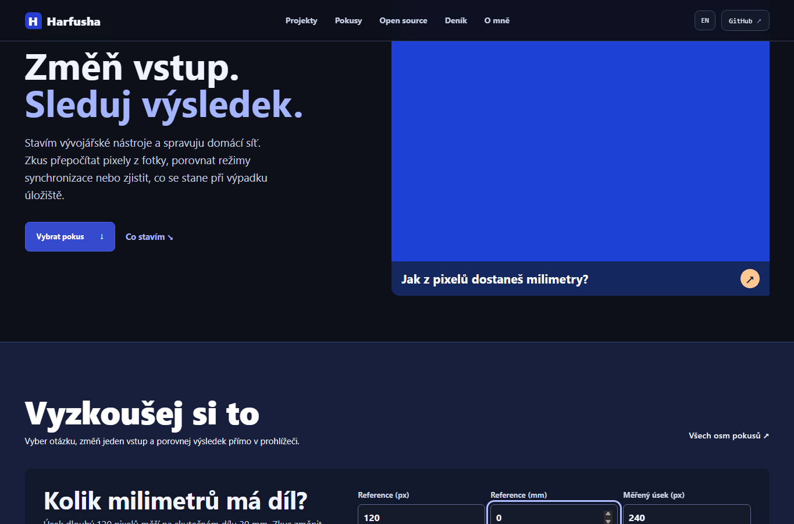

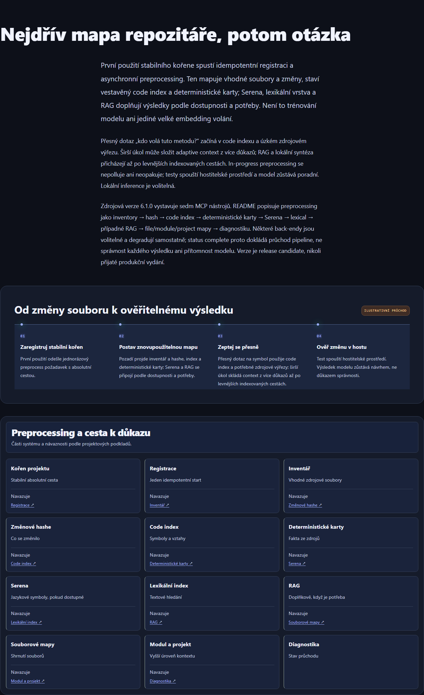

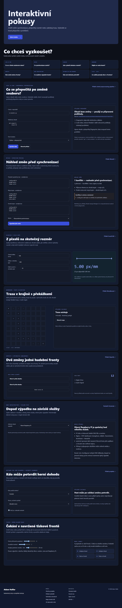


## Project story captures

| Local AI Hub | Home infrastructure | MutaUI |
|---|---|---|
| 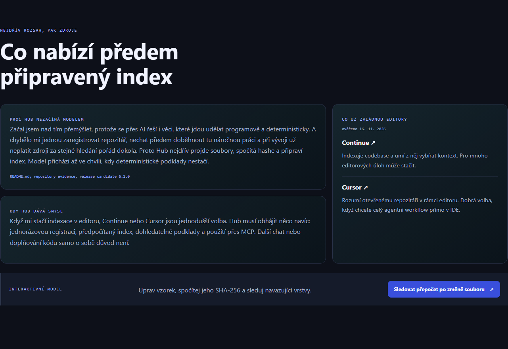 | 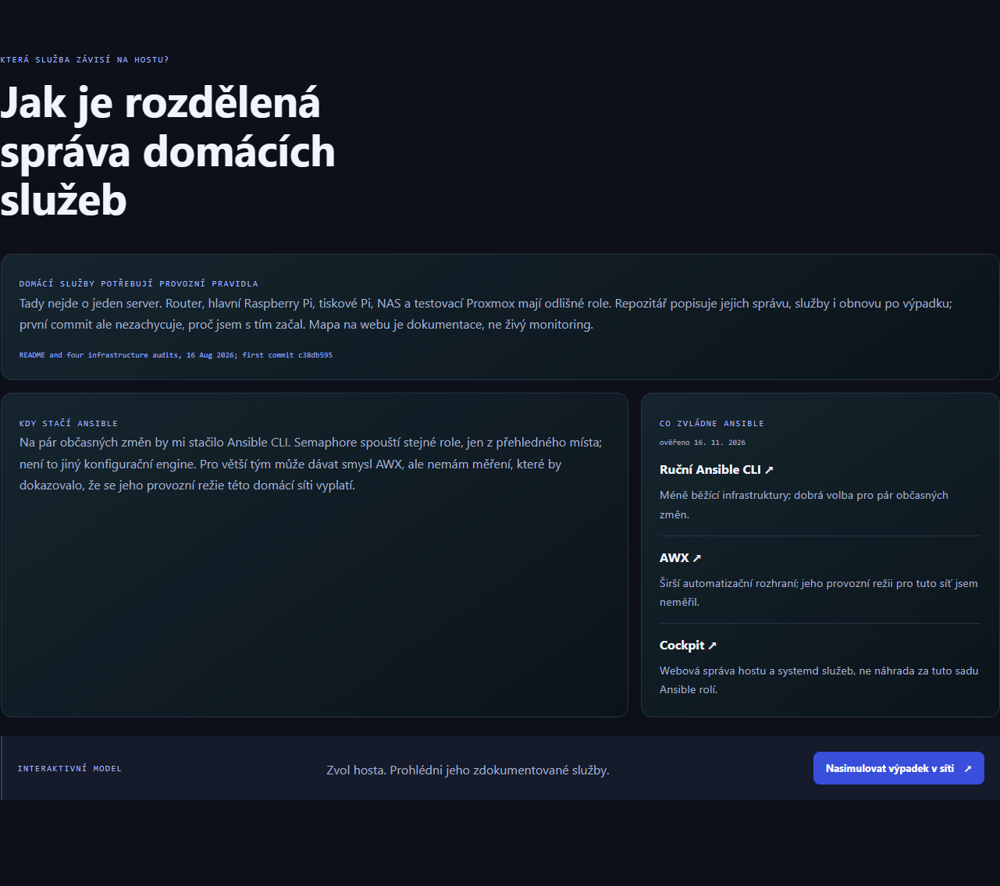 | 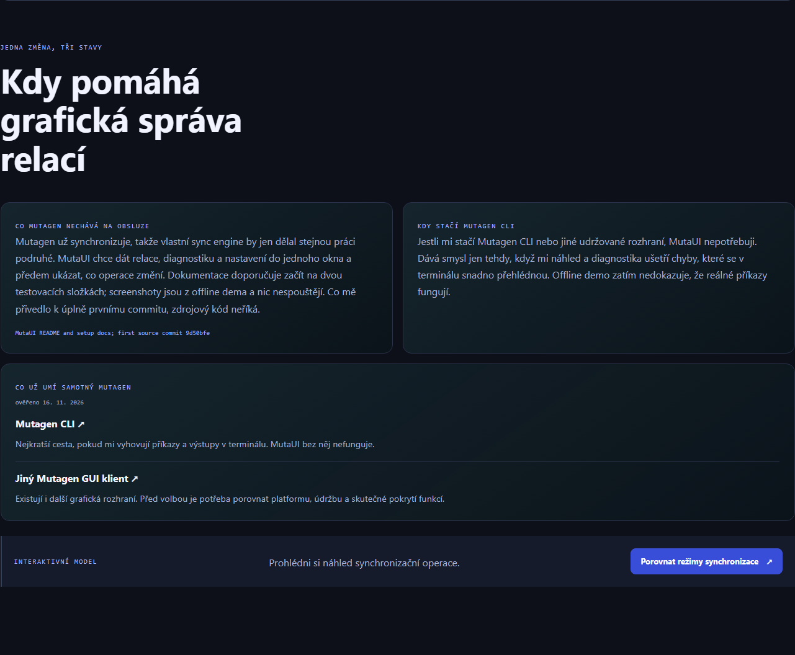 |

| Scan2CAD | Shpotify | Software Inc multiplayer |
|---|---|---|
| 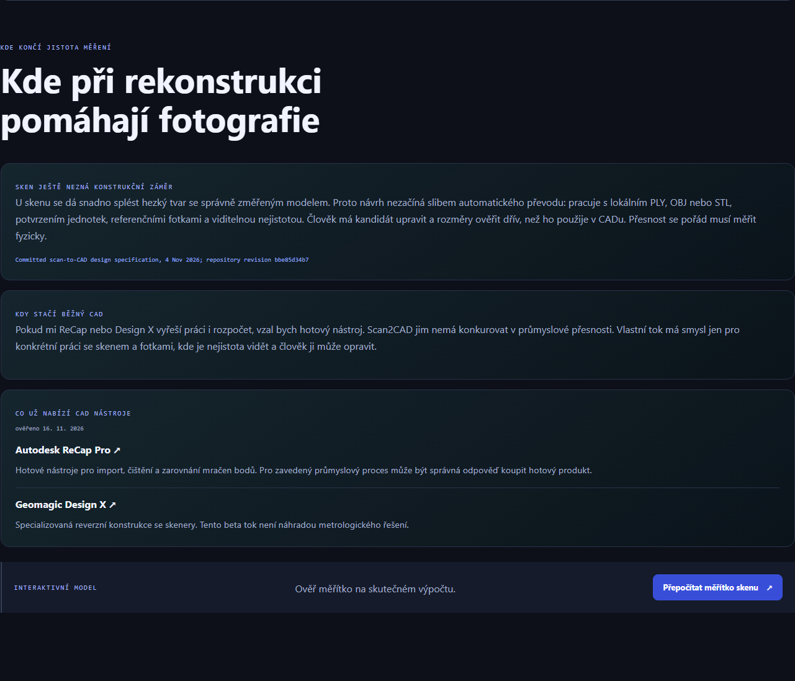 | 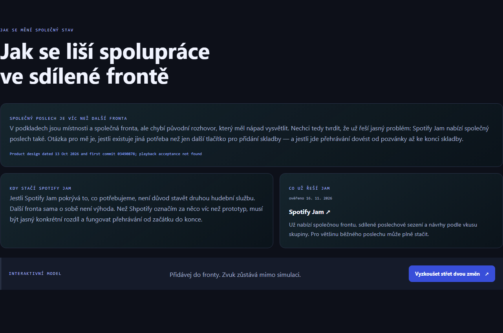 | 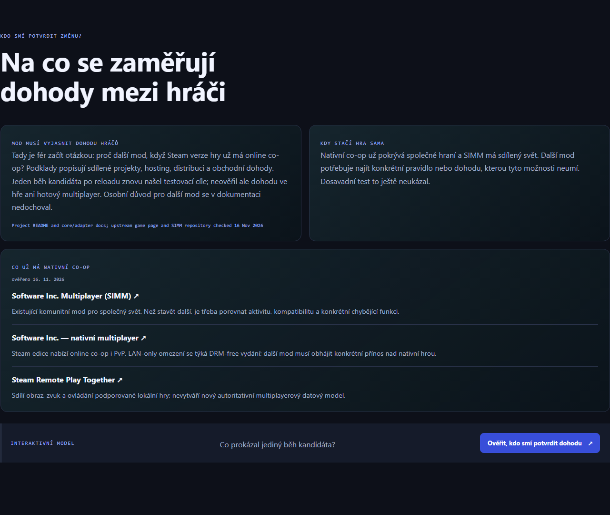 |

| Tiskov | Woodbound | Discord bot |
|---|---|---|
| 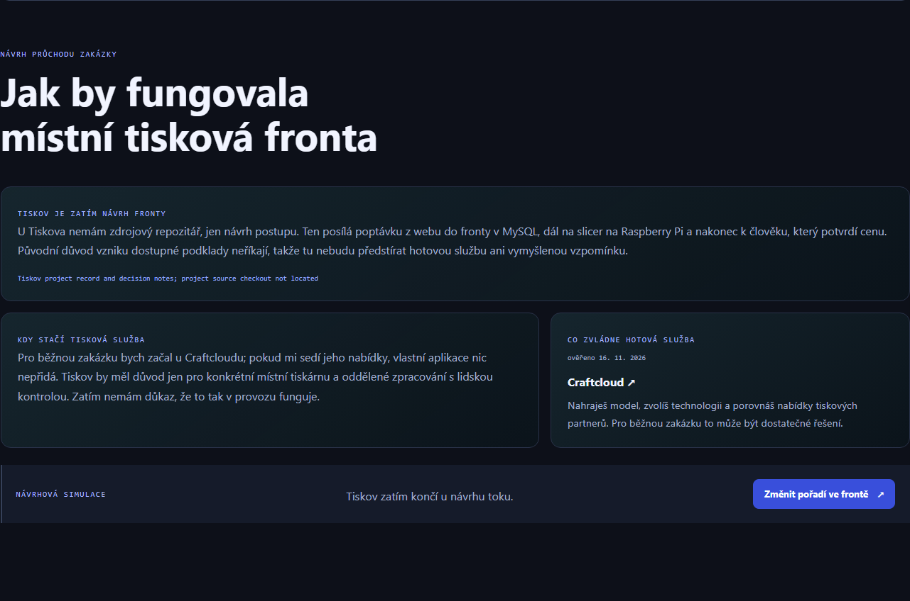 | 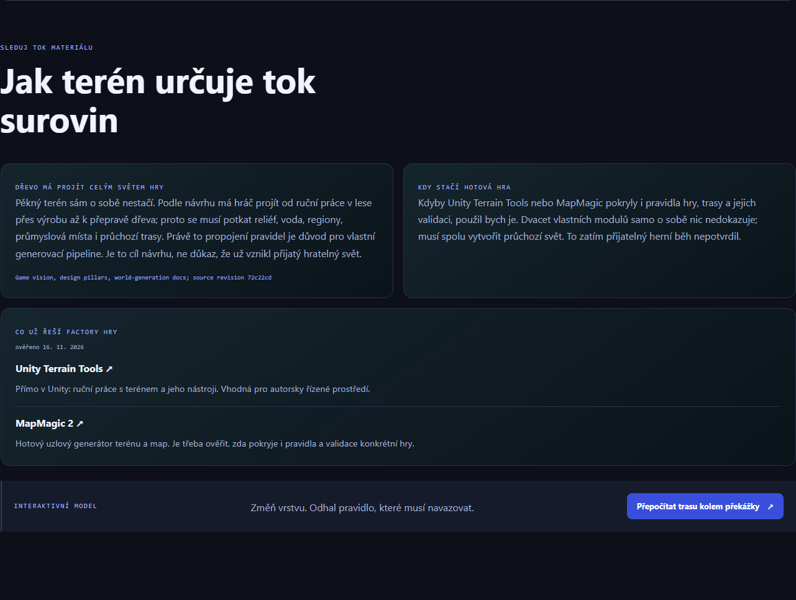 | 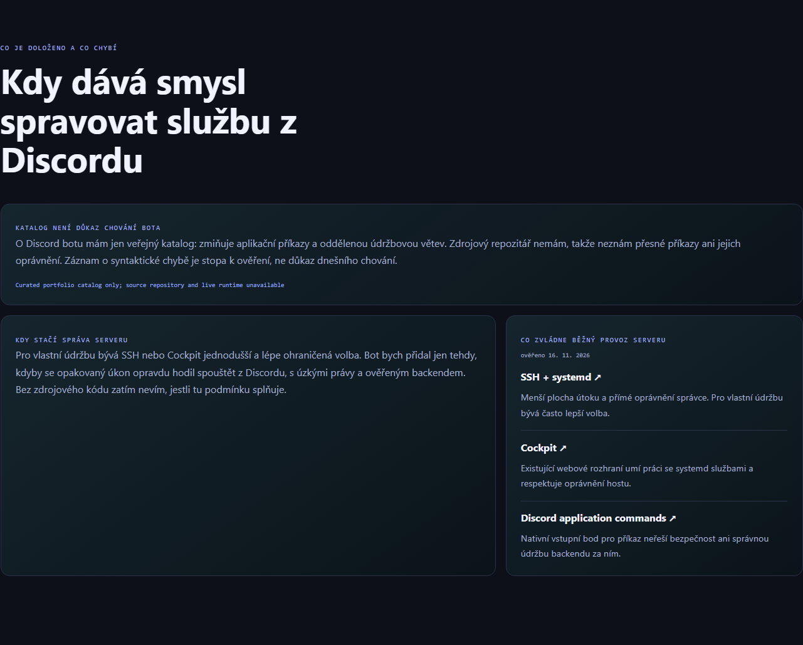 |

## Explore the site

| Public URL (both `/cs` and `/en`) | Behavior |
|---|---|
| `/` | Project-first homepage with interactive areas and recent *public* repository snapshot |
| `/projects` and `/projects/{slug}` | Filterable catalogue and 9 curated case studies, with private project *descriptions* only |
| `/connections` | Searchable map of three thematic work groups; the groups do not imply technical dependencies between repositories |
| `/decisions` | Seven explainable architectural choices with context, trade-offs and documented limitations |
| `/homelab` | Network topology, node inspection, failure simulation and four bilingual conceptual data paths |
| `/maker` | Physical prototypes, design notes, FDM experiments and links to related software |
| `/playground#ai` | Branching preprocessing, indexed retrieval and model-offline scenarios; deterministic illustration only |
| `/playground#sync` | Deterministic synchronization / conflict simulation; **not real Mutagen** |
| `/playground#world` | Seeded 2D terrain generator; **not the Unity game engine** |
| `/playground#cad` | Client-only STL inspection with file/coordinate limits; **not CAD repair** |
| `/open-source` | Real external PR/issues, filterable and linked to upstream sources |
| `/journal` | Engineering log, newest first; unlisted notes can be drafts in MySQL |
| `/about` | Engineering profile and values |

Additional endpoints: `/healthz` (simple public liveness, not DB health), `/sitemap.xml`, `/admin` (editor), `/cron/github` (authenticated POST endpoint, not scheduled). **No cron or scheduled task is configured** in the current deployment. No publicly routable CRUD fallback actions.

## Architecture

- **CakePHP MVC and Cake ORM** with typed `Project` values, status enum, type-annotated Entities, typed TableLocator FQCNs and curated-content boundary validator. Domain and validation logic can run independently of the web framework.
- **MySQL** stores editorial overrides, public journal entries/drafts, cached GitHub activity, sync-run receipts and append-only editorial fingerprints. Static reviewed JSON remains readable with no DB.
- **No Node service, background daemon, WebSocket or third-party browser CDN** on hosting. SSR templates use vanilla JS/CSS; heavy demos run locally in the browser and import **zero** secret configuration.
- **Local deterministic JS core** (`lab-core.js`) provides network outage propagation, curated route validation/tracing, synchronization resolution, terrain noise and bounded STL parsing. The same functions are exercised by Node tests and JSDoc/TypeScript strict checking.
- **Bilingual** route scopes, accessible navigation and interactive SVG elements with keyboard activation.
- **No live homelab access:** the graph is a manually approved abstraction, not a scan of machines or credentials. Any real telemetry would require a separate redaction and consent design.

## Start locally (PHP 8.5)

Requirements: patched PHP **8.5.12+** (8.5 branch), `intl`, `mbstring`, `simplexml`, `pdo_mysql`, `openssl`, Composer 2, MySQL 8.4+ or compatible MariaDB, and a proper Apache rewrite/virtual host for production.

```sh
cp .env.example .env
# Development: APP_ENV=development DEBUG=true APP_URL=http://localhost:8765
# Fill database, SECURITY_SALT and other local variables in private .env
composer install --no-interaction --prefer-dist
php bin/cake.php migrations migrate
php bin/cake.php server -p 8765
```

Open `http://localhost:8765/cs/` or `/en/`. The repository now contains a Composer lockfile resolved on a real PHP 8.5 GitHub Actions runner. Always use `composer install` against that reviewed snapshot; the source archive still does not ship `vendor/`.

### Docker development (optional)

The repo includes `docker/Dockerfile` and `compose.dev.yml` with a PHP 8.5 CLI container and disposable MySQL. Start with `docker compose -f compose.dev.yml up --build`. This is a development convenience, **not** a substitute for testing the target shared host. Example passwords are local-only and must never be deployed. Docker was not available to test this configuration in the authoring environment.

## Content & editorial workflow

- `data/projects.json` — 9 curated software/infrastructure project stories, each with a translated problem, solution and capabilities.
- `data/maker.json` — physical designs with explicit prototype/planned/validated status.
- `data/connections.json` — reviewed project relationships.
- `data/decisions.json` — 7 architecture decision records, including counterarguments and verification limits.
- `data/topology.json` — anonymized, dependency-checked infrastructure diagram.
- `data/flows.json` — four human-reviewed paths (media, remote access, printing, backup). Each path has bilingual step explanations and is validated against the topology edges.
- `data/journal.json` — static historical engineering log.
- `data/contributions.json` — curated external GitHub PR/issues until first successful import.
- `/admin` — authenticated project summary/problem/solution editor; create, edit, publish and unpublish MySQL journal entries. Drafts never appear in the public feed. Changes are stored with an atomic, redacted audit receipt. All saved output is rendered as **plain escaped text**, not arbitrary HTML.

Public static content is bounded and validated at load time. The privacy audit also scans selected public assets, but **manual approval is still mandatory**, especially for private projects and network topology.

### GitHub import

The current deployment intentionally has **no cron or scheduled GitHub sync**. When a refresh is requested, run `php bin/cake.php github_sync` manually from the private application tree; the authenticated `/cron/github` POST endpoint exists but is not scheduled or exposed as a public CRUD action. The importer uses GitHub's **unauthenticated public API**, rejects incomplete pages, explicitly validates public repository ownership and visibility, uses a local `flock` lock, commits only after all remote reads succeed and replaces stale database snapshots transactionally. It fails on remote rate limits rather than silently present a partial import. Historical/project summaries still require manual review.

## Quality gates

```sh
composer validate --strict
composer syntax              # PHP parser
composer standalone          # independent domain/content/template checks
composer stan                # PHPStan level max + strict + CakeDC + ShipMonk
composer test                # PHPUnit + CakePHP integration tests (explicit disposable DB only)
composer cs-check            # CakePHP coding standard
python3 scripts/audit-public.py
python3 scripts/audit-rendered.py   # renders 40 pages and checks internal links/IDs/assets
node --check webroot/assets/js/app.js
node --check webroot/assets/js/lab-core.js
node --test tests/Client/*.test.cjs
# with local typescript 5.8.3
npx --no-install tsc --noEmit --allowJs --checkJs --strict --target ES2022 --lib ES2022,DOM webroot/assets/js/lab-core.js
```

The GitHub Actions workflow provisions PHP 8.5 and MySQL 8.4, requires the committed Composer lockfile, runs all three migrations and checks CakePHP HTTP routes plus standalone, static and JS tests. The deployed site-content snapshot `f05adfe` passed all three jobs in [run #43950641423](https://github.com/Harfusha/harfusha/actions/runs/43950641423); its approved production archive was deployed and passed post-deploy HTTPS checks. Every later release still requires CI and approval of its exact public-content snapshot.

## Deploying on shared hosting

**Only `webroot/` should be exposed to HTTP.** Keep `.env`, `src/`, `config/`, `vendor/`, `logs/`, `tmp/`, `data/` outside the document root. Set `APP_ENV=production`; the application enforces patched PHP 8.5, TLS origin, disabled DEBUG and a random hex salt. Configure `APP_URL`, strong independent secrets, database credentials, writable runtime paths and OPcache. For a fixed `public_html` sibling layout see `docs/DEPLOYMENT.md`.

To make a *production* ZIP (with Composer vendor and a real lockfile), once a disposable MySQL test DB and all build tooling are ready:

```sh
npm install --no-save --ignore-scripts typescript@5.8.3
APP_ENV=testing APP_URL=http://localhost:8765 DB_HOST=127.0.0.1 DB_NAME=harfusha_lab_ci DB_USER=lab_ci LAB_TEST_DB_CONFIRM=harfusha_lab_ci python3 scripts/build-release.py --output ../harfusha-lab-deploy.zip
```

Unlike the source ZIP, the production builder **runs** Composer quality, static privacy/SSR tests, browser-core tests and strict client type checking; it aborts on failure before packaging a `vendor/`-inclusive artifact. Production Composer dependencies are installed into a temporary **clean staging directory**, never over the audited development `vendor/`. It requires the reviewed `composer.lock`, installed dev dependencies, PHP 8.5.12+, an explicitly confirmed disposable MySQL database (`LAB_TEST_DB_CONFIRM=DB_NAME`) configured for integration tests and a working local HTTP smoke server. Set `CHROMIUM_PATH=/usr/bin/chromium` if using system Chromium.

## Earlier implementation notes (15 Nov 2026)

- GitHub profile `README.md` is English-only; bilingual web pages remain available at `/cs/` and `/en/`.
- API `demo` fields now contain localized first-party routes, not rejected external URLs. Conditional `If-None-Match` honors weak validators, multiple tags and `*`.
- Project/PR counters reflect current records; successfully imported empty GitHub activity no longer resurrects outdated curated fallback entries.
- CSS and JS URLs are content-fingerprinted to invalidate stale browser caches without manual release timestamps.
- Browser STL visualization samples up to 6,000 triangles for drawing, batches pointer-driven renders with `requestAnimationFrame` and ignores stale asynchronous file reads. This is a viewer, not an STL repair service.
- Public source dates are strictly validated as real UTC calendar dates; CI checks include date, browser STL upload and persistence regressions.
- Login attempt counters are stored in a private directory with restrictive file permissions; legacy permissions are tightened and failure to secure storage denies new login attempts.
- GitHub API timestamps now require canonical UTC dates with valid calendar days and time components. Impossible dates cannot silently be normalized during import.
- Journal creation requires an explicit `draft` or `public` publication choice; malformed values fail before database writes.
- Admin readiness checks all required migration tables and representative columns without reading user rows; an incomplete schema reports `schema-incomplete` and disables editing controls. This is independent of the GitHub sync freshness check.
- GitHub Actions are pinned to verified action commit SHAs and cancel outdated branch runs; a clean no-dev Composer install is checked without creating a public deployment artifact.
- `scripts/staging-smoke.py --base-url https://staging.example.com` offers read-only HTTPS post-deploy checks. It never logs into admin or approves private content.

## Documentation

- [Český rychlý start](../START-CZ.md)
- [End-to-end master plan with acceptance criteria](MASTER_PLAN.md)
- [Architecture](ARCHITECTURE.md)
- [Security](SECURITY.md)
- [Deployment](DEPLOYMENT.md)
- [Testing](TESTING.md)
- [Release gates](RELEASE.md)
- [Latest executed verification (14 Nov 2026 — release hardening)](VERIFICATION-HARDENING-2026-11-14.md)
- [Earlier verification](VERIFICATION-2026-11-13.md)
- [Public network request paths](DATA-PATHS.md) — safety model, validation and usage
- [Veřejné typované API](API.md) — `/api/v1/projects` (CS/EN, ETag, privacy allowlist)
- [Changes & verification status](../RELEASE-NOTES.md)

MIT license. Not affiliated with CakePHP, GitHub, Mutagen, Spotify or other upstream projects.

### Create an auditable source-only ZIP

```sh
python3 scripts/build-source.py --output ../Harfusha-Lab-full-source.zip
```

The source builder runs the locally executable checks, excludes private `.env`, caches, transient preview files and dependencies, and embeds a `SHA256SUMS` integrity manifest. The source ZIP cannot be uploaded directly as a functioning CakePHP installation because it lacks `vendor/`.

## Vývojový milestone 13. 11. 2026 — Backend Lab a veřejné API

- Přibyl pátý prohlížečový **CakePHP Request Lab**: deterministická simulace HostGuard, routování, CSRF, autorizace, vstupní typové validace a transakční odpovědi. Jde o výukový model, nikoli živý HTTP request.
- Nové veřejné API **`GET /api/v1/projects[/{slug}]?lang=cs|en`** s DTO allowlistem, zamítnutím soukromých URL, `ETag` a podmíněným `304`; specifikace v `docs/API.md`.
- Zlepšené ovládání SVG grafů klávesnicí (obnovení focusu po překreslení), šipkové ovládání ARIA záložek, úspornější ASCII STL parser a vícejazyčný sitemap.
- Snímky skutečně implementovaného request-labu: `docs/screenshots/desktop-cakephp-request.webp` a `docs/screenshots/mobile-cakephp-request.webp`.
- V době tohoto milníku byl zdrojový ZIP bez Composer `vendor/`. Současný produkční release se balí odděleně přes schválený workflow s produkčními závislostmi; aktuální stav nasazení je uveden nahoře.


## Operational readiness (private)

After MySQL migrations and the first successful public GitHub sync, run
`php bin/cake.php lab_health`. A nonzero exit means the database, runtime
write permissions or 48-hour GitHub cache freshness requirements are not met.
The same coarse health states are visible only to an authenticated editor.
Public `/healthz` is **liveness only**. Details: `docs/OPERATIONS.md`.

### Current verification supplement

See `docs/VERIFICATION-CONTINUED-2026-11-13.md` for the current test evidence,
including explicit differentiation between run tests and framework tests that
require the PHP 8.5/Composer/MySQL runtime.

### Authentication-storage hardening (additional iteration)

`LoginLimiter` now atomically reserves login attempts under a fixed 32-shard
file lock, caps entries/storage size, rejects corruption and I/O failures, and
clears state only after a verified password. This replaces unbounded per-IP
files and closes the old concurrent check-then-record race. See
`docs/AUTH-THROTTLE.md` for threat model, false-positive capacity trade-offs
and legacy cleanup. PHPStan, PHPUnit and real CakePHP HTTP flows passed in the
deployed release CI. The shared-host smoke covered public GET routes and security
headers; production admin authentication and PHP-FPM version remain unverified.

For future controlled updates to `composer.lock`, GitHub Actions provides the **manual** `Resolve Composer lockfile on PHP 8.5` workflow. Review the exported artifact and its dependency advisories before updating the tracked lockfile. The lockfile resolver was not needed for this delivery; the main CI used the committed lockfile and passed on the deployed release commit.

## New source-candidate hardening (14 Nov 2026)

- GitHub sync has two independently tested, typed pagination collectors. Duplicates, inconsistent Search API totals, truncated pages and unexpected repository pages fail before destructive MySQL refresh. See `docs/GITHUB-IMPORT-INTEGRITY.md`.
- A production ZIP cannot be built without explicit manual review of public content: run `python3 scripts/review-public-content.py --review` then, **after actual human review**, `--approve --reviewer '...'` interactively. The private hash receipt is excluded from every ZIP; edits invalidate it. See `docs/CONTENT-APPROVAL.md`.
- Python review-gate tests run in CI and source ZIP building; this is not evidence that a human has approved the content.
- This 14 Nov source-candidate milestone recorded Composer, disposable-MySQL migrations, PHPStan max, PHPUnit and PHPCS in [CI run #43648999069](https://github.com/Harfusha/harfusha/actions/runs/43648999069). That archive was source-only. The 16 Nov release and current live checks are recorded at the top of this README.

### Release hardening (14 Nov 2026)

The test bootstrap refuses to run integration tests unless `APP_ENV=testing`, `DB_NAME` ends in `_test`, `_testing` or `_ci`, `LAB_TEST_DB_CONFIRM` exactly equals `DB_NAME`, the database host is local/container-only and the account is not administrative. The release builder uses staging and includes `scripts/preflight.php` in the production archive. Details: [Release hardening notes](RELEASE-HARDENING-2026-11-14.md).


### Latest quality controls (2026-11-14)

- `scripts/http-smoke.py` covers **real** CakePHP CSRF, cookie-backed admin login,
  session rotation, invalid writes and logout in the disposable CI environment.
  It requires an ephemeral test-only password and cannot silently skip auth checks.
- `scripts/verify_archive.py --variant source|production` independently validates
  every distributed file against SHA-256, rejects unsafe ZIP entries and secrets,
  and requires Composer vendor/lock files in production packages.
- Local isolated and browser-core checks do **not** replace `composer quality`,
  MySQL migration/rollback, actual HTTP smoke, or post-deploy production GET checks.
  See `docs/VERIFICATION-ARCHIVE-AUTH-2026-11-14.md`.


> This technical guide was formerly the repository-root `README.md`. The root README now serves the GitHub profile. Links above are relative to this `docs/` directory.
